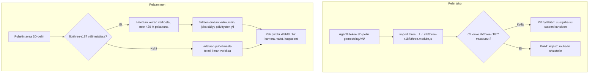

# 3D-kirjasto: three.js shared by every 3D game

How a game version draws in 3D with three.js (#99). The library is one shared copy on the site,
in a folder named after its release (`lib/three-r187/`), and that folder never changes once
published, just like a game version. A newer three.js is a new folder beside it, so an old game
keeps the release it was made with. The phone downloads it the first time a 3D game opens and
keeps it, so the game plays offline from then on.

## Colours

- **rose**: the agent's work on a game version
- **amber**: a check that decides the path
- **green**: the build that puts the library on the site
- **blue**: what the player sees
- **teal**: where the library's files come from

## Boxes

- **import three: ../../../lib/three-r187/three.module.js**: a game's `<script type="module">` imports three.js from the shared folder `public/lib/three-r187/`, which holds the two files of the npm package `three@0.187.0` (`build/three.module.js` and `build/three.core.js`) unchanged, with their MIT licence header. AGENTS.md says how, with a short starter for a phone-sized scene. A 2D game turned 3D keeps its classic `<script>` and loads the same file with `import()` (Hiihto v7, #103), so its functions stay global for its tests; AGENTS.md also notes that a cheap phone is short of pixels, so a game steps its pixel ratio and shadows down when slow.
- **CI: onko lib/three-r187/ muuttunut?**: `scripts/check_immutable.py` treats every file under `public/lib/` that exists on `main` as published: a change or deletion fails the pull request. A new folder (a newer release) is allowed.
- **Build: kirjasto mukaan sivustolle**: `scripts/build.py` already copies `public/` to `_site/`; it now also fails a game version that imports from `lib/` a file that does not exist.
- **lib/three-r187 välimuistissa?**: `public/sw.js` serves `lib/` cache-first from its own cache `ai-pelit-lib`, which outlives builds like the game folders' cache. It is filled the first time a game uses the file, not on install, so phones that never open a 3D game never download it.
- **Peli piirtää WebGL:llä: kamera, valot, kappaleet**: the game builds a `THREE.Scene`, a `PerspectiveCamera` and a `WebGLRenderer` on a full-screen canvas; `tests/fixtures/three-demo.html` is a spinning-cube example that the shared test `tests/test_lib_three.py` opens to prove the library loads and draws.
