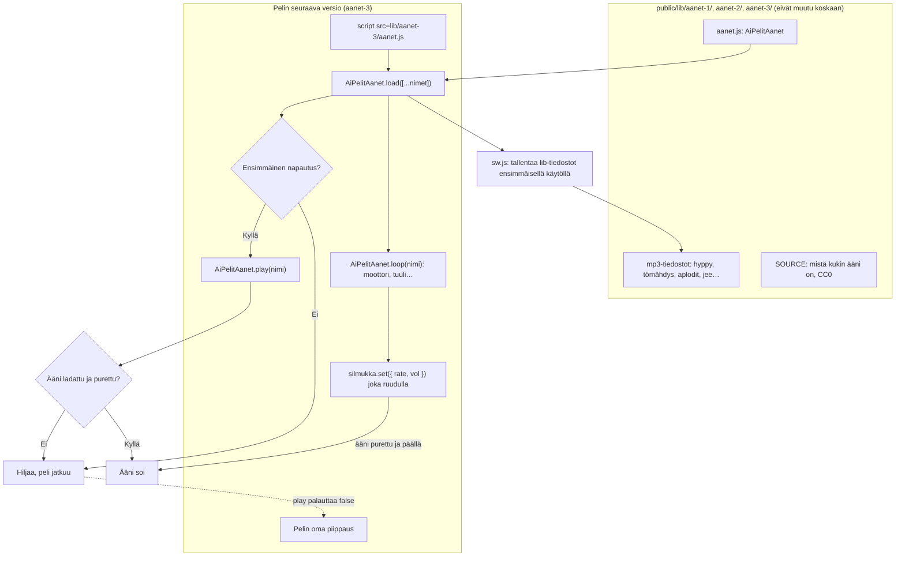

# Äänikirjasto

The shared sound-effect library (#205): recorded CC0 sounds in one never-changing folder under
`public/lib/`, played through one small script any new game version loads. The phone's offline
cache keeps the files after first use, and a game without sound still plays the same.

## Colours

- **teal**: the shared library folder
- **blue**: what the game version does
- **amber**: a check that decides the path
- **violet**: the phone's offline cache
- **green**: what the player hears

## Boxes

- **mp3-tiedostot: hyppy, tömähdys, aplodit, jee…**: short mono MP3 effects in `public/lib/aanet-1/` (23), `aanet-2/` (the same 23 and 48 more, nine of them loops) and `aanet-3/` (#330: aanet-2's 71 and `jee`, a short cheer from freesound.org, CC0, for the athletics meets' "📣 Kannusta"), named in Finnish, each listed in `SOUNDS` at the top of `aanet.js`. A new sound goes in the next folder; `scripts/check_immutable.py` already refuses an edit to a published `public/lib/` file.
- **SOURCE: mistä kukin ääni on, CC0**: one line per file: its source pack and URL, CC0. Only CC0 sounds, so no credit is owed and the repository stays public.
- **aanet.js: AiPelitAanet**: `public/lib/aanet-3/aanet.js` (the same as `aanet-2/`'s with `jee` added; aanet-1's has no `loop()`): `load(names)`, `unlock()`, `play(name, {vol, rate, delay})` (true when it played), `loop(name, {vol, rate})`, `ready(name)`, `muted` (also silences running loops at once, and starts waiting ones when unmuted), `names()`. It keeps its own `AudioContext`, fetches and decodes each named file once, and never throws.
- **AiPelitAanet.load([...nimet])**: called once at start-up; fetches only the sounds this game uses, so the phone downloads a few tens of KB, not the whole library.
- **Ensimmäinen napautus?**: browsers only allow sound after a tap; the library unlocks itself on the first `pointerdown`.
- **sw.js: tallentaa lib-tiedostot ensimmäisellä käytöllä**: `public/sw.js` already caches anything under `lib/` on first use (`cachedFile`), so the sounds play offline after the game has been opened once online. No change to `sw.js`.
- **Hiljaa, peli jatkuu**: a file that failed to load or decode (offline on the first open, an old browser), a name the game did not load, before the first tap or `muted`: nothing plays and `play()` returns false.
- **Pelin oma piippaus**: a game may fall back to its own Web Audio beep when `play()` returns false: `S.play('hiekka') || tone(…)` in Pituushyppy v7.
- **Pelin seuraava versio (aanet-3)**: a game's next version loads the newest folder, `aanet-3/` from #330 (`aanet-2/` for versions made after #210 and before it), and may use loops; the athletics events from Pituushyppy v11, Keihäänheitto v10, Kuulantyöntö v4, Moukarinheitto v7, Korkeushyppy v7, Seiväshyppy v8 and Mäkihyppy v4 are its first users, for the meet's `jee` cheer. The first user, Pituushyppy v7 (`games/pituushyppy/v7/index.html`), loads `aanet-1/` the same way, without loops; it loads askel, askel2, ponnistus, suhahdus, hiekka, aplodit, ohhoo, onnistui, valinta and mitali; its `press()`, `jumpNow()`, `legs()`, `landed()`, `outcome()` and the meet's `chime` play them. Lentopallo v5 (`games/lentopallo/v5/index.html`, #222) loads from `aanet-2/`: pilli, naksu, lyonti, verkko, suhahdus, hiekka, aplodit, voitto and tappio, from `slap()`, `pointSound()`, `matchSound()`, `toss()`, `jump()` and `stepBall()`. The sounds v4 had a beep for (the touches, toss, jump, net and whistle) fall back to that beep; hiekka, aplodit, voitto and tappio are new and stay silent when they cannot play. In a room only the host's rules see the toss, the net and the sand, so it counts them in its snapshots (`fx`) and a guest plays what went up (`applySnapshot()`); a match end sounds once per round, even after a reload (`R.once()`).
- **AiPelitAanet.loop(nimi): moottori, tuuli…**: first used by Jään alla v5 (#214: syvyys, sukellusvene, kuplat, tuuli; `ambience()`); Kaahari v4 sets its `kartti` engine's rate by the kart's speed (#216, `engineSound()`). From `aanet-2/`: `loop(name, {vol, rate})` returns a handle at once (`Loop` in `aanet.js`); it starts by itself once the sound is decoded and sound is on (`wake()`), loops inside the MP3's padded ends, and sleeps with the rest while the page is hidden (`visibilitychange`).
- **silmukka.set({ rate, vol }) joka ruudulla**: `set()` glides to the new rate and volume in about 30 ms, so a game may call it each frame with its speed; `stop()` ends it for good.
- **script src=lib/aanet-3/aanet.js**: a new game version loads the newest folder, now `aanet-3/` (#330; its `aanet.js` is aanet-2's with one more name; versions before it load `aanet-2/`); Pituushyppy v7 loads `aanet-1/`, which plays the same one-shot sounds but has no loops.
