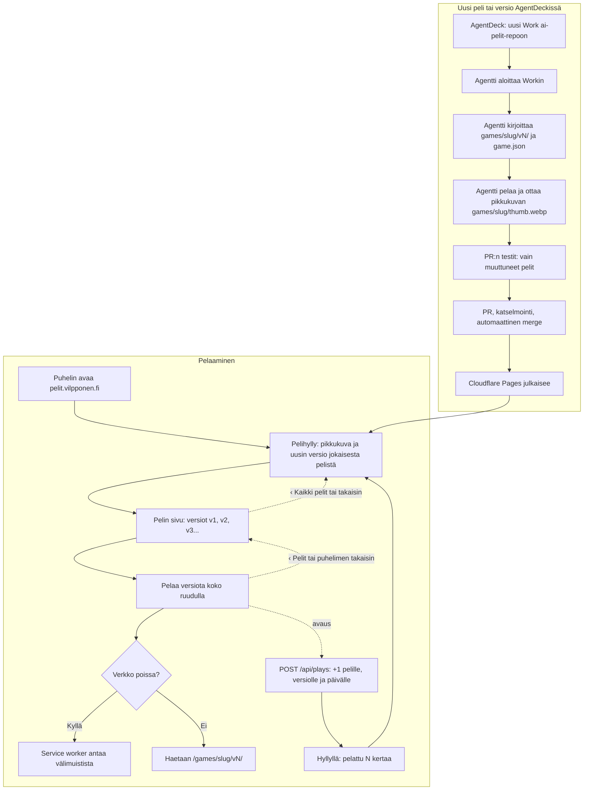

# AI-pelit: how a game is played and how a new one is made

The AI-pelit PWA (eerovil/eeron-omat-taskit#149). Playing is a static page on Cloudflare Pages: the shelf lists every
game, each game lists its versions, and any version opens full screen. A new game or version is
always started from AgentDeck (Eero's choice): the agent writes it into a new version folder,
takes the game's thumbnail, and the merge deploys it. The app has no form and no text to copy (#33).

## Colours

- **blue**: what the player sees and taps
- **amber**: a check that decides the path
- **teal**: where the game's files come from
- **violet**: where Eero starts a new game or version
- **rose**: AgentDeck's agent work, on Eero's existing subscription
- **green**: the deploy that makes the new version live

## Boxes

- **Pelihylly: pikkukuva ja uusin versio jokaisesta pelistä**: `public/index.html` rendered by `public/app.js` from `catalog.json` (first game: Sormiskeitti v1), which `scripts/build.py` builds from every `games/*/game.json`. Each card is a compact row (layout D, picked from the live prototype, #33): the game's thumbnail on its left (`thumb` in the catalog), the name, the description cut to two lines, version and play count, and a round ▶ button that opens the latest version; and its high-score no. 1, and a game's page its top 10, (`loadTops()` and `scoreSection()` in `public/app.js`, through `public/scores.js` loaded with `data-shelf`; see `tuloslistat.md`).
- **Pelin sivu: versiot v1, v2, v3...**: shows the thumbnail beside the title and description, then each version with its date and the change note; every version stays playable. No copy-text box any more (#33).
- **Pelaa versiota koko ruudulla**: opens `/games/<slug>/v<N>/index.html` directly (not in an iframe) with the "‹ Pelit" chip from `public/back.js`. Back always goes up, never into a game (#68): the history is always shelf → game's page → game, so the phone's own back and the "‹ Pelit" / "‹ Kaikki pelit" links and the header's "AI-pelit" each go one step up. `public/app.js` adds the game's page under a game opened with ▶ on the shelf and marks the game in sessionStorage (`ai-pelit:_ylos`); `back.js` then steps back to that page from the chip. A room code for another game first turns the page below into that game's page (see `moninpeli.md`). A Ctrl-, Cmd- or Shift-click still opens a link in a new tab. A game opened any other way (a link, a room code) has no page below, so the chip takes its place in the history instead of adding one, and so does "‹ Kaikki pelit" on a game page opened from a link. The installed app opens full screen (`"display": "fullscreen"` in the manifest, no phone status or navigation bar); in a browser tab, or an app installed before that, `back.js` asks for full screen on the first tap in a game.
- **POST /api/plays: +1 pelille, versiolle ja päivälle**: `public/back.js` sends one anonymous count each time a version page opens (`sendBeacon`, lost when offline); `addPlay()` in `server/api.js` adds it to the `plays` table (`migrations/0004_plays.sql`: game, version, UTC day, count, nothing per phone), only for a game and version in `catalog.json`, and none while no catalog has been read (#26).
- **Hyllyllä: pelattu N kertaa**: `public/app.js` `loadPlays()` reads `GET /api/plays` (all-time total per game) and adds it to each game card, without changing the order; the last totals are kept in `localStorage` (`ai-pelit:_pelikerrat:yhteensa`), so they show offline too.
- **Service worker antaa välimuistista**: `public/sw.js`: the shell (with the shared `back.js`, `scores.js` and `rooms.js`) and `catalog.json` network-first, version folders cache-first once played. Shared libraries under `lib/` (three.js, see `3d-kirjasto.md`) are cache-first too, in their own cache `ai-pelit-lib` that outlives builds. Every game's picture (`thumbs/`) is cached when a new worker installs, in its own cache that outlives builds, so the whole shelf shows offline (#33). The shelf is cached as `./` only, because Pages redirects `index.html` to `./`; `public/404.html` answers missing files so Pages never sends the shelf in their place. `/api/` (the high-score lists, see `tuloslistat.md`) always goes to the network.
- **AgentDeck: uusi Work ai-pelit-repoon**: Eero writes "Uusi peli: …" or "<peli> v<N>: …" straight in AgentDeck; the app no longer shows that text to copy (#33).
- **Agentti kirjoittaa games/slug/vN/ ja game.json**: a new version is always a new folder; old version folders are never edited. The one exception is a version Eero withdraws (`WITHDRAWN` in `scripts/check_immutable.py`): it is deleted whole, and its number is never used again, so `scripts/build.py` lets the numbering skip it.
- **Agentti pelaa ja ottaa pikkukuvan games/slug/thumb.webp**: during its own mid-play check at 360 × 740 the agent saves a screenshot and runs `scripts/make_thumb.py <slug> <screenshot>`, which crops it to 3:4 and writes a 360 × 480 WebP beside `game.json`. One per game, outside the version folders, so it may be retaken when a new version looks different. `scripts/build.py` refuses a game without one, or one that is not a 360 × 480 WebP, and copies it to `thumbs/<slug>-<hash>.webp`, a new name whenever the picture changes, so no phone keeps an old one.
- **PR:n testit: vain muuttuneet pelit**: `.github/workflows/ci.yml` runs pytest with `--changed-since origin/main` on a pull request; `tests/conftest.py` keeps a game's own tests (`tests/test_<slug>*.py`, or marked `@pytest.mark.games("<slug>")`) only when the change touches a version folder that test file tests (`games/<slug>/v<N>/`) or the game's tests, and runs them on four workers side by side (`pytest -n 4`), the 3D games' tests after them one at a time (see `pr-tests.md`), and a change outside `games/` runs only the shared tests, the ones tied to no game. The full suite never runs, and a push to `main` runs no browser tests (#65).
- **Cloudflare Pages julkaisee**: `.github/workflows/ci.yml`: right after the merge, with no browser tests (they passed on the pull request, #65), the deploy job runs `npm test` and `scripts/build.py`, then `wrangler pages deploy` to the `ai-pelit` Pages project (ai-pelit.pages.dev, custom domain pelit.vilpponen.fi) with the `CLOUDFLARE_API_TOKEN` and `CLOUDFLARE_ACCOUNT_ID` secrets; without them the job stops green. `pelit` is a CNAME to `ai-pelit.pages.dev` at hostingpalvelu.fi. Before the site, the job deploys the live rooms' Worker `ai-pelit-rooms` (`rooms/`, see `moninpeli.md`).
