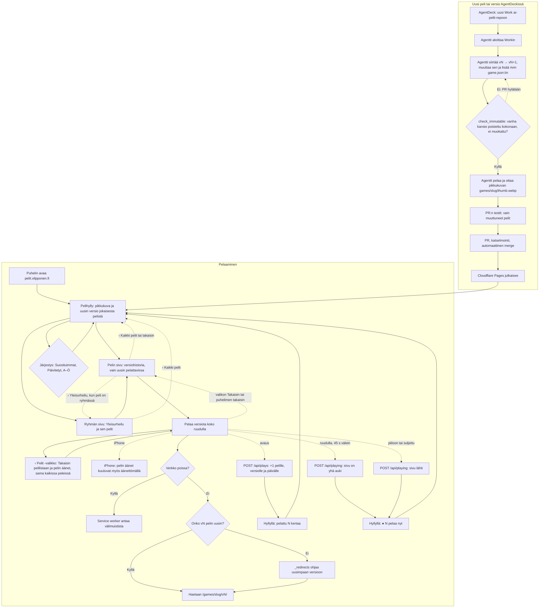

# AI-pelit: how a game is played and how a new one is made

The AI-pelit PWA (eerovil/eeron-omat-taskit#149). Playing is a static page on Cloudflare Pages: the shelf lists every
game, each game's page shows its version history, and only the newest version opens (#346): an old version's address goes to the newest. A new game or version is
always started from AgentDeck (Eero's choice): the agent moves the newest version folder to the next number and changes it there,
takes the game's thumbnail, and the merge deploys it. The app has no form and no text to copy (#33).

## Colours

- **blue**: what the player sees and taps
- **amber**: a check that decides the path
- **teal**: where the game's files come from
- **violet**: where Eero starts a new game or version
- **rose**: AgentDeck's agent work, on Eero's existing subscription
- **green**: the deploy that makes the new version live

## Boxes

- **Pelihylly: pikkukuva ja uusin versio jokaisesta pelistä**: `public/index.html` rendered by `public/app.js` from `catalog.json` (first game: Sormiskeitti v1), which `scripts/build.py` builds from every `games/*/game.json` (Ottelu reads the catalog to play each event's newest version, #303; see `ottelu.md`. An older entry's `"ottelu": false` is passed on as history, but since #346 the build refuses it on a newest version: the match has no older version left to play instead). Each card is a compact row (layout D, picked from the live prototype, #33): the game's thumbnail on its left (`thumb` in the catalog), the name, the description cut to two lines, version and play count, and a round ▶ button that opens the latest version; and its high-score no. 1, and a game's page its top 10 (Marjakori's one `main` list adds its level total beside each score; Tikanheitto's Mökkitikka list first, Pistekisa a tap away; Ottelu's Viisiottelu on the card, its page's lists from Seitsenottelu down a tap away; Mäkihyppy's Mäkiviikko first, v1's Yksi kisa a tap away, #283), (`loadTops()` and `scoreSection()` in `public/app.js`, through `public/scores.js` loaded with `data-shelf`; see `tuloslistat.md`). A game's page also has "💬 Anna palautetta" (`feedbackSection()`, #184; see `palaute.md`). The cards' order is picked in the header's small menu, on the shelf only (see the Järjestys box). Above the cards, "Avoimet huoneet" lists every game's open public rooms with a "Liity" button (`showRooms()`, #203; see `moninpeli.md`), and above those, room invitations and friend requests (`drawPlaying()`, #354); the header's 👫 opens the friends page `#/kaverit` (`renderFriends()`; see `kaverit.md`). Minigolf v1 (#340) joins this shelf with its own thumbnail and a lowest-stroke `main` list in the shared score registry. Kiekkoammunta v1 adds independent `trap` and `skeet` score entries (Trap first, N/25); this box’s existing behavior is unchanged. Frisbeegolf v1 adds its own `main` entry to these registries: lowest strokes against par wins, displayed as `E`, `−2` or `+5`; this box keeps its existing behavior. Frisbeegolf now uses its separate `v3` leaderboard; versions 1–2 are not accepted there (#338). From v5 (#429) its rounds go to a new `v5` list, the shelf's first, and the `v3` list stays for v3–v4.
- **Järjestys: Suosituimmat, Päivitetyt, A–Ö**: the shelf's order (#279; the three and their order are Eero's choice). A `<select>` in the header beside "AI-pelit" (`sortPicker()` in `public/app.js`), shown on the shelf only and only with two games or more, so the shelf gets no taller. Suosituimmat sorts by all-time plays, a group's card by its games' plays together; Päivitetyt is the catalog's own order, newest version first (`scripts/build.py`), and versions dated the same day by their merge time, the last commit of the version folder (`merged_at()`; before that, same-day games went in reverse alphabetical order, so a game new that day could sit near the bottom); A–Ö sorts by name in Finnish order (`localeCompare(…, 'fi')`). Ties keep the catalog's order. A group's page lists its games in the same order. Suosituimmat is the default and the choice is kept on the phone (`ai-pelit:_hylly:jarjestys`); both assumed, not chosen.
- **Ryhmän sivu: Yleisurheilu ja sen pelit**: shelf groups (#153, Eero's choice: separate games, gathered on the shelf). A game's `game.json` names its group with `"group": "<key>"`; `GROUPS` in `scripts/build.py` gives each group's title and description, refuses an unknown key and a game slug that is a group's key, and lists in `catalog.json` only groups that have games. On the shelf (`renderShelf()` in `public/app.js`) the group is one card where its newest game would be: that game's picture on a little pile, the games' names, how many games and their plays together, and a › button. `#/<group>` (`renderGroup()`) shows the group's description and its games' cards, each as on the shelf. A grouped game's page has "‹ <group>" (with `data-up`) instead of "‹ Kaikki pelit", so back goes game → its page → the group → the shelf. First group: Yleisurheilu (Keihäänheitto, Aitajuoksu, then the jumps and the hammer).
- **Pelin sivu: versiohistoria, vain uusin pelattavissa**: shows the thumbnail beside the title and description, then every version with its date and change note as history (#346, Eero's choice: old versions are not kept); only the newest has "Pelaa". `renderGame()` in `public/app.js`. The feedback form no longer asks for a version: it sends the newest.
- **Pelaa versiota koko ruudulla**: opens `/games/<slug>/v<N>/index.html` directly (not in an iframe; in a room the game plays in the room page's frame, see `moninpeli.md`, #388) with the "‹ Pelit" chip from `public/back.js`, which also loads `public/kaverit.js` (friends' "now playing" and invites, #324; see `kaverit.md`). Back always goes up, never into a game (#68): the history is always shelf → game's page → game, so the phone's own back and the "‹ Pelit" menu's "‹ Takaisin pelilistaan", "‹ Kaikki pelit" and the header's "AI-pelit" each go one step up. `public/app.js` adds the game's page under a game opened with ▶ on the shelf and marks the game in sessionStorage (`ai-pelit:_ylos`); `back.js` then steps back to that page from the chip. A room code for another game first turns the page below into that game's page (see `moninpeli.md`). In a room the room page stands where the game's page was (shelf → game's page → room page, with the game in its frame), and the chip asks the room page (`AiPelitRoomShell.up()`) to step back past it. A Ctrl-, Cmd- or Shift-click still opens a link in a new tab. A game opened any other way (a link, a room code) has no page below, so the chip takes its place in the history instead of adding one, and so does "‹ Kaikki pelit" on a game page opened from a link. The installed app opens full screen (`"display": "fullscreen"` in the manifest, no phone status or navigation bar); in a browser tab, or an app installed before that, `back.js` asks for full screen on the first tap in a game; in a room it asks the room page to go full screen, and passes on the same request from a frame inside the game (Ottelu's events), so the room bar and the 🎤 stay on screen (#394).
- **‹ Pelit -valikko: Takaisin pelilistaan ja pelin äänet, sama kaikissa peleissä**: the chip's menu (#336; Eero's choices: every version, one volume for all games, and, after the first draft's 🔊 chip covered Jään alla v2's sideways HUD, no new chip: the volume sits behind a tap on "‹ Pelit"). A tap on the chip (`#ai-pelit-back` in `public/back.js`, unchanged in size) opens `#ai-pelit-valikko` below it (above it at the bottom): a big "‹ Takaisin pelilistaan" (`#ai-pelit-takaisin`, which goes up as the chip used to, #68), "Pelin äänet" with a 0–100 % slider in 5 % steps, "🔇 Mykistä" ("🔊 Äänet päälle" when muted or at 0 %, which gives back 50 %) and "Kavereiden puhe ei hiljene."; a second tap on the chip or a tap elsewhere closes it, and none reaches the game. On the host of a room with a round going, a red "⏹ Lopeta kierros kaikilta" sits under the back button (#392): a first tap turns it into "✓ Kyllä, lopeta kaikilta", a second calls `AiPelitRooms.stopRound()` and every phone goes back to the room screen (see `moninpeli.md`). The phone's own back still leaves at once. The level (`ai-pelit:_aani:voimakkuus`) and the mute (`ai-pelit:_aani:mykistetty`) are kept on the phone for every game. Every game sounds through Web Audio, so `back.js` patches `AudioNode.prototype.connect`/`disconnect`: a node connected to a context's speaker goes through one gain per context instead, set to the level squared (so 50 % sounds about half). Published versions follow unchanged; the friends' voice (`rooms.js`, `<audio>` elements) does not. Ottelu's event frames, which have no `back.js`, are patched from the match page as each loads, and a removed frame's gains are let go (`liveGains()`), so a long match keeps no old event's sound. `window.AiPelitAani` reads the level, the mute and how many audio contexts follow it. A node a game connects to the speaker before `back.js` runs would slip past it; no published version does (checked across all of them).
- **POST /api/plays: +1 pelille, versiolle ja päivälle**: `public/back.js` sends one anonymous count each time a version page opens (`sendBeacon`, lost when offline), except a page a game reloads itself to go on, marked `ai-pelit:_jatkuu` in sessionStorage (Ottelu v3 between events, #168); `addPlay()` in `server/api.js` adds it to the `plays` table (`migrations/0004_plays.sql`: game, version, UTC day, count, nothing per phone), only for a game and version in `catalog.json`, and none while no catalog has been read (#26). Kiekkoammunta v1 adds independent `trap` and `skeet` score entries (Trap first, N/25); this box’s existing behavior is unchanged. Frisbeegolf v1 adds its own `main` entry to these registries: lowest strokes against par wins, displayed as `E`, `−2` or `+5`; this box keeps its existing behavior. Frisbeegolf now uses its separate `v3` leaderboard; versions 1–2 are not accepted there (#338). From v5 (#429) its rounds go to a new `v5` list, the shelf's first, and the `v3` list stays for v3–v4. Kaaosrata v6 (#454) adds `hihna`, `laatat` and `finaali` to its separate score entry; `main` keeps its old times and remains its first list. This box keeps its existing behaviour.
- **Hyllyllä: pelattu N kertaa**: `public/app.js` `loadPlays()` reads `GET /api/plays` (all-time total per game) and adds it to each game card; under Suosituimmat, new counts that change the order redraw the cards in the new order (#279); the last totals are kept in `localStorage` (`ai-pelit:_pelikerrat:yhteensa`), so they show offline too.
- **POST /api/playing: sivu on yhä auki**: who is playing right now (#325). `public/back.js` gives each open game page a random id (from `crypto.getRandomValues`, not `Math.random()`, which games' tests seed, #330), kept only in that page, and while the page shows sends `{id, game}` at once and every 45 seconds (`sendBeacon`); a game inside another page's frame is not counted apart (Ottelu already drops `back.js` from its events' frames), except the room page's frame (#388): the room page has no `back.js`, so the game in it counts as a page of its own. `stillPlaying()` in `server/api.js` keeps one row per page in the `playing` table (`migrations/0007_playing.sql`: id, game, last heard), only for a game in `catalog.json`, and deletes rows older than 10 minutes. Nothing tells one phone from another. Kiekkoammunta v1 adds independent `trap` and `skeet` score entries (Trap first, N/25); this box’s existing behavior is unchanged. Frisbeegolf v1 adds its own `main` entry to these registries: lowest strokes against par wins, displayed as `E`, `−2` or `+5`; this box keeps its existing behavior. Frisbeegolf now uses its separate `v3` leaderboard; versions 1–2 are not accepted there (#338). From v5 (#429) its rounds go to a new `v5` list, the shelf's first, and the `v3` list stays for v3–v4. Kaaosrata v6 (#454) adds `hihna`, `laatat` and `finaali` to its separate score entry; `main` keeps its old times and remains its first list. This box keeps its existing behaviour.
- **POST /api/playing: sivu lähti**: when the page is hidden (another app, the screen off) or left, `back.js` sends `{id, gone: true}` and the row is deleted, so the number drops at once; it says it is back when it shows again. A page that went without a word (no network) stops counting 100 seconds after it was last heard from (`PLAYING_NOW`).
- **Hyllyllä: ● N pelaa nyt**: `loadPlaying()` in `public/app.js` reads `GET /api/playing` (open pages heard from in the last 100 seconds, per game) with the shelf, a group's page or a game's page, then every 20 seconds while it shows, and on coming back to it. Only the number, after a green dot, at the end of the card's version line (Eero: "Vain nro"); a group's card adds its games together; nothing shows while nobody plays. Not kept on the phone: offline nothing shows.
- **Service worker antaa välimuistista**: `public/sw.js`: the shell (with the shared `back.js`, `scores.js`, `rooms.js`, `kaverit.js` and `outfits.js`, see `asut.md`) and `catalog.json` network-first, version folders cache-first once played; cached versions that are no longer the newest are deleted when a new catalog is read (#346). A page of an older version goes to the newest from the cached catalog (`gameFile()`), so an old home-screen shortcut opens the newest offline too, `?huone=` kept. Shared libraries under `lib/` (three.js, see `3d-kirjasto.md`) are cache-first too, in their own cache `ai-pelit-lib` that outlives builds. Every game's picture (`thumbs/`) is cached when a new worker installs, in its own cache that outlives builds, so the whole shelf shows offline (#33). The shelf is cached as `./` only, because Pages redirects `index.html` to `./`; `public/404.html` answers missing files so Pages never sends the shelf in their place. `/api/` (the high-score lists, see `tuloslistat.md`) always goes to the network. It also shows a friend's room invite as a phone notification and opens the room on a tap (#367, see `kaverit.md`).
- **AgentDeck: uusi Work ai-pelit-repoon**: Eero writes "Uusi peli: …" or "<peli> v<N>: …" straight in AgentDeck; the app no longer shows that text to copy (#33).
- **Agentti siirtää vN → vN+1, muuttaa sen ja lisää rivin game.json:iin**: a new version is `git mv games/<slug>/v<N> games/<slug>/v<N+1>` in its own commit, then the change in the next, so the pull request shows only what changed (#346). Each game has one version folder, its newest; `scripts/build.py` refuses a game whose older `game.json` entries still have folders, or whose newest has none. Old entries stay in `game.json` as history, and a number is never used twice (phones may still hold an old copy).
- **check_immutable: vanha kansio poistettu kokonaan, ei muokattu?**: `scripts/check_immutable.py origin/main` in CI: a version folder on `main` may not be edited, only deleted whole, and only when the same game has a newer folder after the change; existing `game.json` entries may not change; `public/lib/` folders stay as they were.
- **Onko vN pelin uusin?**: a link, home-screen shortcut, room code (`?huone=`), friend invite or Ottelu's fallback list can still name an old version.
- **_redirects ohjaa uusimpaan versioon**: `redirects()` in `scripts/build.py` writes `_site/_redirects` with three static lines per number below the newest (a skipped one too: Puhelinkoppi's withdrawn v3 and v4 were published once), for its page only: `/games/<slug>/v<N>`, `/games/<slug>/v<N>/` and `/games/<slug>/v<N>/index.html`, each `302` to `/games/<slug>/v<newest>/`. Cloudflare Pages follows them before the 404 page and keeps the query, so `?huone=` reaches the newest. Static lines because Pages allows 2000 of those but only 100 with a `*` or a placeholder; a file inside an old folder is not redirected (a phone with the old page cached has its files cached with it). 302, because the newest moves on with each version. The service worker drops cached copies of versions that are not the newest when it reads a new catalog (`public/sw.js`).
- **Agentti pelaa ja ottaa pikkukuvan games/slug/thumb.webp**: during its own mid-play check at 360 × 740 the agent saves a screenshot and runs `scripts/make_thumb.py <slug> <screenshot>`, which crops it to 3:4 and writes a 360 × 480 WebP beside `game.json`. One per game, outside the version folders, so it may be retaken when a new version looks different. `scripts/build.py` refuses a game without one, or one that is not a 360 × 480 WebP, and copies it to `thumbs/<slug>-<hash>.webp`, a new name whenever the picture changes, so no phone keeps an old one.
- **PR:n testit: vain muuttuneet pelit**: `.github/workflows/ci.yml` runs pytest with `--changed-since origin/main` on a pull request; `tests/conftest.py` keeps a game's own tests (`tests/test_<slug>*.py`, or marked `@pytest.mark.games("<slug>")`) only when the change touches a version folder that test file tests (`games/<slug>/v<N>/`) or the game's tests, and runs them on four workers side by side (`pytest -n 4`), while the 3D games' tests run only on the AgentDeck host as the deck's verification job, `scripts/host-tests.sh` (#123, see `pr-tests.md`), drawn on its graphics card (#248), and a change outside `games/` runs only the shared tests, the ones tied to no game. The full suite never runs, and a push to `main` runs no browser tests (#65).
- **Cloudflare Pages julkaisee**: `.github/workflows/ci.yml`: right after the merge, with no browser tests (they passed on the pull request, #65), the deploy job runs `npm test` and `scripts/build.py` (on a full-history checkout, which the shelf's same-day order needs, #279), then `wrangler pages deploy` to the `ai-pelit` Pages project (ai-pelit.pages.dev, custom domain pelit.vilpponen.fi) with the `CLOUDFLARE_API_TOKEN` and `CLOUDFLARE_ACCOUNT_ID` secrets; without them the job stops green. `pelit` is a CNAME to `ai-pelit.pages.dev` at hostingpalvelu.fi. Before the site, the job deploys the live rooms' Worker `ai-pelit-rooms` (`rooms/`, see `moninpeli.md`).
- **iPhone: pelin äänet kuuluvat myös äänettömällä**: (#381) an iPhone with its ringer switch on silent muted every game, because Safari treats Web Audio as ringer sound. `public/back.js` sets `navigator.audioSession.type = 'playback'` (Safari 17 / iOS 17 and later) as it loads and again on each tap, in the page and in Ottelu's event frames, so games play like media. Published versions follow unchanged; browsers without `audioSession` are left alone. The same fix as stemmanauhat-cf#100. An iPhone also stops a page's sound on a lock, a call or another app (`interrupted` or `suspended`), and Piano v10 never resumed it, so it stayed silent; `wakeSound()` in `back.js` resumes every context that follows the game volume on each tap (`pointerdown`, `pointerup`, `touchend`, `click`) and when the page comes back on screen (#381).
