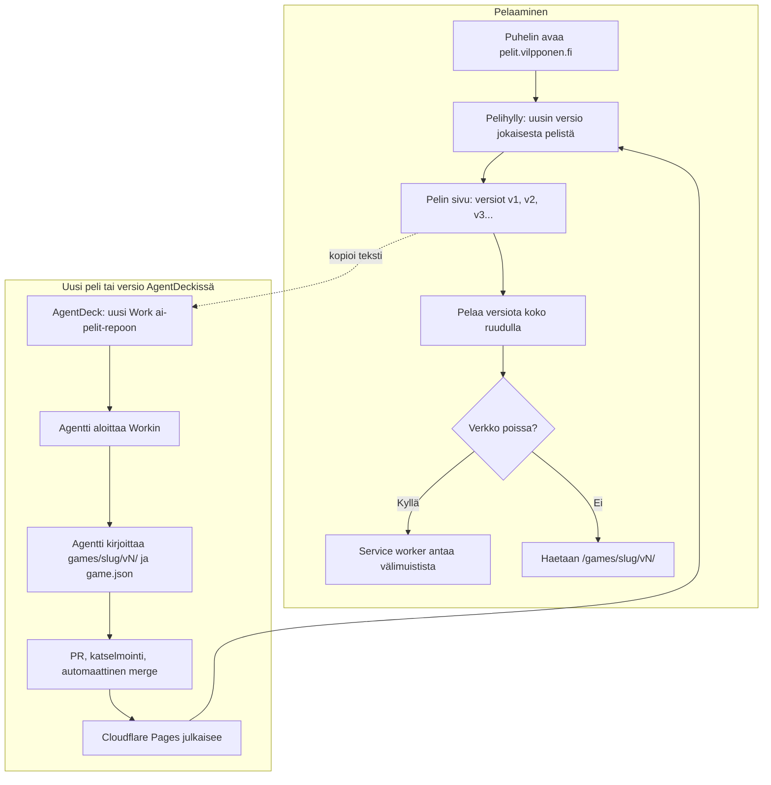

# AI-pelit: how a game is played and how a new one is made

The AI-pelit PWA (eerovil/eeron-omat-taskit#149). Playing is a static page on Cloudflare Pages: the shelf lists every
game, each game lists its versions, and any version opens full screen. A new game or version is
always started from AgentDeck (Eero's choice): the agent writes it into a new version folder,
and the merge deploys it. The app has no form.

## Colours

- **blue**: what the player sees and taps
- **amber**: a check that decides the path
- **teal**: where the game's files come from
- **violet**: where Eero starts a new game or version
- **rose**: AgentDeck's agent work, on Eero's existing subscription
- **green**: the deploy that makes the new version live

## Boxes

- **Pelihylly: uusin versio jokaisesta pelistä**: `public/index.html` rendered from `catalog.json` (first game: Sormiskeitti v1), which `scripts/build.py` builds from every `games/*/game.json`.
- **Pelin sivu: versiot v1, v2, v3...**: lists each version with its date and the change note; every version stays playable.
- **Pelaa versiota koko ruudulla**: opens `/games/<slug>/v<N>/index.html` directly (not in an iframe) with the "‹ Pelit" chip from `public/back.js`. The installed app opens full screen (`"display": "fullscreen"` in the manifest, no phone status or navigation bar); in a browser tab, or an app installed before that, `back.js` asks for full screen on the first tap in a game.
- **Service worker antaa välimuistista**: `public/sw.js`: the shell and `catalog.json` network-first, version folders cache-first once played. The shelf is cached as `./` only, because Pages redirects `index.html` to `./`; `public/404.html` answers missing files so Pages never sends the shelf in their place. `/api/` (the high-score lists, see `tuloslistat.md`) always goes to the network.
- **AgentDeck: uusi Work ai-pelit-repoon**: Eero writes "Uusi peli: …" or "<peli> v<N>: …"; each game page shows that text ready to copy.
- **Agentti kirjoittaa games/slug/vN/ ja game.json**: a new version is always a new folder; old version folders are never edited.
- **Cloudflare Pages julkaisee**: `.github/workflows/ci.yml`: tests, then `wrangler pages deploy` to the `ai-pelit` Pages project (ai-pelit.pages.dev, custom domain pelit.vilpponen.fi) with the `CLOUDFLARE_API_TOKEN` and `CLOUDFLARE_ACCOUNT_ID` secrets; without them the job stops green. `pelit` is a CNAME to `ai-pelit.pages.dev` at hostingpalvelu.fi.
