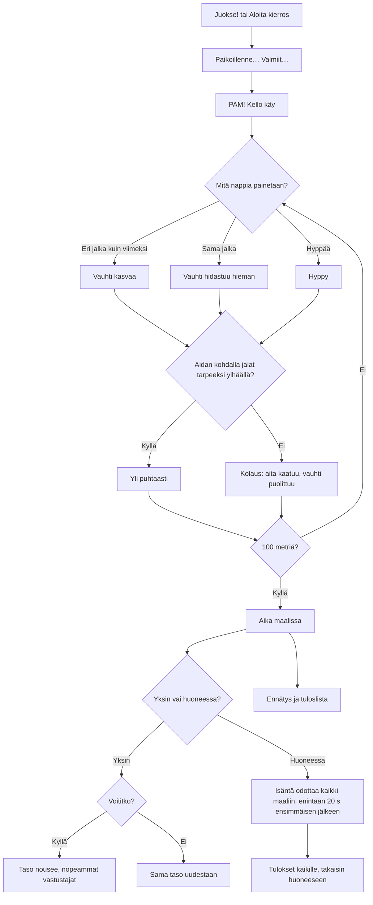

# Aitajuoksu: one 100 m hurdle race, alone or with friends

How one race of Aitajuoksu plays (v1). The runner speeds up with taps on the left and right foot
in turn, and jumps the ten hurdles with the middle button; a hurdle run into falls and slows the
runner down. Alone it is a race against three computer runners of the player's level; in a room
each phone runs its own runner and the phone that made the room (the host) fires the gun and
ends the race.

## Colours

- **blue**: what the player sees and does
- **amber**: a check that decides the path
- **teal**: how the runner moves
- **violet**: the race in a room with friends
- **green**: a finish, a record or a win
- **rose**: a knocked hurdle or a lost race

## Boxes

- **Juokse! tai Aloita kierros**: `soloRace()` in `games/aitajuoksu/v1/index.html` puts the player in lane 2 against three computer runners whose tapping rate rises with the level; in a room, `R.on('start')` gives each phone in the round its own lane, in room order (2–6 phones).
- **Paikoillenne… Valmiit…**: `tick()` counts `race.cdT` up to `race.gunAt`, a random moment 2.1–3.2 s in. In a room only the host counts; the others follow its `s` messages. A tap before the gun does nothing and shows "Odota laukausta!".
- **PAM! Kello käy**: `race.phase` becomes `run`; the race clock starts from the gun on each phone.
- **Vauhti kasvaa**: `step()`: each tap on the other foot adds speed, less the faster the runner goes (up to 12 m/s); `move()` takes some away all the time, so about 8 taps a second holds about 8.3 m/s.
- **Vauhti hidastuu hieman**: `step()`: the same foot twice takes 0.3 m/s off.
- **Hyppy**: `jump()`: a jump of about half a second, 0.58 m high; no steps in the air.
- **Aidan kohdalla jalat tarpeeksi ylhäällä?**: `move()`: passing a hurdle's line (13 m, then every 8.5 m) with the feet under 0.3 m knocks it down (`down` bitmask per runner).
- **Kolaus: aita kaatuu, vauhti puolittuu**: speed × 0.45 and 0.35 s of stumbling with no steps.
- **Aika maalissa**: `move()` sets `fin` to the moment the runner crossed 100 m, to 1/100 s.
- **Taso nousee, nopeammat vastustajat**: `finish()` saves `ai-pelit:aitajuoksu:taso`, `voitot`, `juoksut` and `ennatys`; the menu shows the next opponents.
- **Isäntä odottaa kaikki maaliin, enintään 20 s ensimmäisen jälkeen**: `hostTick()`, with `race.firstFin` set by whichever runner is in first, the host's own, the computer's or a guest's `p` message: each guest runs its own runner and sends it to the host 12 times a second (`p`); the host sends everyone's runners back (`s`) and runs the computer for a phone that is away (`on('continue')`). A guest that reloads takes its runner back from the host's `s`.
- **Tulokset kaikille, takaisin huoneeseen**: the host's `R.deliver()` of `end` with the standings; each phone shows them for three seconds, saves its time once (`R.once`), and goes back to the room with its place and the standings as the room's note.
- **Ennätys ja tuloslista**: `AiPelitScores.submit()` with the time; the list is the fastest first (`aitajuoksu` in `public/scores.js` and `server/api.js`).
