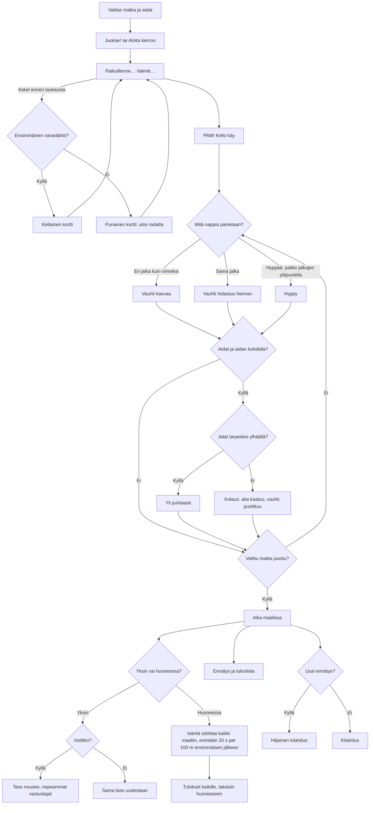

# Aitajuoksu: one race of 100, 200 or 400 m, with or without hurdles, alone or with friends

How one race of Aitajuoksu plays (v1; v2 adds false starts; v3 adds 200 and 400 m and races without hurdles). The runner speeds up with taps on the left and right foot
in turn, and, in a race with hurdles, jumps the ten hurdles with the middle button; a hurdle run into falls and slows the
runner down. Alone it is a race against three computer runners of the player's level; in a room
each phone runs its own runner and the phone that made the room (the host) fires the gun and
ends the race. From v2 a step after "Valmiit…" and before the gun is a false start: a yellow
card, then a red one and that runner is out; the start is called back each time. From v3 the player
picks 100, 200 or 400 m, with or without hurdles, and each kind keeps its own record and list.

From v5 (#158) the player's runner wears the outfit picked under "👕 Asu" in the menu, and in a room each phone's runner wears its own (`body()` in `games/aitajuoksu/v5/index.html`; the picker is `asut.md`).

From v6 (#170) the legs run forwards: in `body()` in `games/aitajuoksu/v6/index.html` the knee bends while the thigh swings forward and the leg is near straight while it pushes back, where v1–v5 bent it on the wrong half of the stride, so the runner looked to run backwards.

From v7 (#211) the race sounds like one: the beeps are recorded sounds from the shared library `public/lib/aanet-2/` (`aanikirjasto.md`), loaded in `games/aitajuoksu/v7/index.html` as `S` — a whistle for a false start, the starting pistol, footsteps, the take-off with a whoosh, a hurdle's metal clatter, a chime at the finish and applause for a new record. Each falls back to v6's own beep when it cannot play (before the sound loads, offline on the first open).

From v8 (#308) the jump button is where the other athletics games have it (Pituushyppy v4, #177): upright, a bar across the screen above the two feet with a gap between, not between the feet; on its side the top of each edge column, with the same 44 px gap above the foot. A touch in the gap, or on the jump's lowest 12 px, is a step, so a thumb drumming the feet does not jump by mistake (`pads()` and `padAt()` in `games/aitajuoksu/v8/index.html`).

From v9 (#313) a pad that does nothing right then is greyed out and does not light up when pressed (v8 flashed every pad at every tap). The feet are on at the start (a step there is a false start) and while running on the ground; off while the whistle blows, over a hurdle, stumbling and past the line. The jump is on only running on the ground, and never in a race without hurdles, where it now does nothing (v8 hopped). A runner with a red card has every pad off, the jump too (v8 let them jump after the gun). `padOn()` in `games/aitajuoksu/v9/index.html`; see `yleisurheilu-napit.md`.

v10 (#311) plays as v9 with the athletics events' common outfit set and one choice shared by every event and Ottelu (`data-share="yleisurheilu"` in `games/aitajuoksu/v10/index.html`, `asut.md`).

Since #346 only each game's newest version folder is kept: a `games/<slug>/v<N>/` path below that is not the newest names a version that is history now (its files are in git's history, and the site sends its address to the newest), and what it says about that version is how it was.

v11 (#337, `aanet-4`) has no crowd: the finish is the quiet `onnistui` blip at 0.3 (no applause for a record), and the whistle is quieter.

## Colours

- **blue**: what the player sees and does
- **amber**: a check that decides the path, or a yellow card
- **teal**: how the runner moves
- **violet**: the race in a room with friends
- **green**: a finish, a record or a win
- **rose**: a knocked hurdle, a lost race or a red card

## Boxes

- **Valitse matka ja aidat**: v3: the menu's `#dists` and `#hurd` buttons (`pick()`) set `dist` (100, 200, 400) and `hurdles`, saved as `ai-pelit:aitajuoksu:matka` and `aidat`; `setTrack()` makes `TRACK` and `HURDLES` (ten hurdles from `SPACING`: 13 m + 8.5 m, 16 m + 19 m, 45 m + 35 m, or none). In a room the host picks under the players (`roomControls()`, `R.extra`), and its `s` messages carry the race as `k`, so every phone runs the same one. The computer slows a little on 200 m and 400 m, and the jump pad dims when there are no hurdles.
- **Juokse! tai Aloita kierros**: `soloRace()` in `games/aitajuoksu/v1/index.html` puts the player in lane 2 against three computer runners whose tapping rate rises with the level; in a room, `R.on('start')` gives each phone in the round its own lane, in room order (2–6 phones).
- **Paikoillenne… Valmiit…**: `tick()` counts `race.cdT` up to `race.gunAt`, a random moment 2.1–3.2 s in. In a room only the host counts; the others follow its `s` messages. In v1 a tap before the gun does nothing and shows "Odota laukausta!"; in v2 only during "Paikoillenne…" (`SET_AT`, 0.9 s).
- **Ensimmäinen varaslähtö?**: v2 `step()` calls `falseStart()` for a foot tap after `SET_AT`; a guest sends `f` and the host decides, ignoring one that arrives after its gun. In a race alone each computer runner goes early in 5 % of starts (`CPU_JUMPY`, `ai.jumpy`). `whistle()` blows (from v7 the `pilli` sound). The runner's `card` goes up by one and `race.phase` is `false` for 2.4 s (`FS_SHOW`, `drawCard()`); guests follow it from the host's `s` (`ph`, `fs`, and each runner's card at `pack()[10]`).
- **Keltainen kortti**: `card` 1: a small yellow card by the name and 🟨 in the top bar; `afterFalse()` calls `countdown()`, a new random gun moment.
- **Punainen kortti: ulos radalta**: `card` 2: the runner stays at the start, dimmed, and comes last as "Hylätty" (`standings()` `dq`). Alone, the player's own red card ends the race straight to the menu, with nothing saved; in a room the race goes on without them.
- **PAM! Kello käy**: `race.phase` becomes `run`; the race clock starts from the gun on each phone. `bang()`: from v7 the `lahto` pistol.
- **Mitä nappia painetaan?**: `pointerdown` on the canvas. Upright v1-v7 had three pads in a row, left foot, jump, right foot; from v8 `padAt()` reads the jump bar above the feet (`PAD_GAP` 44 px under it, the gap and the bar's lowest `JUMP_EDGE` 12 px count as the foot under the thumb), and a tap on the track jumps too. On its side (v4) each edge column is a jump pad on top and that side's foot under it.
- **Vauhti kasvaa**: `step()`: each tap on the other foot adds speed, less the faster the runner goes (up to 12 m/s); `move()` takes some away all the time, so about 8 taps a second holds about 8.3 m/s. The stride's speed follows it (`r.ph`); from v6 the knee bends as each leg swings forward (`body()`). From v7 each tap plays `askel` or `askel2`, a little faster at speed.
- **Vauhti hidastuu hieman**: `step()`: the same foot twice takes 0.3 m/s off.
- **Hyppy**: `jump()`: a jump of about half a second, 0.58 m high; no steps in the air. From v7 `ponnistus` and a soft `suhahdus`.
- **Aidat ja aidan kohdalla?**: `move()` checks each of `HURDLES` the runner passes this frame: 13 m, then every 8.5 m in v1-v2; from v3 the selected race's ten (`setTrack()`), or none in a race without hurdles, so a flat race never knocks anything.
- **Jalat tarpeeksi ylhäällä?**: `move()`: passing a hurdle's line with the feet under 0.3 m knocks it down (`down` bitmask per runner).
- **Valittu matka juostu?**: `move()`: `r.x >= TRACK`, the selected distance.
- **Kolaus: aita kaatuu, vauhti puolittuu**: speed × 0.45 and 0.35 s of stumbling with no steps. From v7 the `rima` clatter.
- **Aika maalissa**: `move()` sets `fin` to the moment the runner crossed `TRACK` (100 m in v1-v2; 100, 200 or 400 m in v3), to 1/100 s.
- **Taso nousee, nopeammat vastustajat**: `finish()` saves `ai-pelit:aitajuoksu:taso`, `voitot`, `juoksut` and `ennatys`; the menu shows the next opponents.
- **Isäntä odottaa kaikki maaliin, enintään 20 s per 100 m ensimmäisen jälkeen**: `hostTick()` waits `race.late` after the first finish: 20 s in v1-v2, and from v3 20 s per 100 m (`20 * d / 100`: 20, 40 or 80 s), with `race.firstFin` set by whichever runner is in first, the host's own, the computer's or a guest's `p` message: each guest runs its own runner and sends it to the host 12 times a second (`p`); the host sends everyone's runners back (`s`) and runs the computer for a phone that is away (`on('continue')`). A guest that reloads takes its runner back from the host's `s`, mid-jump or mid-stumble included (`pack()` sends the jump speed, last foot and stumble too).
- **Tulokset kaikille, takaisin huoneeseen**: the host's `R.deliver()` of `end` with the standings; each phone shows them for three seconds, saves its time once (`R.once`), and goes back to the room with its place and the standings as the room's note.
- **Uusi ennätys?**: v7: when this phone's runner crosses the line, `move()` compares its time with the saved record of this race (`bestKey()`; `finish()` saves the new one a moment later). No record yet counts as a new one.
- **Hiljainen kilahdus**: from v11 (#337) `onnistui` at 0.3, with no applause, for every finish. Before it, v7: `onnistui`, then `aplodit` 0.3 s later. When `onnistui` cannot play, v6's two-note beep plays instead and no applause.
- **Kilahdus**: v7: `onnistui` alone.
- **Ennätys ja tuloslista**: `AiPelitScores.submit()` with the time; the list is the fastest first (`aitajuoksu` in `public/scores.js` and `server/api.js`). v3: each race has its own record (`bestKey()`: 100 m hurdles keeps `ennatys`, the rest `ennatys-<matka>-<aidat|tasainen>`) and list (`boardId()`: 100 m hurdles keeps `main`, the rest e.g. `400-tasainen`); the shelf still shows the `main` list. The level is shared by every race.
