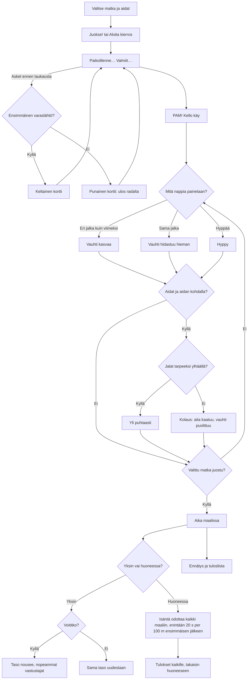

# Aitajuoksu: one race of 100, 200 or 400 m, with or without hurdles, alone or with friends

How one race of Aitajuoksu plays (v1; v2 adds false starts; v3 adds 200 and 400 m and races without hurdles). The runner speeds up with taps on the left and right foot
in turn, and, in a race with hurdles, jumps the ten hurdles with the middle button; a hurdle run into falls and slows the
runner down. Alone it is a race against three computer runners of the player's level; in a room
each phone runs its own runner and the phone that made the room (the host) fires the gun and
ends the race. From v2 a step after "Valmiit…" and before the gun is a false start: a yellow
card, then a red one and that runner is out; the start is called back each time. From v3 the player
picks 100, 200 or 400 m, with or without hurdles, and each kind keeps its own record and list.

From v5 (#158) the player's runner wears the outfit picked under "👕 Asu" in the menu, and in a room each phone's runner wears its own (`body()` in `games/aitajuoksu/v5/index.html`; the picker is `asut.md`).

## Colours

- **blue**: what the player sees and does
- **amber**: a check that decides the path, or a yellow card
- **teal**: how the runner moves
- **violet**: the race in a room with friends
- **green**: a finish, a record or a win
- **rose**: a knocked hurdle, a lost race or a red card

## Boxes

- **Valitse matka ja aidat**: v3: the menu's `#dists` and `#hurd` buttons (`pick()`) set `dist` (100, 200, 400) and `hurdles`, saved as `ai-pelit:aitajuoksu:matka` and `aidat`; `setTrack()` makes `TRACK` and `HURDLES` (ten hurdles from `SPACING`: 13 m + 8.5 m, 16 m + 19 m, 45 m + 35 m, or none). In a room the host picks under the players (`roomControls()`, `R.extra`), and its `s` messages carry the race as `k`, so every phone runs the same one. The computer slows a little on 200 m and 400 m, and the jump pad dims when there are no hurdles.
- **Juokse! tai Aloita kierros**: `soloRace()` in `games/aitajuoksu/v1/index.html` puts the player in lane 2 against three computer runners whose tapping rate rises with the level; in a room, `R.on('start')` gives each phone in the round its own lane, in room order (2–6 phones).
- **Paikoillenne… Valmiit…**: `tick()` counts `race.cdT` up to `race.gunAt`, a random moment 2.1–3.2 s in. In a room only the host counts; the others follow its `s` messages. In v1 a tap before the gun does nothing and shows "Odota laukausta!"; in v2 only during "Paikoillenne…" (`SET_AT`, 0.9 s).
- **Ensimmäinen varaslähtö?**: v2 `step()` calls `falseStart()` for a foot tap after `SET_AT`; a guest sends `f` and the host decides, ignoring one that arrives after its gun. In a race alone each computer runner goes early in 5 % of starts (`CPU_JUMPY`, `ai.jumpy`). The runner's `card` goes up by one and `race.phase` is `false` for 2.4 s (`FS_SHOW`, `drawCard()`); guests follow it from the host's `s` (`ph`, `fs`, and each runner's card at `pack()[10]`).
- **Keltainen kortti**: `card` 1: a small yellow card by the name and 🟨 in the top bar; `afterFalse()` calls `countdown()`, a new random gun moment.
- **Punainen kortti: ulos radalta**: `card` 2: the runner stays at the start, dimmed, and comes last as "Hylätty" (`standings()` `dq`). Alone, the player's own red card ends the race straight to the menu, with nothing saved; in a room the race goes on without them.
- **PAM! Kello käy**: `race.phase` becomes `run`; the race clock starts from the gun on each phone.
- **Vauhti kasvaa**: `step()`: each tap on the other foot adds speed, less the faster the runner goes (up to 12 m/s); `move()` takes some away all the time, so about 8 taps a second holds about 8.3 m/s.
- **Vauhti hidastuu hieman**: `step()`: the same foot twice takes 0.3 m/s off.
- **Hyppy**: `jump()`: a jump of about half a second, 0.58 m high; no steps in the air.
- **Aidat ja aidan kohdalla?**: `move()` checks each of `HURDLES` the runner passes this frame: 13 m, then every 8.5 m in v1-v2; from v3 the selected race's ten (`setTrack()`), or none in a race without hurdles, so a flat race never knocks anything.
- **Jalat tarpeeksi ylhäällä?**: `move()`: passing a hurdle's line with the feet under 0.3 m knocks it down (`down` bitmask per runner).
- **Valittu matka juostu?**: `move()`: `r.x >= TRACK`, the selected distance.
- **Kolaus: aita kaatuu, vauhti puolittuu**: speed × 0.45 and 0.35 s of stumbling with no steps.
- **Aika maalissa**: `move()` sets `fin` to the moment the runner crossed `TRACK` (100 m in v1-v2; 100, 200 or 400 m in v3), to 1/100 s.
- **Taso nousee, nopeammat vastustajat**: `finish()` saves `ai-pelit:aitajuoksu:taso`, `voitot`, `juoksut` and `ennatys`; the menu shows the next opponents.
- **Isäntä odottaa kaikki maaliin, enintään 20 s per 100 m ensimmäisen jälkeen**: `hostTick()` waits `race.late` after the first finish: 20 s in v1-v2, and from v3 20 s per 100 m (`20 * d / 100`: 20, 40 or 80 s), with `race.firstFin` set by whichever runner is in first, the host's own, the computer's or a guest's `p` message: each guest runs its own runner and sends it to the host 12 times a second (`p`); the host sends everyone's runners back (`s`) and runs the computer for a phone that is away (`on('continue')`). A guest that reloads takes its runner back from the host's `s`, mid-jump or mid-stumble included (`pack()` sends the jump speed, last foot and stumble too).
- **Tulokset kaikille, takaisin huoneeseen**: the host's `R.deliver()` of `end` with the standings; each phone shows them for three seconds, saves its time once (`R.once`), and goes back to the room with its place and the standings as the room's note.
- **Ennätys ja tuloslista**: `AiPelitScores.submit()` with the time; the list is the fastest first (`aitajuoksu` in `public/scores.js` and `server/api.js`). v3: each race has its own record (`bestKey()`: 100 m hurdles keeps `ennatys`, the rest `ennatys-<matka>-<aidat|tasainen>`) and list (`boardId()`: 100 m hurdles keeps `main`, the rest e.g. `400-tasainen`); the shelf still shows the `main` list. The level is shared by every race.
