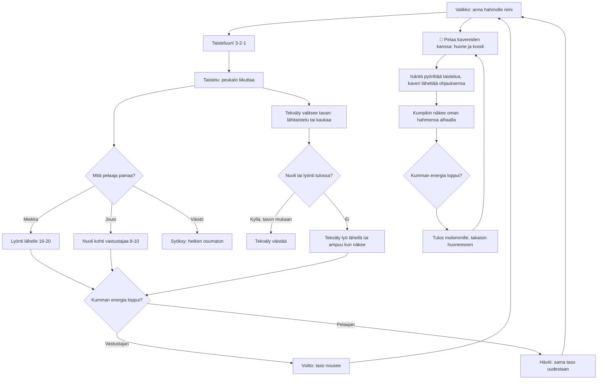

# Areena: one fight, and how the opponent thinks

How one Areena fight plays (v1, v2 which is easier, and v3 which adds a fight against a friend on another phone). The player names their fighter, then fights one AI opponent
with a sword, a bow and a dodge. The opponent switches between close and ranged fighting,
dodges arrows and swings, and gets quicker, tougher and smarter with every level the player wins.

## Colours

- **blue**: what the player sees and does
- **amber**: a check that decides the path
- **teal**: the player's three moves, and the fight against a friend (v3)
- **violet**: the opponent's own decisions
- **green**: a win, saved on the phone
- **rose**: a loss, saved on the phone

## Boxes

- **Valikko: anna hahmolle nimi**: the `#menu` overlay in `games/areena/v1/index.html`, `games/areena/v2/index.html` (the same game with an easier opponent) and `games/areena/v3/index.html` (v2 plus the "👥 Pelaa kavereiden kanssa" button); the name is saved as `ai-pelit:areena:nimi` and drawn over the fighter and on its health bar.
- **Lyönti lähelle 16-20**: `act()` starts a swing; it connects halfway through if the opponent is within reach. Holding the button keeps swinging.
- **Nuoli kohti vastustajaa 8-10**: aims where the opponent will be when the arrow arrives; five arrows, one back every 1.4 s. Pillars stop arrows.
- **Syöksy: hetken osumaton**: 0.2 s dash in the stick's direction (or away from the opponent) during which nothing hits.
- **Tekoäly valitsee tavan: lähitaistelu tai kaukaa**: `aiInput()` picks a mode every 2-5 s, prefers range when it is losing, strafes and walks round pillars.
- **Tekoäly väistää**: decided once per arrow or swing, with a chance that rises from 22 % at level 1 to 80 % in v1, and from 10 % to 50 % in v2.
- **Voitto: taso nousee**: `endFight()` saves `taso`, `voitot` and `haviot`; each level's opponent has a new name, more health, more speed and quicker reactions: v1 90 + 15 health per level; v2 75 + 10, slower, slower to react, and its hits do 30 % less to the player.
- **👥 Pelaa kavereiden kanssa: huone ja koodi**: v3 only. `public/rooms.js` draws the room screen (code, QR link, "Aloita kierros"); the room is for two phones (`data-max="2"`). Its name field is filled with the fighter's name.
- **Isäntä pyörittää taistelua, kaveri lähettää ohjauksensa**: the phone that made the room runs the fight (`step()` with `friendInput()`) and sends the state 30 times a second (`sendState()`); the friend's phone sends its stick and buttons (`guestStep()`). If the friend drops off and the host taps "Jatka ilman heitä", the computer opponent takes over.
- **Kumpikin näkee oman hahmonsa alhaalla**: the friend's phone turns the arena round (`unpack()`), so both players fight upwards.
- **Tulos molemmille, takaisin huoneeseen**: `endOnline()` sends the winner with `deliver()`; both phones show it on the room screen (`backToRoom()`). Online fights do not change the solo level or wins.
