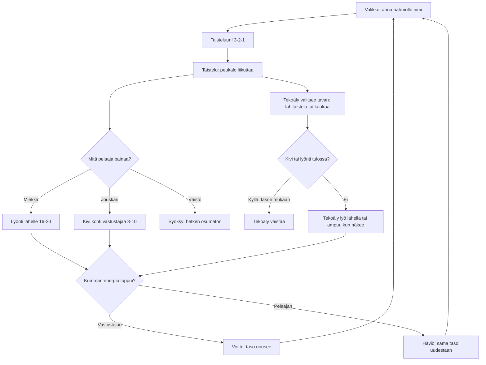

# Areena: one fight, and how the opponent thinks

How one Areena fight plays (v1). The player names their fighter, then fights one AI opponent
with a sword, a slingshot and a dodge. The opponent switches between close and ranged fighting,
dodges stones and swings, and gets quicker, tougher and smarter with every level the player wins.

## Colours

- **blue**: what the player sees and does
- **amber**: a check that decides the path
- **teal**: the player's three moves
- **violet**: the opponent's own decisions
- **green**: a win, saved on the phone
- **rose**: a loss, saved on the phone

## Boxes

- **Valikko: anna hahmolle nimi**: the `#menu` overlay in `games/areena/v1/index.html`; the name is saved as `ai-pelit:areena:nimi` and drawn over the fighter and on its health bar.
- **Lyönti lähelle 16-20**: `act()` starts a swing; it connects halfway through if the opponent is within reach. Holding the button keeps swinging.
- **Kivi kohti vastustajaa 8-10**: aims where the opponent will be when the stone arrives; five stones, one back every 1.4 s. Pillars stop stones.
- **Syöksy: hetken osumaton**: 0.2 s dash in the stick's direction (or away from the opponent) during which nothing hits.
- **Tekoäly valitsee tavan: lähitaistelu tai kaukaa**: `aiInput()` picks a mode every 2-5 s, prefers range when it is losing, strafes and walks round pillars.
- **Tekoäly väistää**: decided once per stone or swing, with a chance that rises from 22 % at level 1 to 80 %.
- **Voitto: taso nousee**: `endFight()` saves `taso`, `voitot` and `haviot`; each level's opponent has a new name, more health (90 + 15 per level), more speed and quicker reactions.
