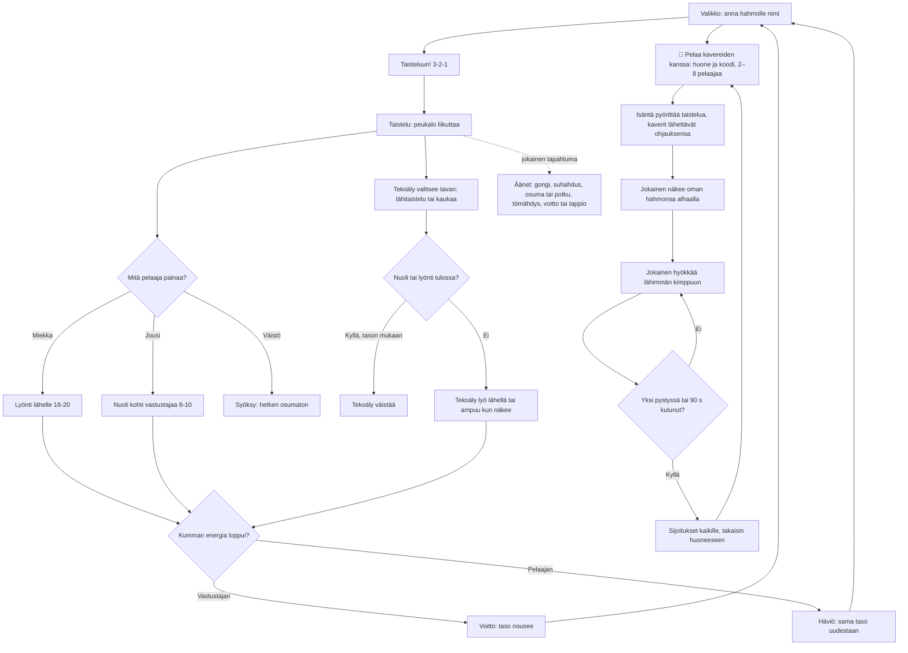

# Areena: one fight, and how the opponent thinks

How one Areena fight plays (v1, v2 which is easier, v3 which adds a fight against a friend on another phone, v4 which plays sideways, v5 with recorded sounds, and v7 where a room takes 2–8 phones, everyone against everyone). The player names their fighter, then fights one AI opponent
with a sword, a bow and a dodge. The opponent switches between close and ranged fighting,
dodges arrows and swings, and gets quicker, tougher and smarter with every level the player wins.

Since #346 only each game's newest version folder is kept: a `games/<slug>/v<N>/` path below that is not the newest names a version that is history now (its files are in git's history, and the site sends its address to the newest), and what it says about that version is how it was.

v6 (#337, `aanet-4`) has no crowd: a knockout is the hit and the thud only.

v7 (#369) takes a whole group's games evening (#354): up to eight phones fight in one room, each turning on the nearest fighter, until one is left standing or the 90 seconds run out.

## Colours

- **blue**: what the player sees and does
- **amber**: a check that decides the path
- **teal**: the player's three moves, and the fight against friends (v3, from v7 up to eight)
- **violet**: the opponent's own decisions, and the sounds (v5)
- **green**: a win, saved on the phone
- **rose**: a loss, saved on the phone

## Boxes

- **Valikko: anna hahmolle nimi**: the `#menu` overlay in `games/areena/v1/index.html`, `games/areena/v2/index.html` (the same game with an easier opponent) and `games/areena/v3/index.html` (v2 plus the "👥 Pelaa kavereiden kanssa" button); the name is saved as `ai-pelit:areena:nimi` and drawn over the fighter and on its health bar.
- **Lyönti lähelle 16-20**: `act()` starts a swing; it connects halfway through if the opponent is within reach. Holding the button keeps swinging.
- **Nuoli kohti vastustajaa 8-10**: aims where the opponent will be when the arrow arrives; five arrows, one back every 1.4 s. Pillars stop arrows.
- **Syöksy: hetken osumaton**: 0.2 s dash in the stick's direction (or away from the opponent) during which nothing hits.
- **Tekoäly valitsee tavan: lähitaistelu tai kaukaa**: `aiInput()` picks a mode every 2-5 s, prefers range when it is losing, strafes and walks round pillars.
- **Tekoäly väistää**: decided once per arrow or swing, with a chance that rises from 22 % at level 1 to 80 % in v1, and from 10 % to 50 % in v2.
- **Voitto: taso nousee**: `endFight()` saves `taso`, `voitot` and `haviot`; each level's opponent has a new name, more health, more speed and quicker reactions: v1 90 + 15 health per level; v2 75 + 10, slower, slower to react, and its hits do 30 % less to the player.
- **👥 Pelaa kavereiden kanssa: huone ja koodi, 2–8 pelaajaa**: v3–v6: v3 and v4. `public/rooms.js` draws the room screen (code, "Aloita kierros"); the room is for two phones (`data-max="2"`). Its name field is filled with the fighter's name. Sideways (#95) the room screen is two columns, and v4 plays sideways too: the arena in the middle, your bar and stick left, the opponent's bar and the attack buttons right (see `docs/diagrams/landscape.md`). The room also has push-to-talk voice (#322, see `moninpeli.md`): the 🎤 chip sits on the arena's right edge upright and in the top bar sideways, clear of the attack buttons. v7 (#369): the room takes 2–8 phones (`data-max="8"` on the `rooms.js` tag in `games/areena/v7/index.html`), so a group playing one room all evening (#354) can switch to Areena. With two it is the same duel as before, plus the time limit.
- **Isäntä pyörittää taistelua, kaverit lähettävät ohjauksensa**: v3–v6: the phone that made the room runs the fight (`step()` with `friendInput()`) and sends the state 30 times a second (`sendState()`); the friend's phone sends its stick and buttons (`guestStep()`). If the friend drops off and the host taps "Jatka ilman heitä", the computer opponent takes over. v7: `onlineFight()` makes one fighter per player in the room's order, at its own spot (`SPOTS`: the corners and the ends, all in the arena's lower or upper part, none in its middle row); the host's `step()` runs them all and `sendState()` sends every fighter (`f`) and arrow, with who shot it. Each guest's stick and buttons arrive as `in` and drive its own fighter (`remoteInput()`); a fighter whose phone is away is run by the computer after "Jatka ilman heitä" (`f.bot`, `aiInput()` with its own `f.ai` head).
- **Jokainen näkee oman hahmonsa alhaalla**: v3–v6: the friend's phone turns the arena round (`unpack()`), so both players fight upwards. v7: every phone keeps the arena's own directions; a phone whose fighter starts in the top half draws the arena turned round (`flip()`, `W2()`) and turns its stick the same way (`playerInput()`). Each phone draws its own fighter blue with a gold ring (it swaps colours with the room's first player).
- **Sijoitukset kaikille, takaisin huoneeseen**: v3–v6: `endOnline()` sends the winner with `deliver()`; both phones show it on the room screen (`backToRoom()`). Online fights do not change the solo level or wins. v7: `endOnline()` delivers the winner and every place (`o`: the ones standing by health, then the fallen, the last to fall first); `finishOnline()` shows "🏆 <nimi> voitti!" or "💀 <voittaja> voitti · olit 3.".
- **Äänet: gongi, suhahdus, osuma tai potku, tömähdys, voitto tai tappio**: from v6 (#337) a knockout has no `yleiso` after the thud. Before it: v5 (`games/areena/v5/index.html`, #212) loads `public/lib/aanet-2/aanet.js` and plays recorded sounds through `sfx`: `gongi` when the fight starts, `suhahdus` for a sword swing, an arrow (higher) and a dodge (quiet, lower), `osuma` for a light hit (an arrow, 12 or less) and `potku` for a big one (a sword; decided in `damage()` before the player's hits are made 30 % lighter), `tomahdys` then `yleiso` at the knockout (each on its own, so the crowd still shouts if the thud cannot play), and `voitto` or `tappio` when the fight ends (alone in `endFight()`, online in `finishOnline()`). A friend's phone plays the same from the host's state (`unpack()`, `guestState()`). When a sound cannot play (before it has loaded, offline on the first open), the v4 beep plays instead; the end tunes had no beep and stay silent.
- **Jokainen hyökkää lähimmän kimppuun**: v7: each fighter faces and aims at the nearest one still standing (`nearest()`); a sword swing hits everyone in reach in front of it, an arrow the first fighter in its way. A knocked-out fighter lies faded and takes no part; its phone shows "Tyrmätty – katso loppuun". With more than two, the HUD shows "Pystyssä n/N" and small health bars over the fighters' heads.
- **Yksi pystyssä tai 90 s kulunut?**: v7: `damage()` ends the round when one is left (K.O.!), `step()` when `ROUND` (90 s) runs out (AIKA!), the most health left winning; two or more level on the most health is a draw between them (`d` in the end message, "🤝 Tasapeli: Eero ja Aino"), never the room's first player.
