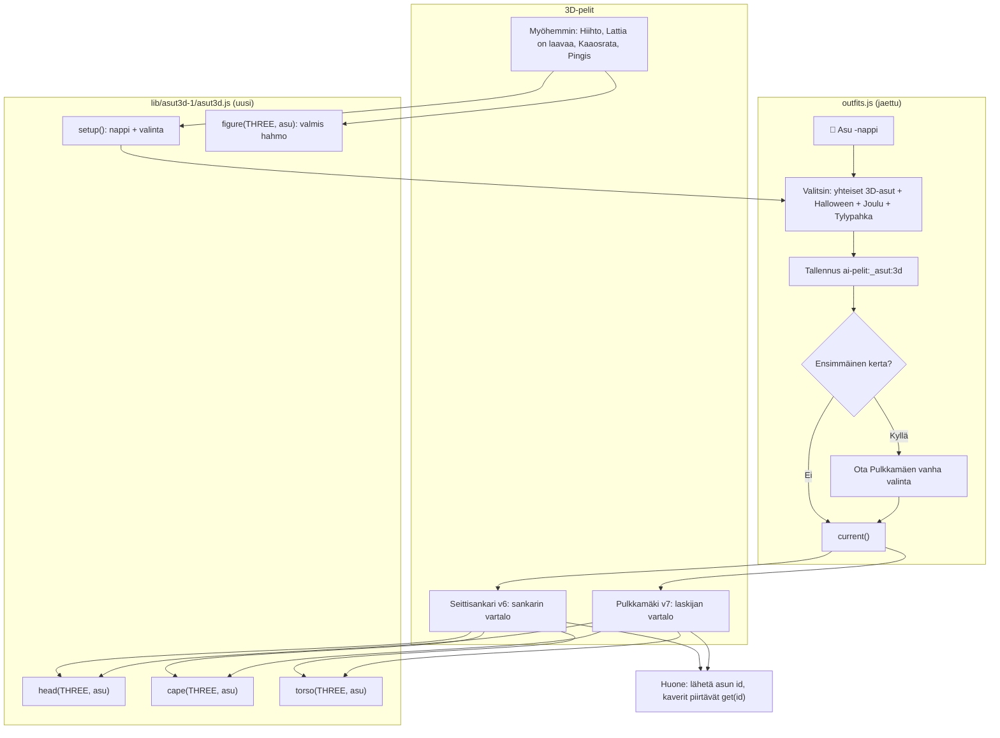

# Asut 3D-peleissä

How a 3D game dresses its player from the shared outfit picker. `outfits.js` keeps one choice for
every 3D game, and a new shared library builds that outfit's 3D pieces (costume heads, cape,
stripes) so each game only fits them onto its own body. Seittisankari v6 and Pulkkamäki v7 are the
first two games to use it.

## Colours

- **blue**: the picker the player sees
- **amber**: the saved choice and taking over an older one
- **teal**: the new shared 3D library
- **green**: games changed in this Work
- **violet**: games left for later Works
- **rose**: friends in a room

## Boxes

- **Valitsin: yhteiset 3D-asut + Halloween + Joulu + Tylypahka**: `public/outfits.js` `open()`; with `data-share="3d"` the cards show the shared front figure, as the athletics events do.
- **Tallennus ai-pelit:_asut:3d**: one key for every 3D game; a pick is also saved under the game's own key `ai-pelit:_asut:<slug>`.
- **Ota Pulkkamäen vanha valinta**: `adopt()` with `SHARED_FROM['3d'] = ['pulkkamaki']`, so a rider's earlier pick carries over.
- **head(THREE, asu)**: returns a `THREE.Group` facing +Z: a face with hair (and a beanie when the outfit has `pipo`), the hero mask, or one of the 14 costume heads.
- **cape(THREE, asu)**: a cape mesh when the outfit has `cape`, else null.
- **torso(THREE, asu)**: extras on the chest: the skeleton's ribs or a `stripe` band; null when there are none.
- **setup(): nappi + valinta**: `AiPelitAsut3d.setup({ default, button, change })` sets up the shared picker with the game's default first and adds the "👕 Asu" button.
- **figure(THREE, asu): valmis hahmo**: a whole jointed person in the outfit, for a game with no body of its own.
- **Seittisankari v6: sankarin vartalo**: `makeHero()` reads `top`, `bottom` and `shoe` and takes its head, cape and chest from the library; robbers and passers-by stay as they are.
- **Pulkkamäki v7: laskijan vartalo**: `makeRig()` keeps its sled and body and swaps its own `dressHead()` for the library's head, and adds its cape and ribs.
- **Huone: lähetä asun id, kaverit piirtävät get(id)**: each phone sends `current().id`; a friend's hero is rebuilt when the id changes.
