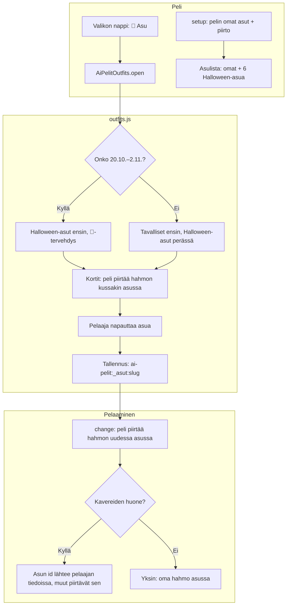

# Asut: the shared outfit picker and Halloween costumes

How a game version lets the player pick an outfit for their figure (#158). One shared script,
`public/outfits.js`, draws the picker and keeps the choice on the phone; each game draws its own
figure in the chosen outfit. The six Halloween costumes are the same in every game, always
available, and come first in the picker around Halloween.

## Colours

- **blue**: what the player taps
- **violet**: the game's own outfits and drawing
- **amber**: a check that decides the path
- **teal**: the picker's order
- **green**: the save on the phone
- **rose**: the figure in the game

## Boxes

- **Valikon nappi: 👕 Asu**: the menu button each game draws; shows the outfit now, e.g. "👕 Asu: Kurpitsa".
- **setup: pelin omat asut + piirto**: `AiPelitOutfits.setup({outfits, draw, change})` in the game's script; the first own outfit is the default.
- **Asulista: omat + 6 Halloween-asua**: `HALLOWEEN` in `public/outfits.js`: Kurpitsa, Noita, Haamu, Luuranko, Vampyyri, Muumio, each a palette plus a costume head drawn by `AiPelitOutfits.head()`.
- **Onko 20.10.–2.11.?**: `season()` in `public/outfits.js`.
- **Tallennus: ai-pelit:_asut:slug**: one key per game, shared by all its versions.
- **Asun id lähtee pelaajan tiedoissa, muut piirtävät sen**: Aitajuoksu and Keihäänheitto send the outfit id with the player; a phone on an older version just draws its normal look.
