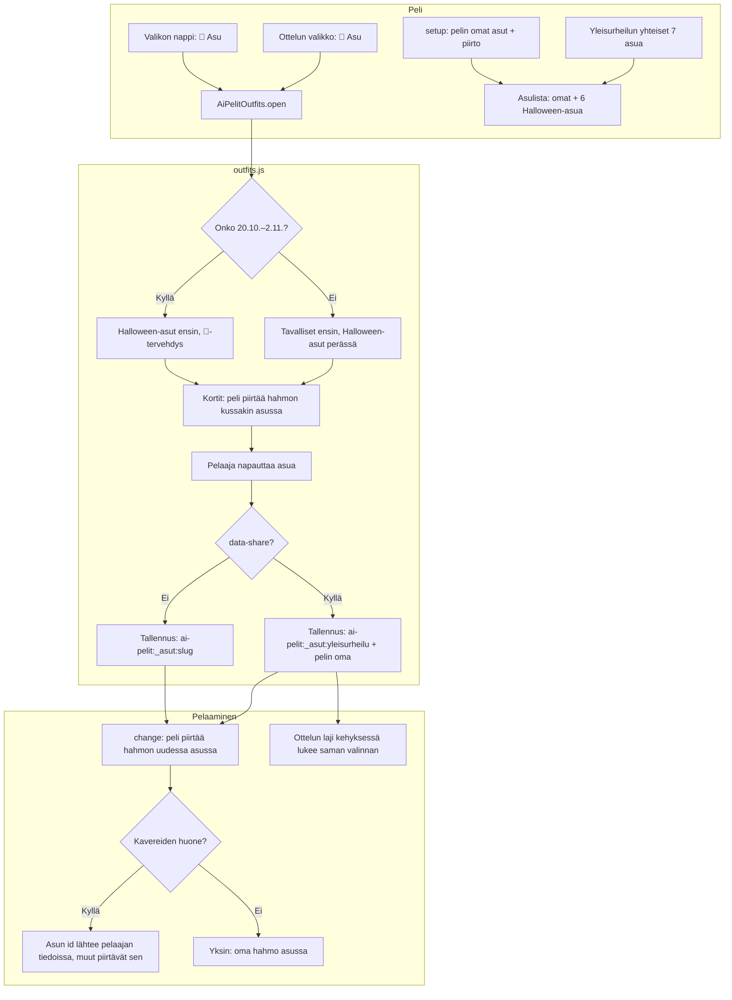

# Asut: the shared outfit picker and Halloween costumes

How a game version lets the player pick an outfit for their figure (#158). One shared script,
`public/outfits.js`, draws the picker and keeps the choice on the phone; each game draws its own
figure in the chosen outfit. The six Halloween costumes are the same in every game, always
available, and come first in the picker around Halloween. From #311 the athletics events and
Ottelu share one choice (`data-share="yleisurheilu"`) and one set of everyday kits, so the outfit
picked in any of them, or on Ottelu's menu, is worn in every event.

## Colours

- **blue**: what the player taps
- **violet**: the game's own outfits and drawing
- **amber**: a check that decides the path
- **teal**: the picker's order
- **green**: the save on the phone
- **rose**: the figure in the game

## Boxes

- **Valikon nappi: 👕 Asu**: the menu button each game draws; shows the outfit now, e.g. "👕 Asu: Kurpitsa".
- **setup: pelin omat asut + piirto**: `AiPelitOutfits.setup({outfits, draw, change})` in the game's script; the first own outfit is the default.
- **Asulista: omat + 6 Halloween-asua**: `HALLOWEEN` in `public/outfits.js`: Kurpitsa, Noita, Haamu, Luuranko, Vampyyri, Muumio, each a palette plus a costume head drawn by `AiPelitOutfits.head()`.
- **Onko 20.10.–2.11.?**: `season()` in `public/outfits.js`.
- **Tallennus: ai-pelit:_asut:slug**: one key per game, shared by all its versions.
- **Ottelun valikko: 👕 Asu**: from Ottelu v7 (#311) the match's menu has its own button (`drawKit()` draws the cards' figure from the front, in `games/ottelu/v7/index.html`); events in a match hide their own menu. At the end of the match the player stands on the podium in the outfit (`podiumLook()`); the others in their plain kit.
- **Yleisurheilun yhteiset 7 asua**: `AiPelitOutfits.yleisurheilu` in `public/outfits.js` (#311): Perus, Sinivalkoinen, Musta, Punainen, Vihreä, Kulta, Neon, the ids the events had on their own, so an earlier choice is found. Used from Pituushyppy v9, Korkeushyppy v6, Seiväshyppy v6, Moukari v6, Keihäs v8, Kuula v3, Aitajuoksu v9 and Ottelu v7.
- **data-share?**: `data-share="yleisurheilu"` on the script tag. `current()` reads the shared key. The first time a phone opens a game of the group, `adopt()` makes an earlier choice the group's: the first valid one in the fixed order of `SHARED_FROM` (Keihäs, Aitajuoksu, Kuula, then the game itself), so every game shows the same outfit whichever opens first.
- **Tallennus: ai-pelit:_asut:yleisurheilu + pelin oma**: a pick is saved under both keys, so the game's older versions, which read only their own, follow it too.
- **Ottelun laji kehyksessä lukee saman valinnan**: each event of a match is its own published page in a frame (`ottelu.md`); its `outfits.js` reads the shared key as it loads, and sends the outfit to the meet with `fit`.
- **Asun id lähtee pelaajan tiedoissa, muut piirtävät sen**: Aitajuoksu sends the outfit id with the runner, the field events through the athletics library's `fit` option (`kisa.js`); a phone on an older version just draws its normal look.
