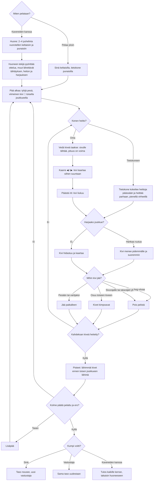

# Curling: one match, from the first stone to the result

How a match of Curling plays. The sheet is seen from above: each throw is aimed by pulling the
stone back, given a turn so it bends, and swept by rubbing the screen while it slides. Three ends
of four stones a team; the stones nearest the tee score. Alone the computer throws for the other
team; with friends, 2–4 phones split into two teams through the shared room library (see
`moninpeli.md`).

v3 (#337, `aanet-4`) has no crowd: an end your team wins is the quiet `onnistui` blip at 0.3, any other end is silent (no applause, no "ooh").

## Colours

- **blue**: what the player sees and does
- **amber**: a check that decides the path
- **teal**: the stone moving, and the computer's throw
- **violet**: playing in a room
- **green**: a win
- **rose**: a stone lost, or a lost match

## Boxes

- **Miten pelataan?**: the menu in `games/curling/v2/index.html` (v1 is the same, but for the pad's place): **Pelaa yksin** (`newMatch()`), **Jatka ottelua** when a match alone was left unfinished (saved before every throw as `ai-pelit:curling:ottelu` by `keepMatch()`), or **👥 Pelaa kavereiden kanssa** (`AiPelitRooms.open()`).
- **Huone: 2–4 puhelinta vuorotellen keltaisiin ja punaisiin**: `setupFor()` on the host; the phones of a team take its throws in turn (`thrower()`), and every phone of the throwing team can sweep.
- **Huoneen tekijä pyörittää ottelua, muut lähettävät tähtäyksen, heiton ja harjauksen**: the host runs the physics and sends `s` (`snapshot()`) about 8–20 times a second; the thrower's phone sends `aim` while it drags and `throw` when it lets go, the throwing team's phones send `sw` (their sweeping). A phone let go with "Jatka ilman heitä" is thrown for by the computer (`net.away`); a phone that comes back gets the setup and the match as it is (`on('hello')`).
- **Pää alkaa: tyhjä pesä, viimeinen kivi 🔨 toisella joukkueella**: `startEnd()`; the team without the hammer throws first (`turnTeam()`). The team that scores an end loses the hammer; after a blank end it stays.
- **Vedä kiveä taakse: sivulle tähtää, pituus on voima**: `dragAim()` turns the finger's pull (down upright, left sideways) into the broom's place on the tee line and the weight; a bar shows it as Liian kevyt / Vartija / Pesään / Pesän läpi / Poistolyönti (`weightName()`), and a ring on the aim line shows where it would stop going straight. A pull shorter than 18 px throws nothing. Upright the stone sits a full pull plus 30 px above the bottom edge (`resize()`, v2, #293), and the view ends just past the back line (`farY()`) so the house stays whole above it; in v1 it sat 74 px from the edge and only guards fit.
- **Tietokone kokeilee heittoja päässään ja heittää parhaan, pienellä virheellä**: `cpuPlan()` simulates about 700 throws with the game's own `physics()` and scores each end position (`value()`); the throw then gets an error from `skillOf()` that shrinks as the levels go up.
- **Kivi menee pidemmälle ja suoremmin**: `sweep` comes from how fast the finger rubs (about 1300 px/s is full); full sweeping takes 12 % of the friction and half the bend away (`physics()`), about 3 m more on a draw.
- **Kivi hidastuu ja kaartaa**: friction 0.6 m/s²; a turning stone bends about a metre on a draw, more as it slows.
- **Pois pelistä**: `physics()` takes off a stone touching the side line or wholly past the back line; `settle()` one that did not wholly cross the far hog line and hit nothing.
- **Pisteet: lähimmät kivet ennen toisen joukkueen lähintä**: `endPoints()` counts stones in the house (touching it counts); the counting stones get a green ring, and a tap goes on (`nextEnd()`).
- **Taso nousee, uusi vastustaja**: `record()` saves `taso`, `voitot` and `haviot` the moment the last end is scored.
- **Tulos kaikille kerran, takaisin huoneeseen**: `hostEnd()` → `AiPelitRooms.deliver()`; each phone saves its result once in `ai-pelit:curling:kaverit` (`finish()`).
