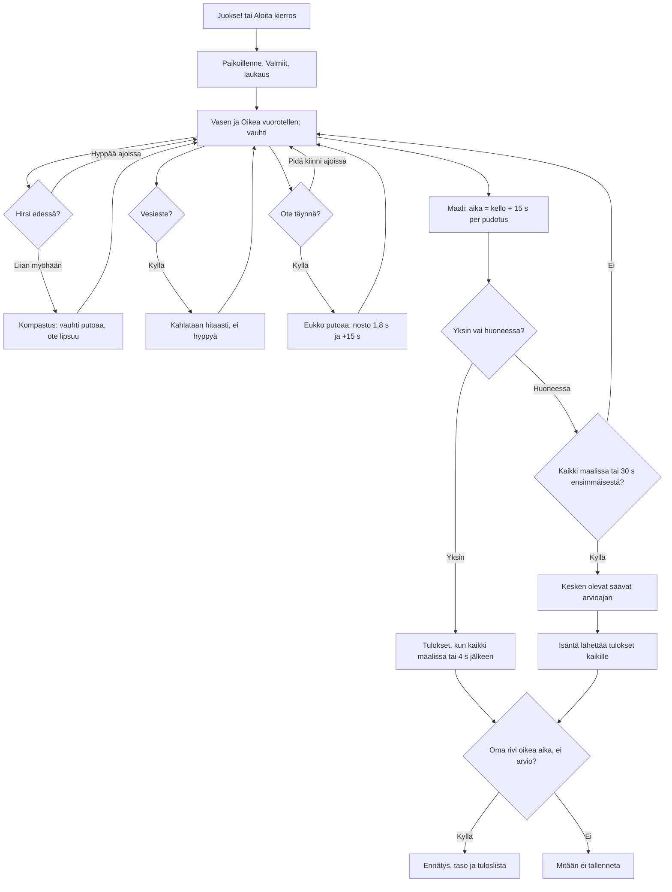

# Eukonkanto: one wife-carrying race, alone or with friends

How one race of Eukonkanto plays (v1, #501). The player carries the wife upside down on the back
over the real course: 253.5 m of sand, two log obstacles and a water pit. Taps on the left and
right foot in turn run, "Hyppää" jumps a log, and "Pidä kiinni" pulls her back up when she
slips. If the slip meter ("Ote") fills, she falls: picking her up takes a moment and adds 15 s to
the time. Alone it is a race against three computer couples of the player's level; in a room each
phone runs its own couple and the phone that made the room (the host) fires the gun and ends the
race. A step after "Valmiit…" and before the gun is a false start, as in Aitajuoksu.

## Colours

- **blue**: what the player sees and does
- **amber**: a check that decides the path
- **rose**: what slows the couple down, or a race that is not saved
- **violet**: the race in a room with friends
- **green**: the finish, a time on the list

## Boxes

- **Juokse! tai Aloita kierros**: `soloRace()` in `games/eukonkanto/v1/index.html` puts the player in lane 2 against three computer couples whose tapping rate rises with the level (`ai-pelit:eukonkanto:taso`); in a room (`rooms.js` with `data-min="2" data-max="6"`), `R.on('start')` gives each phone in the round its own lane, in room order.
- **Paikoillenne, Valmiit, laukaus**: `countdown()`; a step after `SET_AT` and before the gun is a false start (`falseStart()`): a yellow card, then a red one and the couple is out. Alone a computer couple goes early now and then (`CPU_JUMPY`). With friends only the host decides, from a guest's `f` message.
- **Vasen ja Oikea vuorotellen: vauhti**: `step()`: the other foot adds speed up to `VMAX` (7.5 m/s), the same foot twice slows down. The pads are drawn by `drawControls()` and found by `padAt()`: upright "Hyppää" left and "Pidä kiinni" right above the two feet; sideways a column at each edge, "Hyppää" over Vasen and "Pidä kiinni" over Oikea. Only a drawn pad counts: a tap on the scene, or in a gap between pads, does nothing. `padOn()` greys out a pad that does nothing right then. A tap is judged at its own moment (#404): `catchUp()` runs the race on to the event's `timeStamp` before `press()`. With no race on, the scene is drawn once (and again when the screen turns), not every frame.
- **Hirsi edessä?**: two logs at 62 m and 196 m (`LOGS`); a jump (`jump()`, `JUMP_V`) clears one when the couple is at least `CLEAR` high over it.
- **Kompastus: vauhti putoaa, ote lipsuu**: `move()`: the couple keeps `HIT_KEEP` of its speed, stumbles for `STUMBLE` s and the slip meter grows by `HIT_SLIP`; the log is drawn knocked over.
- **Vesieste?**: the pit from 118 m to 134 m (`POOL`, `depth()`), sloping in and out over 2 m; in it the top speed is `VW`, and the jump is off.
- **Kahlataan hitaasti, ei hyppyä**: `step()` adds less there, `move()` brakes harder above `VW`, and the slip grows a little slower.
- **Ote täynnä?**: the slip `s` grows with speed and with itself in `move()`, and each landing adds `LAND_SLIP`. "Pidä kiinni" (`hold()`) takes `HOLD` off it. The computer grabs at a moment of its own (`aiHoldAt()`), and now and then too late: less often the higher the level.
- **Eukko putoaa: nosto 1,8 s ja +15 s**: `drop()`, called from `move()` where the slip reached 1 within the step, so a fall just before the line comes before the finish, and the line reached first is a finish (a landing or a log hit that fills the meter drops her there, before the line): `drops` grows by one, the couple stands still for `DOWN_T` and the wife is drawn sitting on the ground; "Pudotus! +15 s" shows.
- **Maali: aika = kello + 15 s per pudotus**: `move()` sets `fin` once, on the phone that runs the couple (the host for the computer's), with `PENALTY` × drops in it; the results, the record and the list take `fin` as it is.
- **Tulokset, kun kaikki maalissa tai 4 s jälkeen**: alone, `tick()` calls `finish(standings())` when every couple is in or out, or 4 s after the player's own finish; a couple still running then gets an estimate.
- **Kaikki maalissa tai 30 s ensimmäisestä?**: `hostTick()`: every couple in or out, or `LATE` (30 s) after the first one in.
- **Kesken olevat saavat arvioajan**: `estimate()`: the clock, the way left at its speed (the water at wading speed), the pick-up still to go and its penalties; `standings()` marks the row `est`, shown "(arvio)".
- **Isäntä lähettää tulokset kaikille**: `R.deliver()` with the `end` message, then `R.endRound()`; every phone shows the same results and goes back to the room. A host that reloads mid-race loses the round (`lobby`), and nothing is saved. A guest that reloads takes its couple back from the host's copy (`race.adopt`); one that was away has the computer run its couple (`takeOver()`), and when it comes back (`giveBack()`) the host marks the couple `give` and ignores the phone's spots until they are no longer behind its copy (and do not undo its finish), while the phone takes the host's copy. Alone, a reload mid-race starts at the menu: a race is about a minute.
- **Oma rivi oikea aika, ei arvio?**: `finish()` reads the phone's own row of the delivered results (`res[mine]`), never its own `me.fin`; with friends `R.once()` makes it count once per round.
- **Ennätys, taso ja tuloslista**: `ai-pelit:eukonkanto:ennatys`, `juoksut`, `voitot` and, after a win alone, `taso`; `AiPelitScores.submit()` with the row's time on the `main` list, the fastest first (`eukonkanto` in `public/scores.js` and `server/api.js`).
- **Mitään ei tallenneta**: an estimated row, a red card, or no row at all.
