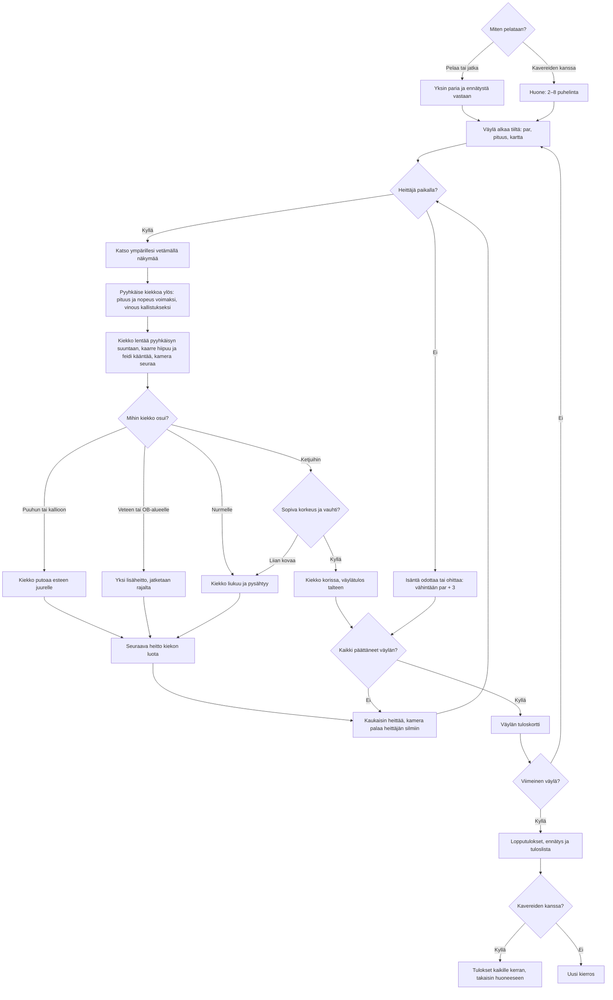

# Frisbeegolf: one round, from the first tee to the scorecard

How a round of Frisbeegolf plays (#338; from v5, #429, seen through the thrower's eyes). Nine
holes on a Finnish park and forest course drawn with three.js; the player looks around by
dragging the view and throws by swiping the held disc upward, a slanted swipe tilting it into a
curve, and the camera follows the disc in flight. The disc's flight, the trees, the water
and the chains of the basket are plain numbers the tests can drive. Alone the player plays
against the par and their own record; with friends, 2–8 phones throw in turn, the one furthest
from the basket first.

## Colours

- **blue**: what the player sees and does
- **amber**: a check that decides the path
- **teal**: the disc flying and landing
- **violet**: playing in a room
- **green**: a disc in the basket, and the round's result
- **rose**: a tree, water or out of bounds

## Boxes

- **Miten pelataan?**: `games/frisbeegolf/v5/index.html` and the handlers in `ui.js` offer a new round, a saved solo round, or `AiPelitRooms.open()`. `resumeRound()` in `game.js` restores the saved lie or the between-hole card. A reload during flight returns to the lie before that throw.
- **Huone: 2–8 puhelinta**: `room.js` uses `rooms.js` and `turns()`. The host owns every turn and score. Guests send round- and sequence-tagged throws; the host accepts only the current player's valid input. Guests replay the same seeded `fly()` and receive the host's result. A guest reload gets a snapshot through `hello`; a host reload sends everybody back to the room. The normal room page plays the game in a frame. From v3 the microphone sits at the top-left below the back chip; the roster keeps its original width below it in portrait and to its right in landscape, starting at 124 px to clear the speaking label as well as the chip. The landscape HUD starts at 4 px, leaving its wind row above the label. A real room test holds another phone’s microphone and checks the visible label against the roster. Tests check it stays clear of the wind label, map, roster, throw controls and final scorecard in portrait and landscape.
- **Väylä alkaa tiiltä: par, pituus, kartta**: `HOLES` in `games/frisbeegolf/v5/holes.js` defines nine holes, par 3–4, 45–140 m, total par 30. `scene.js` draws hills with blended fairway colours, rounded birches, layered spruces, a forest backdrop, meadow details, rocks, a pond with a shore, marked OB boundaries and the basket. Instanced meshes keep repeated scenery in a few draw calls. A sky dome follows the camera. `nextHole()` orders tee honours by the previous hole's strokes.
- **Heittäjä paikalla?**: `rooms.js` waits only for the player whose turn it is. `myTurn()` blocks input while paused; `hasTurn()` keeps the current player's controls ready when a previous pause clears.
- **Isäntä odottaa tai ohittaa: vähintään par + 3**: the `skip` handler in `room.js` finishes that player's current hole with `max(strokes, par + 3)`. The player can rejoin and play the following holes.
- **Katso ympärillesi vetämällä näkymää**: the `pointerdown` handler in `games/frisbeegolf/v5/ui.js` starts a view drag (`drag.type==='aim'`) anywhere except on the held disc: one canvas width turns half a circle and the height tilts the view (`view.yaw`, `view.pitch`); `aim.angle` follows the yaw. `drawScene()` in `scene.js` puts the camera at the lie, 1.5 m above `ground()`, with no figure drawn. A tap does not turn; cancellation, rotation and visibility changes end the gesture. The map button (`#map`) opens and closes a view from above the hole and keeps the round; while it is open, drags do nothing.
- **Pyyhkäise kiekkoa ylös: pituus ja nopeus voimaksi, vinous kallistukseksi**: the held disc (`heldDisc` in `scene.js`) sits at 72 % of the screen height while the camera rests at the thrower's eyes (`!scene3d.moving`). A drag starting on it is a swipe: `movePull()` in `ui.js` sets `aim.power` to the smaller of the upward length over 40 % of the screen height and the recent finger speed (`(speed/fullSpeed)^1.25`), and `aim.curve` from the swipe's slant (30° is full tilt; below 10 m a few pixels of slant are ignored). On release `makeSwipeLaunch()` turns the visible release point and the finger's velocity into a world `origin` and `velocity`, the climb capped 10–30° above the gaze. A swipe shorter than 24 px or under 6 % power is no throw. A guest sends the throw to the host (`t:'shot'`); `startShot()` in `game.js` checks every number, keeps the swipe path only when the release is within 3 m of the lie, and every throw uses the midrange disc (`disc:1`).
- **Kiekko lentää pyyhkäisyn suuntaan, kaarre hiipuu ja feidi kääntää, kamera seuraa**: `fly()` in `games/frisbeegolf/v5/flight.js` starts a swipe throw at its `origin` with its `velocity`, slows it (drag 0.16/s) and samples no more than 12 cm apart. The tilt pulls sideways at 10 m/s² × `curve`, dying out with a 1.4 s time constant while sideways drift is damped (0.4/s); a speed-based fade then turns the slow disc the other way. A throw without `velocity` (an old guest, a test) flies the older arc from `throwRange()`. `flightPoint()` interpolates the animation. `drawScene()` in `scene.js` chases the disc 6 m behind and 1.6 m above along its travel direction (a drag orbits it), then glides back to the thrower's eyes; it lowers pixel ratio and then shadows on a slow phone. Drawing rests when nothing moves and pauses when hidden.
- **Kiekko putoaa esteen juurelle**: a collision with a tree trunk or a rock drops the disc at its foot, 5 cm outside its collision footprint on the impact side, so the next throw can move away; separate tree and rock tests exercise that second throw. `puu` supplies the impact sound.
- **Yksi lisäheitto, jatketaan rajalta**: a final lie in water or beyond OB adds exactly one penalty stroke. `fly()` returns the last safe boundary point with a small inward margin. A throw may pass over water and land safely on the other side.
- **Sopiva korkeus ja vauhti?**: `catches()` requires 0.5–1.3 m above the basket ground, within 0.38 m of the pole, and speed no greater than `CHAIN_MAX` (9 m/s). A faster hit rattles out. The quieter `lib/aanet-5/` provides metal, success, wood and water sounds on every phone.
- **Kiekko korissa, väylätulos talteen**: `recordHole()` and a guest's `applyState()` immediately save that phone's per-hole best in `ai-pelit:frisbeegolf:vaylat`.
- **Kaukaisin heittää, kamera palaa heittäjän silmiin**: `nextThrower()` in `game.js` lets everyone tee off first, then chooses the unfinished player farthest from the basket. Ties retain tee order. `resetAim()` faces the basket, moves a lie closer than 2 m back to 2 m, and the next disc is held once the camera is back at the lie.
- **Väylän tuloskortti**: `showCard()` in `ui.js` shows the hole result; only the host advances a room to the next hole. Solo play saves the card so a reload can continue from it.
- **Lopputulokset, ennätys ja tuloslista**: `finishRecord()` saves the best round and played-round count. `showCard()` lists every solo hole and, in rooms, each player's total with per-hole details under their name. Short screens use two columns. From v5 the round goes to the new low `v5` list (`AiPelitScores.board('v5','Frisbeegolf v5+')`); `public/scores.js` shows it first and keeps the `v3` list (v3–v4's harder aiming) beside it as "Frisbeegolf v3–v4", and `server/api.js` accepts `v3` only from v3–v4 and `v5` only from v5 on (`boardVersions`, so the two throws' scores never mix), `v5` first on the shelf. Scores read against par as `E`, `−2` or `+5`. A first score queues immediately and asks for a nickname after the card appears. `0011_frisbeegolf_v3_scores.sql` removed only Frisbeegolf v1/v2 rows at the owner's request. A saved round without `rules: 5` (one started in v3 or v4) keeps its personal record but is not submitted to the v5 list. Phone records and saves (`ai-pelit:frisbeegolf:*`) are preserved. Kaaosrata v6 (#454) adds `hihna`, `laatat` and `finaali` to its separate score entry; `main` keeps its old times and remains its first list. This box keeps its existing behaviour. Kaaosrata v7 adds separate `hihna7`, `laatat7`, `finaali7` lists to this shared registry, retains its v6 lists for v6 only and keeps `main` unchanged.
- **Tulokset kaikille kerran, takaisin huoneeseen**: `deliver()` reliably sends the final state; `R.once(roomRound)` records it once per phone, including after reloading. The player dismisses the scorecard with `backToRoom()`.
