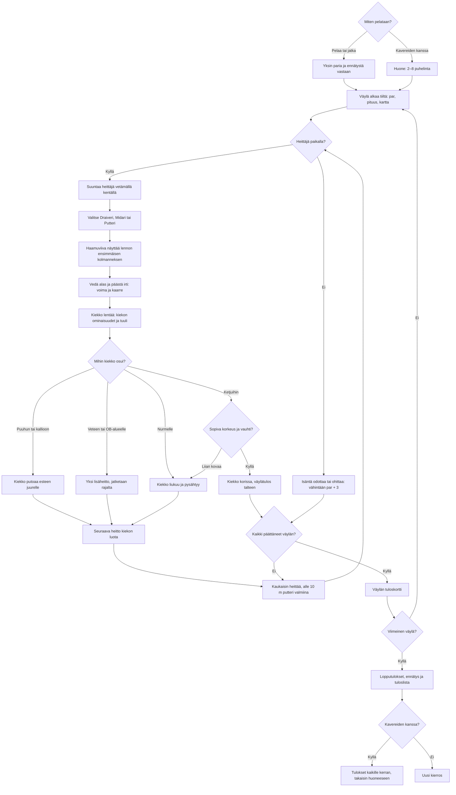

# Frisbeegolf: one round, from the first tee to the scorecard

How a round of Frisbeegolf plays (#338). Nine holes on a Finnish park and forest course
drawn with three.js; each throw is aimed by dragging across the course, the disc chosen, and the disc pulled down
and let go, sideways at the release giving it a curve. The disc's flight, the trees, the water
and the chains of the basket are plain numbers the tests can drive. Alone the player plays
against the par and their own record; with friends, 2–8 phones throw in turn, the one furthest
from the basket first.

## Colours

- **blue**: what the player sees and does
- **amber**: a check that decides the path
- **teal**: the disc flying and landing
- **violet**: playing in a room
- **green**: a disc in the basket, and the round's result
- **rose**: a tree, water or out of bounds

## Boxes

- **Miten pelataan?**: `games/frisbeegolf/v3/index.html` and the handlers in `ui.js` offer a new round, a saved solo round, or `AiPelitRooms.open()`. `resumeRound()` in `game.js` restores the saved lie or the between-hole card. A reload during flight returns to the lie before that throw.
- **Huone: 2–8 puhelinta**: `room.js` uses `rooms.js` and `turns()`. The host owns every turn and score. Guests send round- and sequence-tagged throws; the host accepts only the current player's valid input. Guests replay the same seeded `fly()` and receive the host's result. A guest reload gets a snapshot through `hello`; a host reload sends everybody back to the room. The normal room page plays the game in a frame. From v3 the microphone sits at the top-left below the back chip; the roster sits below it in portrait and to its right in landscape, keeping its original width. Tests check it stays clear of the wind label, map, roster, throw controls and final scorecard in portrait and landscape.
- **Väylä alkaa tiiltä: par, pituus, kartta**: `HOLES` in `games/frisbeegolf/v3/holes.js` defines nine holes, par 3–4, 45–140 m, total par 30. `scene.js` draws hills, trees, rocks, a pond, marked OB boundaries and the basket. `nextHole()` orders tee honours by the previous hole's strokes.
- **Heittäjä paikalla?**: `rooms.js` waits only for the player whose turn it is. `myTurn()` blocks input while paused; `hasTurn()` keeps the current player's controls ready when a previous pause clears.
- **Isäntä odottaa tai ohittaa: vähintään par + 3**: the `skip` handler in `room.js` finishes that player's current hole with `max(strokes, par + 3)`. The player can rejoin and play the following holes.
- **Suuntaa heittäjä vetämällä kentällä**: `moveAim()` in `ui.js` turns the player continuously with horizontal pointer movement: one canvas width turns half a circle. The initial angle and pointer position keep the drag stable while the camera follows. A tap does not turn; cancellation, rotation and visibility changes end the gesture. A second finger cannot steal aiming or start a simultaneous throw. The map uses the same drag and keeps the round.
- **Valitse Draiveri, Midari tai Putteri**: `DISCS` in `flight.js` supplies speed, glide, turn, fade and range. `resetAim()` selects a suitable disc; below 10 m it selects the putter and a finer power range.
- **Haamuviiva näyttää lennon ensimmäisen kolmanneksen**: `refreshPreview()` uses `fly()` with wind but without the hand's seeded shake. `game.js` keeps only the first third of its duration, ending at the interpolated flight point. `scene.js` redraws this short line as the direction, disc, power or curve changes. There is no landing marker; the player discovers the rest of the flight after release (owner's latest choice).
- **Vedä alas ja päästä irti: voima ja kaarre**: the pointer handlers in `ui.js` turn a downward pull into power and sideways movement into a curve. The pad leaves its whole range inside the screen in portrait and landscape. Cancellation and a tap do not throw; another finger cannot steal a pull.
- **Kiekko lentää: kiekon ominaisuudet ja tuuli**: `fly()` in `flight.js` samples at no more than 12 cm between points. `flightPoint()` interpolates the animation. `scene.js` follows the disc, then returns behind the new lie; it lowers pixel ratio and then shadows on a slow phone. Drawing rests when nothing moves and pauses when hidden.
- **Kiekko putoaa esteen juurelle**: a collision with a tree trunk or a rock drops the disc at its foot, 5 cm outside its collision footprint on the impact side, so the next throw can move away; separate tree and rock tests exercise that second throw. `puu` supplies the impact sound.
- **Yksi lisäheitto, jatketaan rajalta**: a final lie in water or beyond OB adds exactly one penalty stroke. `fly()` returns the last safe boundary point with a small inward margin. A throw may pass over water and land safely on the other side.
- **Sopiva korkeus ja vauhti?**: `catches()` requires 0.5–1.3 m above the basket ground, within 0.38 m of the pole, and speed no greater than `CHAIN_MAX` (9 m/s). A faster hit rattles out. The quieter `lib/aanet-5/` provides metal, success, wood and water sounds on every phone.
- **Kiekko korissa, väylätulos talteen**: `recordHole()` and a guest's `applyState()` immediately save that phone's per-hole best in `ai-pelit:frisbeegolf:vaylat`.
- **Kaukaisin heittää, alle 10 m putteri valmiina**: `nextThrower()` in `game.js` lets everyone tee off first, then chooses the unfinished player farthest from the basket. Ties retain tee order. A solo player continues from the same disc.
- **Väylän tuloskortti**: `showCard()` in `ui.js` shows the hole result; only the host advances a room to the next hole. Solo play saves the card so a reload can continue from it.
- **Lopputulokset, ennätys ja tuloslista**: `finishRecord()` saves the best round and played-round count. `showCard()` lists every solo hole and, in rooms, each player's total with per-hole details under their name. Short screens use two columns. `public/scores.js` and `server/api.js` register the low `main` list, shown against par as `E`, `−2` or `+5`. A first score queues immediately and asks for a nickname after the card appears.
- **Tulokset kaikille kerran, takaisin huoneeseen**: `deliver()` reliably sends the final state; `R.once(roomRound)` records it once per phone, including after reloading. The player dismisses the scorecard with `backToRoom()`.
