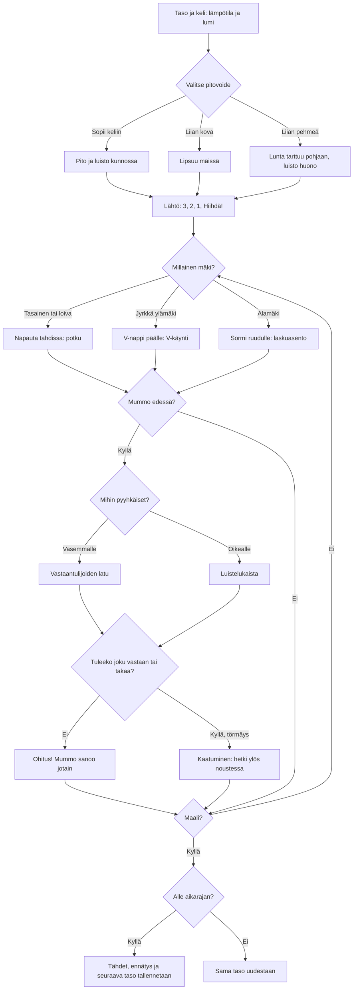

# Hiihto: one race, from the wax to the finish

How one race of Hiihto plays (v1). The player picks a grip wax for the day's weather, then skis
the classic track to the finish. Taps kick, a swipe changes track, the V button is for steep
climbs and a held finger is the tuck downhill. Grannies are overtaken on the oncoming track or
the skating lane, and running into anyone is a fall.

## Colours

- **blue**: the start of a level
- **amber**: a choice or check that decides the path
- **teal**: the three ways of moving, by the shape of the trail
- **violet**: the two lanes used for overtaking
- **green**: a good wax, a clean overtake, a level passed
- **rose**: a wrong wax, a fall, a level failed

## Boxes

- **Taso ja keli: lämpötila ja lumi**: `games/hiihto/v1/index.html` `weatherFor()`: levels 1-10 have set temperatures (`TEMPS`), later ones a random one from −18 to +3 °C. `buildCourse()` makes the course: 500 m at level 1, 100 m more each level, at most 1500 m; the second hill is always steep.
- **Valitse pitovoide**: `drawWax()` shows four waxes with their temperature ranges as on a real tube: green, blue, violet and klister. The arrows beside the level go back to any level already opened.
- **Lipsuu mäissä**: `waxFit()`: a wax made for colder weather loses 14 % of its grip per degree above its range (at least 35 % left), so kicks slip on climbs that a right wax holds.
- **Lunta tarttuu pohjaan, luisto huono**: a wax made for warmer weather adds 0.02 friction per degree below its range (at most 0.06), so the skier glides badly everywhere.
- **Napauta tahdissa: potku**: `kick()`: each tap is one diagonal-stride kick; it grips only when the wax grips enough for the slope (`kickNeed()`), and taps faster than about 2.7 a second kick weakly.
- **V-nappi päälle: V-käynti**: the V button (bottom left) toggles the V step: it grips on any climb but is slow on the flat and brakes downhill like a snowplough.
- **Sormi ruudulle: laskuasento**: a finger held still for 0.2 s is the tuck (`held()`), which cuts air drag to a third.
- **Mummo edessä?**: grannies ski the own track at about 2 m/s, slower uphill and faster downhill (`slopeFactor()`), and queue behind each other.
- **Vastaantulijoiden latu**: the left track; classic skiers come towards you on it.
- **Luistelukaista**: the right lane; skaters overtake from behind at 7-8 m/s and shout "Latua!" first, and the hint warns of one behind.
- **Kaatuminen: hetki ylös noustessa**: `crash()`: 1.6 s on the ground and the speed lost, then a moment when nobody can knock you down again.
- **Alle aikarajan?**: `finish()`: the time limit is 1.5 × the time a perfect skier needs on an empty trail (`idealTime()`); 3 stars within 1.15 ×, 2 within 1.3 ×. Saves `ai-pelit:hiihto:taso`, `:tahdet` and `:ajat`.
