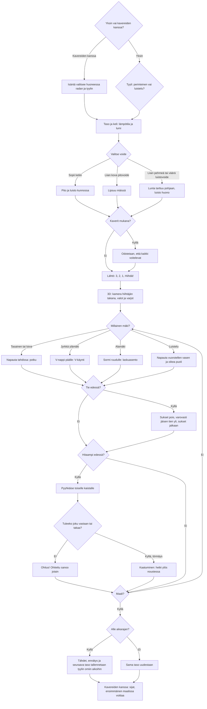

# Hiihto: one race, from the style and wax to the finish

How one race of Hiihto plays (v1–v9). From v7 the world is drawn in real 3D with three.js; the play is v6's. From v8 it also plays sideways, with the same rules. v9 makes the 3D finer. From v4, levels 3, 5, 7… cross a road on foot. Since v3 the player first picks a style: classic
(perinteinen) or skating (luistelu); a race with friends skis the host's course and style. The
player picks a wax for the day's weather (a grip wax for classic, a glide wax for skating), then
skis to the finish. Slower skiers are overtaken from another lane, running into anyone is a fall,
and times are kept apart for each style.

## Colours

- **blue**: the start of a level, and how it is drawn
- **amber**: a choice or check that decides the path
- **teal**: the ways of moving, by the style and the shape of the trail
- **violet**: overtaking, and the race with friends
- **green**: a good wax, a clean overtake, a level passed
- **rose**: a wrong wax, a fall, a level failed

## Boxes

- **Yksin vai kavereiden kanssa?**: `games/hiihto/v3/index.html` and `v4` `drawWax()`: alone, the panel before the race has the style switch, the level arrows and "👥 Pelaa kavereiden kanssa", which opens the shared room screen (`public/rooms.js`). From v5 that button sits 30 px below the waxes (8 px in v3–v4) and opens only on a finished tap (down and up on it), so a tap aimed at a wax never opens the friends game. From v6 the menu is drawn for the canvas's own box on the screen and a finger is read against that box (`resize()`, `at()`); v5 drew for the window's height but stretched the canvas to `100dvh`, so on some phones the buttons showed lower than where a tap landed. From v8, sideways (`LAND`, the canvas wider than tall), the menu and the end screens are drawn in two columns (`drawWaxLand()`, `drawResultLand()`, `drawNetResultLand()` in `landBox()`), the V button and the skating pads sit in the lower corners (`vButton()`, `skatePads()`), the road's button low on the right, and `render3d()` sizes the renderer and camera to the canvas each time it changes and shifts the picture 6 % down (`setViewOffset`) so the HUD stays in the sky; turning the phone mid-race keeps the race.
- **Tyyli: perinteinen vai luistelu?**: `setStyle()` saves the pick in `ai-pelit:hiihto:tyyli`; v1 and v2 saves stay as they were and are classic. The opened levels (`taso`) are shared by both styles.
- **Isäntä valitsee huoneessa radan ja tyylin**: `roomControls()` puts the level arrows and the two styles under the player list through `AiPelitRooms.extra()`; the others see who picks. At "Aloita kierros" `netStart()` sends everyone the host's level, style and a seed, so every phone has the same course and the same grannies and skaters to start with. A friend's own saved style is not changed.
- **3D: kamera hiihtäjän takana, valot ja varjot**: `games/hiihto/v7/index.html` loads three.js from the shared `lib/three-r187/` (`import()` in the game's own script, so the rest of the game and its tests stay as v6's). `build3d()` lays the land, the trail's lanes and tracks, the road, the spruces (two instanced meshes: those beside the trail cast shadows, a forest further out does not), the banners and posts, once per course; `skiers3d()` poses a simple jointed skier (`makeRig()`, `pose()`) for everyone in sight from the same numbers v6 drew from; `render3d()` puts the camera 5 m behind and 2.5 m above the skier and moves the sun's shadow box with them. The menus, HUD, speech bubbles (`screenOf()`) and snowfall are still drawn on the 2D canvas over it. `tune()`: on a phone below 40 frames a second it draws fewer pixels, then drops shadows below 28. With no WebGL the game still plays and says the phone cannot draw 3D. v9 (`games/hiihto/v9/index.html`, on v8's sideways layout), picked by the owner in a prototype over flat v6 figures on cards: brighter, whiter light with the sun behind the camera and softer shadows; finer skiers (`makeExtra()`, `dress()`: bent elbows and knees, neck, mittens, boots, turned-up ski tips, pole baskets, hat brim; skiers more than 40 m ahead skip these); poses that blend into each other (`pose()`, `r.sm`), a stride that swings from leg to leg at each kick, knees that give, a skater's weight over the gliding ski; 3D spruces in v6's flat colours, unlit (`spruce()`); a groove cut into the classic tracks for each ski (`GROOVES`, `lifted()`); and `tune()` steps down only below 27 frames a second, so a screen held at 30 does not blur (v7 and v8 stepped down below 40).
- **Taso ja keli: lämpötila ja lumi**: `weatherFor()`: levels 1-10 have set temperatures (`TEMPS`), later ones a random one from −18 to +3 °C. `buildCourse()` makes the course: 500 m at level 1, 100 m more each level, at most 1500 m; the second hill is always steep. The time limit is set for the style (`idealTime()` skis it with `botStep()`).
- **Valitse voide**: classic shows four grip waxes (`WAXES`), skating four glide waxes (`GLIDES`), each with its temperature range.
- **Lipsuu mäissä**: `waxFit()`: a grip wax made for colder weather loses 14 % of its grip per degree above its range (at least 35 % left), so kicks slip on climbs that a right wax holds.
- **Lunta tarttuu pohjaan, luisto huono**: a grip wax made for warmer weather adds 0.02 friction per degree below its range (at most 0.06); a glide wax made for other weather adds 0.012 per degree off (`glideFit()`, at most 0.05).
- **Odotetaan, että kaikki voitelevat**: `drawWait()` (from v6, as many names as fit and "+N" for the rest); a room holds up to six skiers, each in its own colour (`COLORS`). The host starts the countdown once every skier has a wax (`netTick()`). A phone away pauses the race for everyone until the host presses "Jatka ilman heitä"; then the computer skis for it (`cpuTakes()`), and gives it back where it got to. A finish the computer skied keeps its place in the race but is not saved as the player's own time (`arrived()`).
- **Napauta tahdissa: potku**: `kick()`: each tap is one diagonal-stride kick; it grips only when the wax grips enough for the slope (`kickNeed()`), and taps faster than about 2.7 a second kick weakly. v4 shows the speed at the top in the middle and a rhythm meter under the hint (`beat()`, `rhythmBar()`): it fills after each tap and turns green ("Nyt!") at 0.37 s, the fastest rhythm; a tap long before that turns it red with "Liian tiheään: odota vihreää" until the next full-strength moment (`meter()`).
- **V-nappi päälle: V-käynti**: the V button (bottom left) toggles the V step: it grips on any climb but is slow on the flat and brakes downhill like a snowplough. Classic only.
- **Sormi ruudulle: laskuasento**: a finger held still for 0.2 s is the tuck (`held()`), which cuts air drag to a third. Both styles.
- **Napauta vuorotellen vasen ja oikea puoli**: `push()`: a tap on the left half pushes off the left ski, on the right half the right one; the same ski twice is a weak push. In v4 the rhythm meter turns green at 0.32 s, the fastest rhythm for pushes. The yellow pad, "‹ vasen" or "oikea ›" in the middle of its half (`skatePads()`), shows which ski is next. Faster than the stride and needs no V step, since a skate's edge always grips.
- **Tie edessä?**: `buildCourse()` in `games/hiihto/v4/index.html`: levels 3, 5, 7… have an 8 m road at 45 % of the course, flat for 30 m each side, with a "⚠ TIE" post before it; the hint says "Tie edessä: hidasta!".
- **Sukset pois, varovasti jäisen tien yli, sukset jalkaan**: `roadStep()` and `roadTap()`: the skier stops at the edge (coming in faster than 4.5 m/s is a fall), a tap takes the skis off, each tap is a 0.9 m step and one before the meter turns green (0.45 s, the same moment) slips; on the far side a tap puts the skis on, but first snow in the bindings (likelier in wet snow, decided at the start, the same for a whole room) needs 4–6 knocks. The computer skier does the same in rhythm (`botStep()`), so the time limit counts the crossing. In a room each phone sends its road step and the snow left in its bindings (`pack()`), so the computer taking over a friend, or the friend back after a reload, carries on from the same step (`roadFrom()`); a skier put back past the road skis on.
- **Hitaampi edessä?**: classic: grannies on the own track at about 2 m/s. Skating: fitness skaters at 3.6–5 m/s on either half of the skating lane. Both go slower uphill and faster downhill (`slopeFactor()`) and queue behind each other on their track.
- **Pyyhkäise toiselle kaistalle**: classic: the oncoming track on the left, or the skating lane on the right, where fast skaters shout "Latua!" first. Skating: the other half of the skating lane, or the classic track, where the grannies scold.
- **Kaatuminen: hetki ylös noustessa**: `crash()`: 1.6 s on the ground and the speed lost, then a moment when nobody can knock you down again. Friends ski through each other.
- **Tähdet, ennätys ja seuraava taso tallennetaan tyylin omiin aikoihin**: `finish()`: 3 stars within 1.15 × the ideal time, 2 within 1.3 ×, 1 within the limit (1.5 ×). Classic saves `ajat` and `tahdet` and the online list `taso-N`; skating saves `luistelu-ajat` and `luistelu-tahdet` and the list `luistelu-N`. A race with friends is saved once (`AiPelitRooms.once()`).
- **Kavereiden kanssa: sijat, ensimmäinen maalissa voittaa**: `standings()`: finished skiers in the order the host saw them arrive, on its own race clock (`arrive()`, so a phone whose clock ran slow cannot win), then the rest by how far they got. Each phone still shows and saves its own time. The host ends the race when everyone is in, or a minute after the first finish (`LATE`), and sends the places to every phone (`deliver()`); a tap goes back to the room, with the place and everyone's times there. The host sends the results again to a phone that reloads after them (`lastEnd`).
