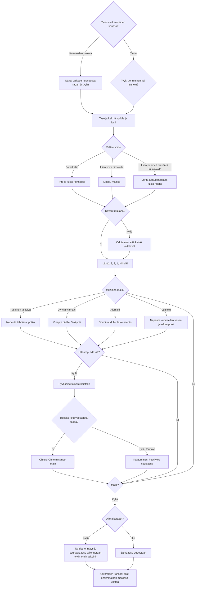

# Hiihto: one race, from the style and wax to the finish

How one race of Hiihto plays (v1–v4). Since v3 the player first picks a style: classic
(perinteinen) or skating (luistelu); a race with friends skis the host's course and style. The
player picks a wax for the day's weather (a grip wax for classic, a glide wax for skating), then
skis to the finish. Slower skiers are overtaken from another lane, running into anyone is a fall,
and times are kept apart for each style.

## Colours

- **blue**: the start of a level
- **amber**: a choice or check that decides the path
- **teal**: the ways of moving, by the style and the shape of the trail
- **violet**: overtaking, and the race with friends
- **green**: a good wax, a clean overtake, a level passed
- **rose**: a wrong wax, a fall, a level failed

## Boxes

- **Yksin vai kavereiden kanssa?**: `games/hiihto/v3/index.html` and `v4` `drawWax()`: alone, the panel before the race has the style switch, the level arrows and "👥 Pelaa kavereiden kanssa", which opens the shared room screen (`public/rooms.js`).
- **Tyyli: perinteinen vai luistelu?**: `setStyle()` saves the pick in `ai-pelit:hiihto:tyyli`; v1 and v2 saves stay as they were and are classic. The opened levels (`taso`) are shared by both styles.
- **Isäntä valitsee huoneessa radan ja tyylin**: `roomControls()` puts the level arrows and the two styles under the player list through `AiPelitRooms.extra()`; the others see who picks. At "Aloita kierros" `netStart()` sends everyone the host's level, style and a seed, so every phone has the same course and the same grannies and skaters to start with. A friend's own saved style is not changed.
- **Taso ja keli: lämpötila ja lumi**: `weatherFor()`: levels 1-10 have set temperatures (`TEMPS`), later ones a random one from −18 to +3 °C. `buildCourse()` makes the course: 500 m at level 1, 100 m more each level, at most 1500 m; the second hill is always steep. The time limit is set for the style (`idealTime()` skis it with `botStep()`).
- **Valitse voide**: classic shows four grip waxes (`WAXES`), skating four glide waxes (`GLIDES`), each with its temperature range.
- **Lipsuu mäissä**: `waxFit()`: a grip wax made for colder weather loses 14 % of its grip per degree above its range (at least 35 % left), so kicks slip on climbs that a right wax holds.
- **Lunta tarttuu pohjaan, luisto huono**: a grip wax made for warmer weather adds 0.02 friction per degree below its range (at most 0.06); a glide wax made for other weather adds 0.012 per degree off (`glideFit()`, at most 0.05).
- **Odotetaan, että kaikki voitelevat**: `drawWait()`; the host starts the countdown once every skier has a wax (`netTick()`). A phone away pauses the race for everyone until the host presses "Jatka ilman heitä"; then the computer skis for it (`cpuTakes()`), and gives it back where it got to. A finish the computer skied keeps its place in the race but is not saved as the player's own time (`arrived()`).
- **Napauta tahdissa: potku**: `kick()`: each tap is one diagonal-stride kick; it grips only when the wax grips enough for the slope (`kickNeed()`), and taps faster than about 2.7 a second kick weakly. v4 shows the speed at the top in the middle and a rhythm meter under the hint (`beat()`, `rhythmBar()`): it fills after each tap and turns green ("Nyt!") at 0.37 s, the fastest rhythm; a tap long before that turns it red with "Liian tiheään: odota vihreää".
- **V-nappi päälle: V-käynti**: the V button (bottom left) toggles the V step: it grips on any climb but is slow on the flat and brakes downhill like a snowplough. Classic only.
- **Sormi ruudulle: laskuasento**: a finger held still for 0.2 s is the tuck (`held()`), which cuts air drag to a third. Both styles.
- **Napauta vuorotellen vasen ja oikea puoli**: `push()`: a tap on the left half pushes off the left ski, on the right half the right one; the same ski twice is a weak push. In v4 the rhythm meter turns green at 0.32 s, the fastest rhythm for pushes. The yellow pad, "‹ vasen" or "oikea ›" in the middle of its half (`skatePads()`), shows which ski is next. Faster than the stride and needs no V step, since a skate's edge always grips.
- **Hitaampi edessä?**: classic: grannies on the own track at about 2 m/s. Skating: fitness skaters at 3.6–5 m/s on either half of the skating lane. Both go slower uphill and faster downhill (`slopeFactor()`) and queue behind each other on their track.
- **Pyyhkäise toiselle kaistalle**: classic: the oncoming track on the left, or the skating lane on the right, where fast skaters shout "Latua!" first. Skating: the other half of the skating lane, or the classic track, where the grannies scold.
- **Kaatuminen: hetki ylös noustessa**: `crash()`: 1.6 s on the ground and the speed lost, then a moment when nobody can knock you down again. Friends ski through each other.
- **Tähdet, ennätys ja seuraava taso tallennetaan tyylin omiin aikoihin**: `finish()`: 3 stars within 1.15 × the ideal time, 2 within 1.3 ×, 1 within the limit (1.5 ×). Classic saves `ajat` and `tahdet` and the online list `taso-N`; skating saves `luistelu-ajat` and `luistelu-tahdet` and the list `luistelu-N`. A race with friends is saved once (`AiPelitRooms.once()`).
- **Kavereiden kanssa: sijat, ensimmäinen maalissa voittaa**: `standings()`: finished skiers in the order the host saw them arrive, on its own race clock (`arrive()`, so a phone whose clock ran slow cannot win), then the rest by how far they got. Each phone still shows and saves its own time. The host ends the race when everyone is in, or a minute after the first finish (`LATE`), and sends the places to every phone (`deliver()`); a tap goes back to the room, with the place and everyone's times there. The host sends the results again to a phone that reloads after them (`lastEnd`).
