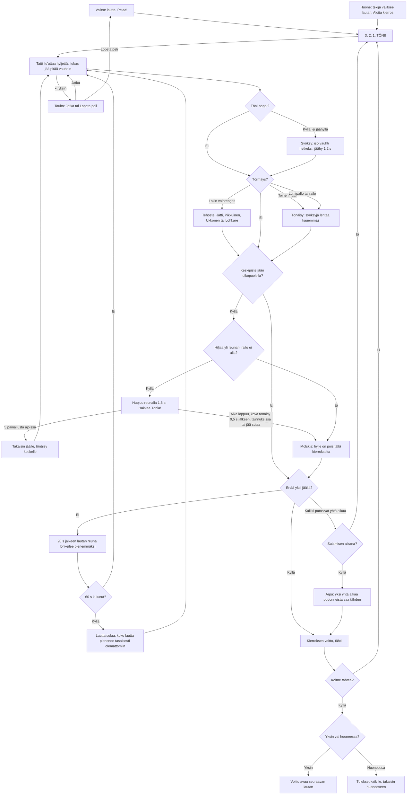

# Jäälautta: one round on the ice floe

How a match of Jäälautta plays (v1, #478; drawn in 3D from v2; friends' seals glide from v3, #480). Up to eight round, belly-sliding seals
stand on a floating ice floe seen from above, and each tries to shove the others into the sea.
The last one still on the ice wins the round; the first to win three rounds wins the match.
Alone the player meets three computer seals; in a room 2–8 phones play the same floe, and
computer seals fill the empty places up to four.

## Colours

- **blue**: what the player sees and does
- **amber**: a check that decides the path
- **teal**: a push, the heart of the game
- **rose**: losing ice, or falling in
- **violet**: the match in a room with friends
- **green**: a win or a new floe opened

## Boxes

- **Valitse lautta, Pelaa!**: the menu offers five floes (`FLOES` in `games/jaalautta/v3/world.js`); the next opens when the player wins a match alone on the newest open one, saved as `ai-pelit:jaalautta:auki`. The last floe picked is `ai-pelit:jaalautta:lautta`, the hat colour `ai-pelit:jaalautta:hattu`. "👥 Pelaa kavereiden kanssa" opens the room. A match alone is saved as `ai-pelit:jaalautta:kesken1` (floe, stars, next erä) when it starts and after each erä, never mid-erä; a reload plays that erä again from the start, and a save that does not read is dropped and the menu shows.
- **Huone: tekijä valitsee lautan, Aloita kierros**: `rooms.js` with `data-min="2" data-max="8"`; the host picks one of its own open floes under the player list (`RM.extra()`, `games/jaalautta/v3/net.js`). The host runs the only real world for every seal and sends it 15 times a second; computer seals fill up to four, and with seven or eight seals the floe is a quarter bigger. A guest sends its stick and lunge count 20 times a second, moves its own seal at once and is eased to the host's position. Up to v2 a guest slid the other seals on at their speed between states; from v3 (#480, `games/jaalautta/v3/net.js`, `lib/sulava-1/` loaded in `index.html`) each other seal keeps the newest spot the host sent and is drawn from its own `AiPelitSulava.track()` (keys `x`, `y`, `face`), a moment back, gliding between the states: each state carries the host's `AiPelitSulava.now()` as `st`, `heardSpot()` pushes the spot, and `asDrawn()` and `putBack()` swap the drawn spot in around `draw()` in `frame()` (`ui.js`). A seal in the water is drawn where it went in (`outX`, `outY`), except that the state saying it went in is ahead of the drawn moment: `asDrawn()` keeps drawing it dry from its track until the track's drawn time reaches that state's `st` (`fallSt`), and only then starts its splash, from the beginning (`outLag`). The tracks run on `netClock()`, which stands still while `RM.paused` (the host's world waits and sends nothing), on the host for its stamps and on a guest for arrivals and the drawn moment, so a moving seal is not guessed on and pulled back when the round goes on; `netTick()` reads it every frame, the pause too. The track starts again (`snap`) on a new erä (`era` changed), when a wobbling seal is mashed back onto the ice (`saved` rose), and on a move of over 8 units between two states (`SEAL_JUMP`). A guest judges no bump, so nothing else uses the drawn spot; the host draws its own world as it runs, with no track.
- **Tauko: Jatka tai Lopeta peli**: alone, a ⏸ button in the top right corner (v2) stops the erä (`pauseGame()` in `games/jaalautta/v3/ui.js`), as does leaving the app (`visibilitychange`). "Jatka" plays on from where it stopped; "Lopeta peli" drops `ai-pelit:jaalautta:kesken1`, so the match does not come back, and shows the menu; nothing is counted. In a room there is no ⏸: the host ends a round from the "‹ Pelit" chip (#392).
- **Tatti liu'uttaa hyljettä, liukas jää pitää vauhdin**: a finger anywhere but the button is a floating stick: where it touched down is the middle, and its direction and distance (up to 56 px) push the seal that way. On ice the seal keeps sliding after the finger lifts and slows only a little, so turning takes time.
- **Töni-nappi?**: the round "Töni" button in the lower right corner, fired on touch-down because timing is the game. It works only while the erä is on: a press during the countdown or between erät does nothing; a guest's press that reaches the host between erät is counted, never used, and the guest counts on from the host's number. `resetEra()` drops any press left pending.
- **Syöksy: iso vauhti hetkeksi, jäähy 1,2 s**: the seal lunges the way the stick points (or the way it faces, with no stick), counted even while the cooldown runs but done only once it is over; the button's ring fills back over the cooldown.
- **Tönäisy: syöksyjä lentää kauemmas**: two seals bounce like discs; a lunging seal counts 2.5 times heavier, so a well-timed lunge throws the other far and itself hardly moves. Jätti is heavier and Pikkuinen lighter.
- **Lumipallo tai railo**: on the third floe big snowballs roll across and shove whoever they hit; on the fourth, holes open in the ice: cracks flash for 1.5 s, then the hole is open water for 4 s.
- **Tehoste: Jätti, Pikkuinen, Ukkonen tai Lohkare**: a gull flies a lantern in and lights a ring on the ice 6 s into the erä, and again 6 s after each ring is gone; it glows 4 s (`POWERS` in `world.js`). The first seal in gets one at random: Jätti (big, heavy, 8 s), Pikkuinen (small, light, 8 s), both easing back to the seal's own size over their last second (`sized()`), Ukkonen (a 5 s cloud passed on by any touch; at its end every other seal is stunned 1.5 s), Lohkare (an 8 s ice block passed on by any touch; its last holder is pressed through the ice: from v2 the block drops onto it, it squashes flat, shards fly and both sink through a hole, `CRUSH_T` 1.3 s, drawn by `crush()` in `games/jaalautta/v3/three3d.js` and in `drawSeal()` in `ui.js`). A fuse passes on the first touch between its holder and another seal, whoever pushed whom (v2); straight back to the seal that gave it only after the two have parted (`PART_GAP`, `passFuse()` and `powers()`), so one touch passes it once. Only one is on the floe at a time. A computer seal keeps Ukkonen and runs from the others, who come to take it (not the one that just gave it, until they have parted); it passes Lohkare on to the nearest seal it may, and the others keep away from it (`decide()` in `ai.js`). The same four effects as the original's, with this game's own names and look.
- **Keskipiste jään ulkopuolella?**: a seal falls only when its centre leaves the ice (or is over an open hole), so half over the edge it still has a moment to scramble back; past that, a slow one wobbles on the edge (below) before it goes in.
- **Hiljaa yli reunan, railo ei alla?**: when a seal's centre leaves the ice slower than `TEETER_V` (9 from v2, was 6.5; a seal walking at full stick goes about 6, an ordinary shove less than 9, a lunge's full hit faster), it starts wobbling there instead of falling (`teeter()` in `games/jaalautta/v3/world.js`). Not over an open hole (straight in), and not where the edge has melted under about one and a half seal widths (straight in). The owner asked for this on #478, as in the genre's model.
- **Huojuu reunalla 1,6 s: Hakkaa Töniä!**: the seal rocks over the water and stays put; the stick does nothing, and each Töni press is a dot filled over it (`wobble()`), never a lunge. "Hakkaa Töniä!" shows above the button, which throbs, and a creak (`narina`) plays. A computer seal presses at a pace its floe's skill gives (`cpuThink()` in `ai.js`), and other computer seals within 5 come at it and, once its first `TEETER_SAFE` seconds are over and they are within 3.5, lunge into it (`lungeAt()`), since leaning does not tip it in. In a room the host counts the presses; a guest's own seal is drawn where the host has it.
- **5 painallusta ajoissa**: `TEETER_N` presses within `TEETER_T` (1.6 s) put the seal back just inside the edge, sliding inwards at 4, with the `onnistui` chime.
- **Aika loppuu, kova tönäisy 0,5 s jälkeen, tainnuksissa tai jää sulaa**: the time running out; another seal coming at it at `TIP_V` (3) or faster, once its first `TEETER_SAFE` (0.5 s) are over (v2: before, the seal that pushed it over was usually still touching it and sent it straight in); one standing by or leaning on it is only moved off and stopped (`nudge()`, a fuse still passes on the touch) or a snowball; the ice under it melting away. A seal stunned by Ukkonen cannot press, so it goes in when its time ends.
- **Molskis: hylje on pois tältä kierrokselta**: `loiskis` sound (a crushed one `tomahdys` too), rings on the water; its head bobs where it went in until the next erä.
- **20 s jälkeen lautan reuna lohkeilee pienemmäksi**: after 20 s, every 8 s a piece of each floe part's edge cracks (flashing 1.5 s ahead, `jaa` sound) and goes, never below a third of the start radius (the melt below then takes it all).
- **60 s kulunut?** and **Lautta sulaa**: from `SUDDEN_AT` (60 s) "Lautta sulaa!" shows above the floe and the whole floe melts evenly, `MELT` (a twentieth of its first radius) a second, down to nothing, so every erä ends by about 80 s, even in a room where nobody touches the screen.
- **Kierroksen voitto, tähti**: the last seal on the ice gets a star.
- **Kaikki putosivat yhtä aikaa** / **Sulamisen aikana?**: if the last seals fall in the same step before 60 s, nobody gets a star and the erä is played again (spec D8).
- **Arpa**: during the melt, one of the seals that went in together gets the star by lot (`tick()` in `world.js`), so the match always ends.
- **Voitto avaa seuraavan lautan**: alone, the end screen names the winner with everyone's stars, "Uusi ottelu" and "Valitse lautta". A win adds one to `ai-pelit:jaalautta:voitot`, sends that total to the high-score list (`AiPelitScores.submit`, list `main`) and opens the next floe; a loss saves and sends nothing.
- **Tulokset kaikille, takaisin huoneeseen**: the host's `deliver()` of the match result; each phone shows it once (`once()`; a phone that already saw it goes straight back to the room) and saves nothing lasting, then "Takaisin huoneeseen". A seal the computer drove for an away phone ("Jatka ilman heitä") is marked so.
