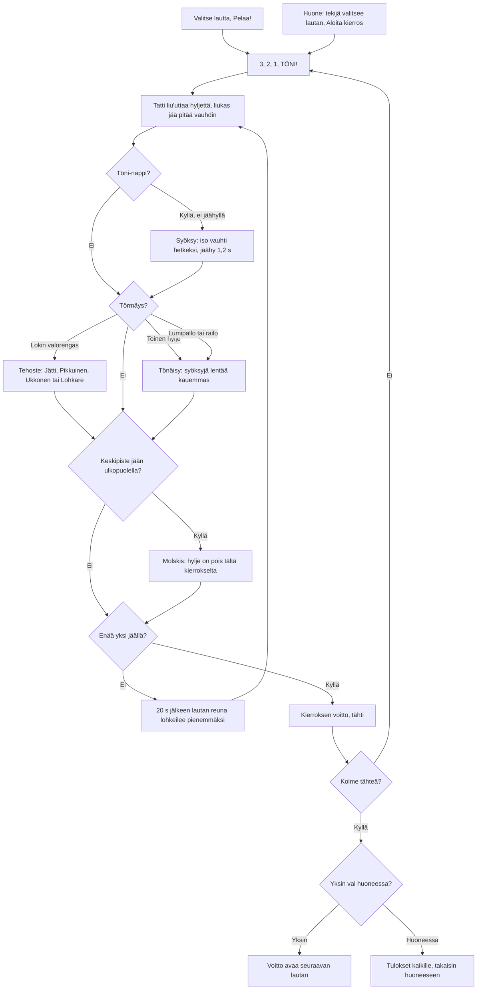

# Jäälautta: one round on the ice floe

How a match of Jäälautta plays (v1, #478). Up to eight round, belly-sliding seals
stand on a floating ice floe seen from above, and each tries to shove the others into the sea.
The last one still on the ice wins the round; the first to win three rounds wins the match.
Alone the player meets three computer seals; in a room 2–8 phones play the same floe, and
computer seals fill the empty places up to four.

## Colours

- **blue**: what the player sees and does
- **amber**: a check that decides the path
- **teal**: a push, the heart of the game
- **rose**: losing ice, or falling in
- **violet**: the match in a room with friends
- **green**: a win or a new floe opened

## Boxes

- **Valitse lautta, Pelaa!**: the menu offers five floes (`FLOES` in `games/jaalautta/v1/world.js`); the next opens when the player wins a match alone on the newest open one, saved as `ai-pelit:jaalautta:auki`. The last floe picked is `ai-pelit:jaalautta:lautta`, the hat colour `ai-pelit:jaalautta:hattu`. "👥 Pelaa kavereiden kanssa" opens the room. A match alone is saved as `ai-pelit:jaalautta:kesken1` (floe, stars, next erä) when it starts and after each erä, never mid-erä; a reload plays that erä again from the start, and a save that does not read is dropped and the menu shows.
- **Huone: tekijä valitsee lautan, Aloita kierros**: `rooms.js` with `data-min="2" data-max="8"`; the host picks one of its own open floes under the player list (`RM.extra()`, `games/jaalautta/v1/net.js`). The host runs the only real world for every seal and sends it 15 times a second; computer seals fill up to four, and with seven or eight seals the floe is a quarter bigger. A guest sends its stick and lunge count 20 times a second, moves its own seal at once and is eased to the host's position.
- **Tatti liu'uttaa hyljettä, liukas jää pitää vauhdin**: a finger anywhere but the button is a floating stick: where it touched down is the middle, and its direction and distance (up to 56 px) push the seal that way. On ice the seal keeps sliding after the finger lifts and slows only a little, so turning takes time.
- **Töni-nappi?**: the round "Töni" button in the lower right corner, fired on touch-down because timing is the game.
- **Syöksy: iso vauhti hetkeksi, jäähy 1,2 s**: the seal lunges the way the stick points (or the way it faces, with no stick), counted even while the cooldown runs but done only once it is over; the button's ring fills back over the cooldown.
- **Tönäisy: syöksyjä lentää kauemmas**: two seals bounce like discs; a lunging seal counts 2.5 times heavier, so a well-timed lunge throws the other far and itself hardly moves. Jätti is heavier and Pikkuinen lighter.
- **Lumipallo tai railo**: on the third floe big snowballs roll across and shove whoever they hit; on the fourth, holes open in the ice: cracks flash for 1.5 s, then the hole is open water for 4 s.
- **Tehoste: Jätti, Pikkuinen, Ukkonen tai Lohkare**: a gull flies a lantern in and lights a ring on the ice 6 s into the erä, and again 6 s after each ring is gone; it glows 4 s (`POWERS` in `world.js`). The first seal in gets one at random: Jätti (big, heavy, 8 s), Pikkuinen (small, light, 8 s), Ukkonen (a 5 s cloud passed on by any touch; at its end every other seal is stunned 1.5 s), Lohkare (an 8 s ice block passed on by any touch; its last holder is pressed through the ice). A fuse cannot pass back within 0.5 s, and only one is on the floe at a time. The same four effects as the original's, with this game's own names and look.
- **Keskipiste jään ulkopuolella?**: a seal falls only when its centre leaves the ice (or is over an open hole), so half over the edge it still has a moment to scramble back.
- **Molskis: hylje on pois tältä kierrokselta**: `loiskis` sound (a crushed one `tomahdys` too), rings on the water; its head bobs where it went in until the next erä.
- **20 s jälkeen lautan reuna lohkeilee pienemmäksi**: after 20 s, every 8 s a piece of each floe part's edge cracks (flashing 1.5 s ahead, `jaa` sound) and goes, never below a third of the start radius, so every erä ends: within 90 s in the tests' matches.
- **Kierroksen voitto, tähti**: the last seal on the ice gets a star; if the last two fall in the same step, nobody does and the next erä is played.
- **Voitto avaa seuraavan lautan**: alone, the end screen names the winner with everyone's stars, "Uusi ottelu" and "Valitse lautta". A win adds one to `ai-pelit:jaalautta:voitot`, sends that total to the high-score list (`AiPelitScores.submit`, list `main`) and opens the next floe; a loss saves and sends nothing.
- **Tulokset kaikille, takaisin huoneeseen**: the host's `deliver()` of the match result; each phone shows it once (`once()`; a phone that already saw it goes straight back to the room) and saves nothing lasting, then "Takaisin huoneeseen". A seal the computer drove for an away phone ("Jatka ilman heitä") is marked so.
