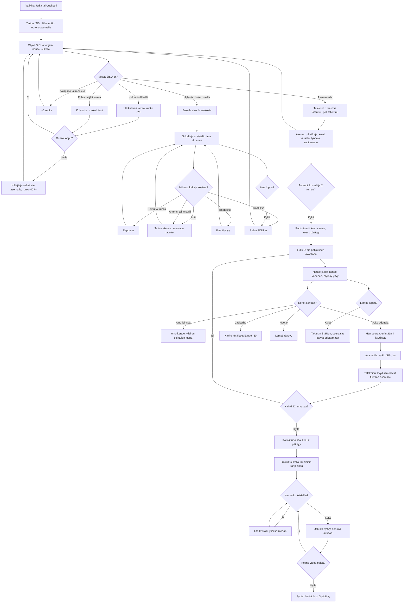

# Jään alla: luvut 1–3, sukellusvene, sukeltaja, jäällä kulkija ja rauniot

How chapter 1 of Jään alla plays (v1, #106). The player drives the one-person submarine SISU
under the arctic ice from Aurora station to the RV Nordlys wreck, the iceberg cave and the
crystal cave, swims inside them as a diver, and brings the radio antenna, a glowing crystal and
scrap home to fix the radio mast. Air, power, food and hull are the four needs; running out of
air or hull sends the player back to safety, never ends the story. Chapter 2 (v3) follows on: SISU
surfaces through an opening in the ice at the northern shore, the player walks the ice in a storm,
finds Aino's camp and the five who left it, and ferries all twelve to the station, four a trip.
Chapter 3 (v4) opens the ancient ruins in the deep canyon: the diver carries crystals to stone
sockets that open the doors, reads the murals, and wakes the Heart.

## Colours

- **blue**: what the player sees and does first
- **amber**: a check that decides the path
- **teal**: places and moving between SISU and the diver
- **green**: supplies and air gained
- **violet**: the story moving on
- **rose**: danger and the rescue that follows

## Boxes

- **Valikko: Jatka tai Uusi peli**: `games/jaan-alla/v1/index.html`, `showMenu()`. "Jatka" shows only when `ai-pelit:jaan-alla:peli` holds a save; "Uusi peli" over a save asks for a second tap first. v2 (#95) plays sideways too: the menu, and every story and station card, in two columns (text left, buttons right); the meters, goal and bag in one thin row at the top; the stick lower left, dive, rise and the action button lower right.
- **Tarina: SISU lähetetään Aurora-asemalle**: `newGame()` starts a fresh save (`fresh()`) and shows the intro panel.
- **Ohjaa SISUa: ohjain, nouse, sukella**: `stepSub()`: the stick turns and drives (12 m/s at most), the ▲ ▼ buttons rise and sink; `collideSub()` keeps SISU under the ice, above `floorY()` and out of the spheres and columns in `SPHERES` and `COLUMNS`. Driving uses power; the reactor gives a little back. With no power SISU crawls at 35 %, hungry at 70 %.
- **Missä SISU on?**: `currentAction()` shows the yellow action button when SISU is under the station's moon pool or within 15 m of a place's door (the blinking yellow light). `goal()` picks the current goal, shown at the top with an arrow and distance, and as a light column in the sea.
- **Telakoidu: reaktori latautuu, peli tallentuu**: `dock()` fills power and saves.
- **Asema: päiväkirja, kalat, varasto, työpaja, radiomasto**: `stationPanel()`: the log (`STATION_LOG`) sets the first goal; the fish farm gives 2 food every 2 minutes of play; the store gives 2 food and 1 scrap the first time and 1 scrap every 2 minutes of play after that, so scrap spent on repairs can never leave the radio unfixable; the workshop mends the hull fully for 1 scrap. Once the radio works, its button only replays Aino's message.
- **Sukella ulos ilmalukosta**: `enterSite()` first saves SISU's place outside, then builds the inside from the site's grid (`SITES[...].map`, `buildRoom()`) and puts the diver just inside the airlock with full air.
- **+1 ruoka**: a fish school (`SCHOOLS`, once a minute each) or the kelp forest (`KELP`, every 45 s) adds a food can to the bag; the 🎒 button eats one for +35 % food.
- **Jättikalmari tarraa: runko -20**: `stepSquid()`: the squid circles the crystal cave, chases SISU within 28 m, and after a grab swims home for 6 s. SISU outruns it.
- **Kolahdus: runko kärsii**: hitting anything faster than 5 m/s costs hull.
- **Hätäjärjestelmä vie asemalle, runko 40 %**: `hullOut()`; inventory and story are kept.
- **Sukeltaja ui sisällä, ilma vähenee**: `stepDive()`: grid collision with walls, air falls 1.3 % a second (2 % hungry); the camera stays out of walls (`drawDiver()`).
- **Mihin sukeltaja koskee?**: things are taken on touch (`take()`); taken ones are kept in the save (`taken`) and stay gone.
- **Tarina etenee: seuraava tavoite**: the Nordlys log, the cave message, the antenna and the crystal each set a flag that `goal()` reads.
- **Ilmatasku**: an `A` cell refills air at 40 % a second.
- **Ilma loppu?**: `airOut()` puts the player back in SISU at the door, keeping what was found.
- **Antenni, kristalli ja 2 romua?**: `mast()` says what is missing, or fixes the radio.
- **Radio toimii: Aino vastaa, luku 1 päättyy**: sets `flags.radio`, writes `ai-pelit:jaan-alla:luku1` (play time), and the player may keep exploring.
- **Luku 2: aja pohjoiseen avantoon**: `games/jaan-alla/v3/index.html`. Fixing the radio (`mast()`) fills `G.s.crew` with the twelve (`CREW`); an older version's save that finished chapter 1 gets them in `loadSave()`. `goal()` points at `HOLE`, the opening in the ice by the northern shore, where the floor rises (`floorY()`).
- **Nouse jäälle: lämpö vähenee, myrsky yltyy**: `surface()` switches to the ice scene (`ice`), its own coordinates with the hole at 0, 0. `stepIce()` walks with the stick, blocked by ridges and tents (`ICE_ROCKS`) and the storm's edge (`ICE_R`). Warmth falls 0.8–1.7 % a second; `storm()` grows with everyone saved, thickening the fog and the snow in `drawIce()`.
- **Kenet kohtaat?**: people within 2.6 m of the walker; seven wait at the camp, five far out by red flares.
- **Aino kertoo: viisi on soihtujen luona**: `meetAino()`, once.
- **Hän seuraa, enintään 4 kyydissä**: followers plus those already aboard never pass `SEATS` (4); followers walk in a line behind the walker.
- **Karhu tönäisee: lämpö -30**: `stepBear()`: the bear wanders near its home, chases within 14 m slower than the walker, shoves once and walks home for 8 s.
- **Lämpö täyttyy**: within 7 m of the fire (`FIRE`), +25 % a second.
- **Takaisin SISUun, seuraajat jäävät odottamaan**: `coldOut()`; followers stay where they stood.
- **Avannolla: kaikki SISUun**: `boardSisu()` at the hole puts followers aboard (`at: 'sub'`); a reload never leaves anyone following.
- **Telakoidu: kyydissä olevat turvaan asemalle**: `dock()` → `unload()`; the station card counts the saved.
- **Kaikki turvassa: luku 2 päättyy**: `rescuedPanel()` sets `flags.rescued` and writes `ai-pelit:jaan-alla:luku2`.
- **Luku 3: sukella raunioihin kanjonissa**: `games/jaan-alla/v4/index.html`. The ruins (`SITES.rauniot`, temple and columns at `RX`, `RZ`) open only once `flags.rescued` is set; `goal()` points there. Inside, three murals (`MURALS`) tell the story of the Light Keepers once each (`G.s.read`).
- **Kannatko kristallia?**: `G.s.carry`, saved, so a reload keeps the crystal in hand; a carried crystal shows in the diver's hands (`carryMesh`).
- **Ota kristalli, yksi kerrallaan**: `ruinsTouch()` on a `C` cell; a second crystal stays put while one is carried.
- **Jalusta syttyy, sen ovi aukeaa**: a crystal on socket 1, 2 or 3 sets `G.s.lit`, and its door (`SOCKET_DOOR`: a, b, c) stops being a wall in `isWall()`. Any crystal fits any socket.
- **Kolme valoa palaa?**: `litCount()`.
- **Sydän herää: luku 3 päättyy**: touching the Heart (`H`) with three lights lit sets `flags.heart`, writes `ai-pelit:jaan-alla:luku3` and shows `heartPanel()` with the chapter 4 teaser.
