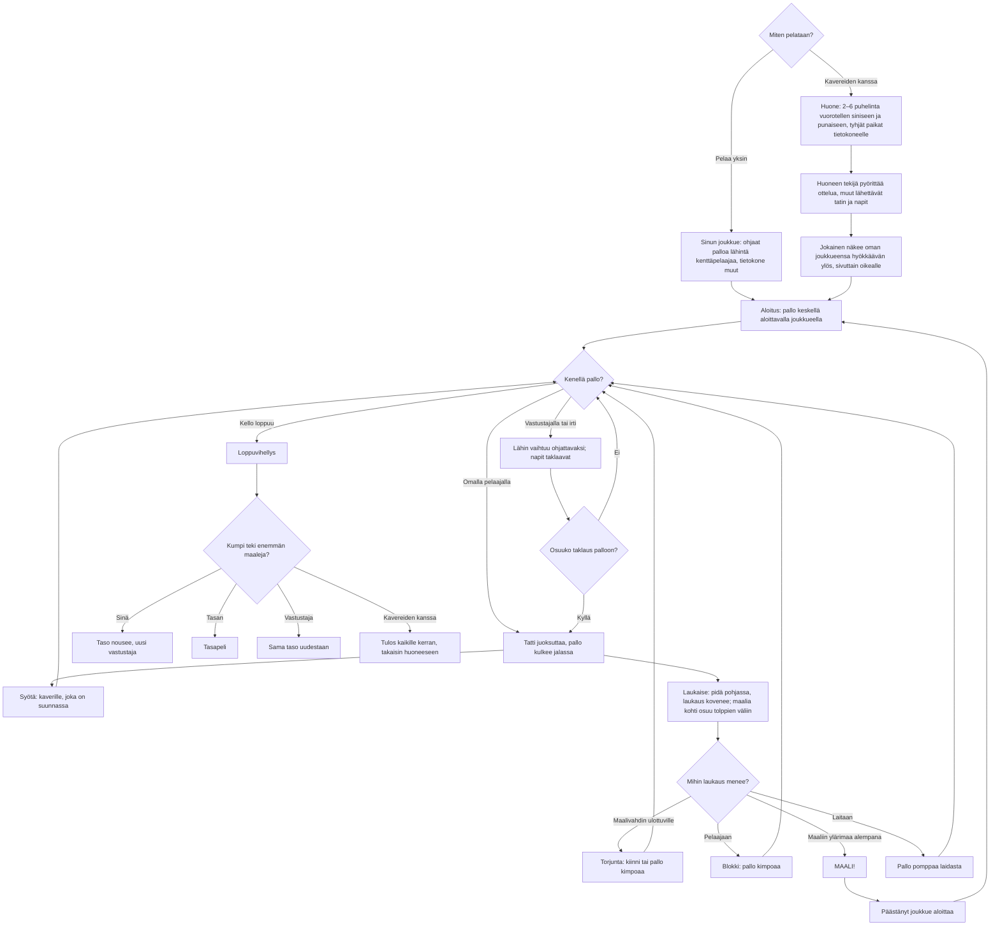

# Jalkapallo: one match, from the kickoff to the final whistle

How a match of Jalkapallo plays. Football seen from above, 3 vs 3 (two field players and a
keeper a side), a three-minute match. Alone, the phone steers the field player nearest the ball
and the computer moves everyone else; with friends, 2–6 phones split into two teams through the
shared room library (see `moninpeli.md`) and the computer fills the empty spots. Sideways the
pitch turns to run across the screen (see `landscape.md`).

## Colours

- **blue**: what the player sees and does
- **amber**: a check that decides the path
- **teal**: the ways to play the ball
- **violet**: playing in a room, and the ball bouncing off someone or something
- **green**: a goal or a win
- **rose**: a lost match

## Boxes

- **Miten pelataan?**: the menu in `games/jalkapallo/v1/index.html`: **Pelaa yksin** (`newMatch()`), or **Jatka ottelua** when a match alone was left unfinished (it is saved every second as `ai-pelit:jalkapallo:ottelu` by `keepMatch()`, so a reload or a trip to the shelf does not lose it), or **👥 Pelaa kavereiden kanssa** (`AiPelitRooms.open()`; the room screen says how phones are split, `roomNote()`).
- **Sinun joukkue: ohjaat palloa lähintä kenttäpelaajaa, tietokone muut**: one entry in `ctrls` with `fixed: -1`; `autoSwitch()` hands the phone the field player nearest the ball (never the keeper) when it is 2 m nearer than the one it steers, and `take()` hands it whoever gets a pass. The computer's players run `cpuThink()`; its teammates play as level 3, the opponents as this phone's level (`skill()`).
- **Huone: 2–6 puhelinta vuorotellen siniseen ja punaiseen, tyhjät paikat tietokoneelle**: `setupFor()` on the host: phones alternate between the teams in room order. A phone alone on its team follows the ball as above, owns no player, and its name shows on whichever player it steers now (`ctrlName()`), the goal message too; two phones on a team keep their own field player each and the computer keeps goal; three play every spot. The host sends it as `setup`, and again to a phone that comes back (`on('hello')`). A phone let go with "Jatka ilman heitä" is played by the computer (`on('continue')`, `k.away`).
- **Huoneen tekijä pyörittää ottelua, muut lähettävät tatin ja napit**: the host runs the rules, the ball and the computer's players and sends `s` 20 times a second (`snapshot()`); a guest sends its joystick as `i` 20 times a second and each button as `a` at once (`act()`), and draws from `applySnapshot()`.
- **Jokainen näkee oman joukkueensa hyökkäävän ylös, sivuttain oikealle**: `view` turns the pitch round on a phone of team 1; `P()` and `dirS()` map the world to the screen, upright or sideways (`wide`, from `resize()`), and `setStick()` maps the joystick back.
- **Aloitus: pallo keskellä aloittavalla joukkueella**: `kickoff()`: everyone in their own half, the ball with the kicking team's front player. A phone's player starts it with a button or by running off the spot; the computer after 0.8 s.
- **Tatti juoksuttaa, pallo kulkee jalassa**: `steerCtrl()`; the ball sits just in front of the owner's feet (`stepBall()`), a little slower than running without it. A player who walks into the goal with the ball scores.
- **Syötä: kaverille, joka on suunnassa**: `pass()` → `passTarget()`: the teammate most in the joystick's (or facing) direction, led a little; over 15 m the pass is lofted over the players between.
- **Laukaise: pidä pohjassa, laukaus kovenee; maalia kohti osuu tolppien väliin**: holding the button 0.8 s gives full power (a ring round the button shows it); `shoot()` pulls a shot aimed within about 40° of the goal inside the posts, then adds a small error.
- **Lähin vaihtuu ohjattavaksi; napit taklaavat**: without the ball either button is `tackle()`: a short lunge.
- **Osuuko taklaus palloon?**: `contest()`: a lunge that reaches the ball takes it and stuns the owner a moment; a foe merely touching the ball takes it now and then.
- **Torjunta: kiinni tai pallo kimpoaa**: `pickUp()`: a keeper in its box reaches further, and holds a hard shot by its level's `save` chance; otherwise it parries. The computer's keeper stands between the ball and the goal and dives to a shot after its reaction time, guessing the line a little wrong (`cpuThink()`); it throws the ball to its most open teammate after 0.9 s.
- **Blokki: pallo kimpoaa**: a field player in the way of a hard shot blocks it; a softer ball is simply taken.
- **MAALI!**: `goal()`: across the line between the posts and under the bar (2.2 m). The scorer's name, or "Sinä teit maalin!" on the phone that steered them.
- **Pallo pomppaa laidasta**: the pitch has boards all round, so the ball never goes out.
- **Loppuvihellys**: `clock` runs only while the ball is in play.
- **Kumpi teki enemmän maaleja?**: `endMatch()` saves `ai-pelit:jalkapallo:taso`, `voitot`, `tasapelit` and `haviot`; a win raises the level, which makes the opponents quicker, quicker to react, surer in their aim and their keeper safer.
- **Tulos kaikille kerran, takaisin huoneeseen**: `hostEnd()` → `AiPelitRooms.deliver()`; every phone saves its result once (`once()`) in `ai-pelit:jalkapallo:kaverit` and goes back to the room (`backToRoom()`). The end names each phone's team, so a phone that reloads after missing it still knows its result (`finish()`).
