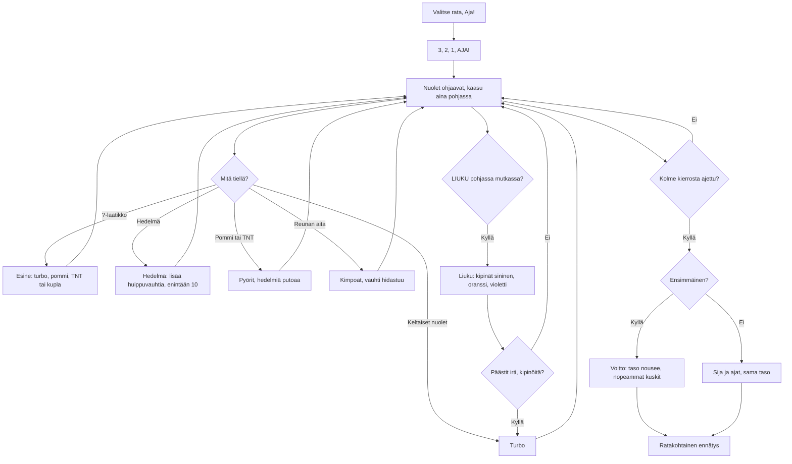

# Kaahari: one kart race

How one race of Kaahari plays (v1). The player drives a kart seen from behind it, three laps
round one of three tracks against five computer drivers. The gas is always on: the player
steers, slides through bends for a turbo, and picks up items and fruit on the way.

## Colours

- **blue**: what the player sees and does
- **amber**: a check that decides the path
- **teal**: what helps the kart go faster
- **rose**: a knock, a slow-down or a lost race
- **green**: a win or a record

## Boxes

- **Valitse rata, Aja!**: the menu's three track buttons (`showMenu()` in `games/kaahari/v1/index.html`) pick Hiekkaranta, Viidakko or Laavaluola (saved as `rata`); `soloRace()` paints the track's ground picture (`paintTrack()`), plants its trees (`plantScenery()`) and puts the player at the back of a grid of six.
- **3, 2, 1, AJA!**: `tick()` counts `race.cdT` to 3 s; nobody moves before it.
- **Nuolet ohjaavat, kaasu aina pohjassa**: the ◀ ▶ buttons (`which()`, `syncInput()`) steer, eased in over about a tenth of a second; `drive()` speeds the kart up to its top speed by itself. Off the road, on the verge, the top speed is about half. The ground is drawn from behind the kart, row by row, by `ground()`, and everything standing on it by `draw()`.
- **Mitä tiellä?**: `pickups()` for crates, fruit, bombs and TNT boxes; `drive()` for the turbo pads and the barrier; `collide()` pushes karts apart.
- **Esine: turbo, pommi, TNT tai kupla**: `giveItem()`: the drivers behind get more turbos and bombs, the leader more TNT boxes. `useItem()` (the ESINE button) fires it: a turbo, a bomb that rolls forward along the road, a TNT box left behind, or a bubble that takes one hit.
- **Hedelmä: lisää huippuvauhtia, enintään 10**: each fruit adds 1.5 % to the top speed; a fruit comes back after 8 s.
- **Turbo**: `k.boost` raises the top speed by 38 % while it lasts; from a turbo pad 0.8 s, from the ?-box turbo 1.3 s.
- **Pyörit, hedelmiä putoaa**: `hit()`: the kart spins for 1.1 s, loses its slide and turbo and three fruit, unless a bubble takes the hit.
- **Kimpoat, vauhti hidastuu**: past the verge (`WALL`) `drive()` puts the kart back inside, cuts its speed to 60 % and turns its nose along the barrier.
- **Liuku: kipinät sininen, oranssi, violetti**: holding LIUKU at speed hops the kart; the first arrow pressed picks the slide's way. Sliding, the kart keeps turning that way and the arrows only tighten or widen the turn. After 0.7 s the sparks are blue, after 1.4 s orange, after 2.1 s purple (`TIERS`).
- **Päästit irti, kipinöitä?**: letting go gives a turbo of 0.55, 0.9 or 1.35 s by the spark colour (`TIER_BOOST`); a shorter slide gives nothing.
- **Kolme kierrosta ajettu?**: `k.prog` counts the distance along the track past the line; each full lap behind adds one, and the third finishes the kart (`fin`).
- **Voitto: taso nousee, nopeammat kuskit**: `finishMe()` saves `taso`, `voitot` and `kisat`; a higher level makes the computer drivers faster (`cpuSkill()`) and gives them more turbos out of bends (`think()`).
- **Sija ja ajat, sama taso**: `showResult()` lists the finishing order, every driver's time and the player's best lap; a driver still on the track gets the time it would finish in at its average speed so far.
- **Ratakohtainen ennätys**: the fastest race on each track is saved in `ennatykset` and shown on its track button.
