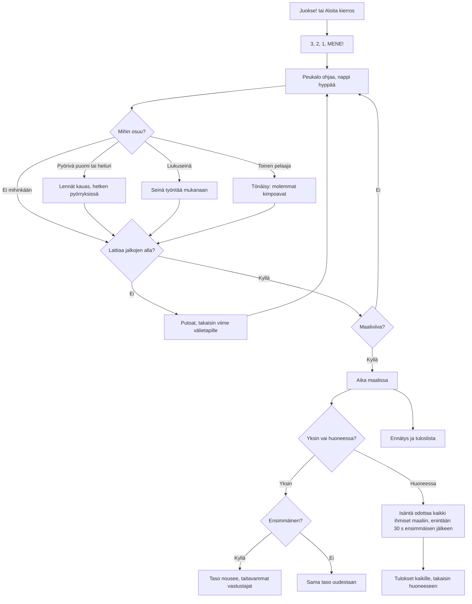

# Kaaosrata: one obstacle race, alone or with friends

How one race of Kaaosrata plays (v1). Jellybean players run up a course seen from above, through
five obstacle sections, and bump into each other on the way; off the floor you fall and come
back at the last checkpoint. Alone it is a race against seven computer players of the player's
level; in a room each phone runs its own player, and the phone that made the room (the host)
moves the computer players and ends the race.

## Colours

- **blue**: what the player sees and does
- **amber**: a check that decides the path
- **teal**: players and walls pushing each other
- **violet**: the race in a room with friends
- **green**: a finish, a record or a win
- **rose**: a knock, a fall or a lost race

## Boxes

- **Juokse! tai Aloita kierros**: `soloRace()` in `games/kaaosrata/v1/index.html` starts the player against seven computer players whose skill rises with the level; in a room, `R.on('start')` gives each phone in the round its own player (2–8 phones) and fills the start up to six with computer players.
- **3, 2, 1, MENE!**: `tick()` counts `race.cdT` to 3 s; in a room only the host counts and the others follow its `s` messages. Nobody moves or jumps before it.
- **Peukalo ohjaa, nappi hyppää**: a thumb anywhere drags a stick from where it lands (`pointerdown`/`pointermove`, `input`); the round button bottom right jumps (`press()` → `jump()`, held 0.15 s so an early tap still counts). `move()` runs at 5.5 m/s, jumps about 1.3 m high, and carries the player with a moving floor (`groundAt()`).
- **Mihin osuu?**: `hits()` for the bars (`SWEEPERS`, low enough to jump), the sliding walls (`PUSHERS`, too tall to jump), the bumpers and the hammers (`HAMMERS`); `bumps()` for the players.
- **Lennät kauas, hetken pyörryksissä**: `knock()`: thrown the way the bar or ball moves, 0.6–0.7 s with little control.
- **Seinä työntää mukanaan**: a wall moving into the player pushes it along, off the edge if it does not get out of the way.
- **Tönäisy: molemmat kimpoavat**: `bumps()` pushes apart every player moved on this phone, harder the faster they met; a player moved on another phone gets its own push there. A player who has finished passes through everyone, so it cannot change a result still being raced.
- **Lattiaa jalkojen alla?**: `groundAt()`: the floors, the stepping stones, the sliding platform and the three spinning discs; over nothing for 0.1 s means falling.
- **Putoat, takaisin viime välietapille**: `respawn()` after 1.1 s at the last of the checkpoints (`CPS`, the green dashed lines) the player has stood past.
- **Aika maalissa**: `move()` sets `fin` when the player crosses 140 m, to 1/100 s. From then on the player stands still where it crossed (`tick()` skips it on every phone, and it bumps nobody) until the race ends.
- **Taso nousee, taitavammat vastustajat**: `finish()` saves `ai-pelit:kaaosrata:taso`, `voitot`, `kisat` and `ennatys`; higher levels make the computer players faster and surer in their jumps (`think()`).
- **Isäntä odottaa kaikki ihmiset maaliin, enintään 30 s ensimmäisen jälkeen**: `over()` and `hostTick()`: each guest runs its own player and sends it to the host 12 times a second (`p`); the host sends everyone back (`s`), with the race clock that moves every obstacle, and runs the computer for a phone that is away (`on('continue')`). The race also ends at 150 s.
- **Tulokset kaikille, takaisin huoneeseen**: the host's `R.deliver()` of `end` with the standings (finishers by time, the rest by how far they got); each phone shows them, saves once (`R.once`) and goes back to the room.
- **Ennätys ja tuloslista**: `AiPelitScores.submit()` with the time; the list is the fastest first (`kaaosrata` in `public/scores.js` and `server/api.js`).
