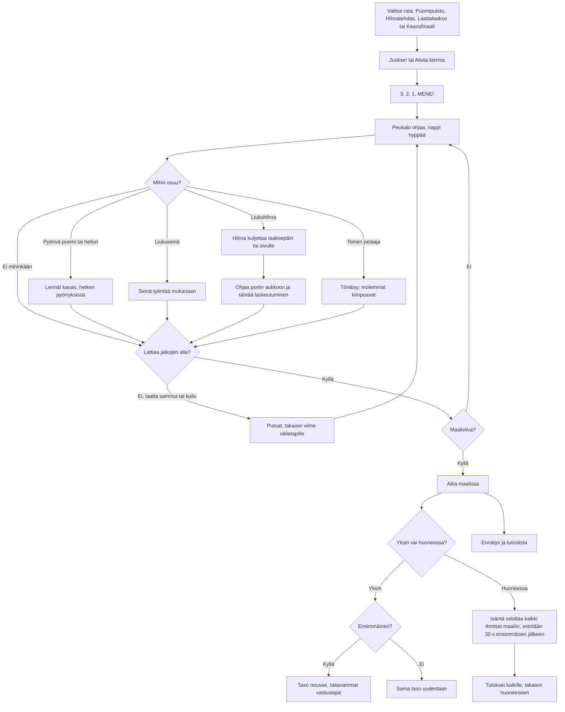

# Kaaosrata: one obstacle race, alone or with friends

How one race of Kaaosrata plays (v1). Jellybean players run up a course seen from above, through
five obstacle sections, and bump into each other on the way; off the floor you fall and come
back at the last checkpoint. Since v3 (#217) each moment has a recorded sound from the shared
library (`lib/aanet-2/`), named in brackets below; a sound not loaded yet falls back to v1's beep. Alone it is a race against seven computer players of the player's
level; in a room each phone runs its own player, and the phone that made the room (the host)
moves the computer players and ends the race.

Since #346 only each game's newest version folder is kept: a `games/<slug>/v<N>/` path below that is not the newest names a version that is history now (its files are in git's history, and the site sends its address to the newest), and what it says about that version is how it was.

v4 (#337, `aanet-4`) has no crowd: a fall plays only the (quieter) falling whistle, no "ooh".

v5 (#355) loads `aanet-5`, where the sounds Eero still found too loud are swapped for softer ones he picked by ear, or play quieter (the winning and losing tunes); nothing else changed.

v6 (#454) has four courses instead of one: the old one (Puomipuisto) and three new ones, two of them with a new obstacle each (conveyor belts, blinking tiles). The player picks the course in the menu; in a room the host picks it and every phone runs the same one. Each course has its own record and high-score list.

v7 (#454 follow-up) makes the three new courses harder: narrow belt bridges, tall moving gates, gaps and narrower tile lanes. Puomipuisto keeps its original layout and movement. New courses require real ground before another jump; their new records and lists stay separate from v6, whose saved records remain visible.

v8 (#454, "still too easy"; Eero picked harder obstacles) keeps v7's layouts but makes every obstacle on the three new courses harder: faster belts (3.3–3.6 m/s), bridges at most 2.4 m from the middle, wider gaps (2.8 m), more and faster gates, sweepers, hammers and discs, tiles that stay solid a shorter time and step further sideways, narrower stepping stones, and a sweeper bridge before Laattalaakso's last tiles. Even the computer's best runner is about 20–30 % slower and falls 2–3 times a race. Records and lists are new again (`hihna8`, `laatat8`, `finaali8`); the menu shows the newest older record (v7, else v6).

v9 (#480) draws the other phones' runners gliding, a moment back, between the spots their messages brought (`lib/sulava-1`, `sulava-liike.md`), keeping v8's courses, records and lists. v8 drew each spot as it came and carried it on at its last speed until the next, so a friend jerked on every uneven gap.

v10 (#493) draws the race in 3D (three.js from `lib/three-r187/`), the camera behind and above the runner and always looking up the course, so the stick still means up = forward (Eero's choice). Every course has heights (Eero's choice): ramps up and down, steps to jump onto, drops to lower floors and, where a course has stepping stones, stones at rising heights. The layouts are v8's, lifted; each course has a new record and score list, and v9's record shows under it as the old one. A phone that cannot draw WebGL plays on v9's 2D drawing, with the heights lifting the runner.

## Colours

- **blue**: what the player sees and does
- **amber**: a check that decides the path
- **teal**: players and walls pushing each other
- **violet**: the race in a room with friends
- **green**: a finish, a record or a win
- **rose**: a knock, a fall or a lost race

## Boxes

- **Valitse rata: Puomipuisto, Hihnatehdas, Laattalaakso tai Kaaosfinaali**: v6 (#454): the courses are data in `games/kaaosrata/v10/radat.js` (`RADAT`), one object each with its floors (v10: each with a top height `h`, a ramp rising from `h` at `y0` to `h1` at `y1`), obstacles (Kaaosfinaali includes stepping stones before its narrow hammer bridge), checkpoints (`CPS`), sections, the bots' path (`PATH`), finish line and time limit; `useCourse(id)` in `index.html` sets them before a race. Alone, the menu's "‹ Rata ›" chooser picks it and saves it in `ai-pelit:kaaosrata:rata`. In a room the host picks it under the player list (`R.extra()`) and sends its id in every `s` message (`c`), so a guest, also one that reloads mid-race, runs the same course. A guest waits for its first snapshot before moving; an end message also carries the course so a phone that missed the race saves to the right list.
- **Ohjaa portin aukkoon ja tähtää laskeutuminen**: v7: `radat.js` combines narrow belt bridges, 2.2 m gaps and tall gate pairs. v8: bridges at most 2.4 m half-width, 2.8 m gaps, two or three faster gates (`w` ≥ 1.3, `a` 1.3) per belt, each gate's `lane` the bridge's half-width. Each new gate has its own sideways amplitude (`a`); `blockX()`, collision, drawing and `gapX()` use the same geometry. `gapX()` only offers openings inside the gate’s `lane`. Safe wide islands carry the checkpoints; sideways belts require countersteering.
- **Hihna kuljettaa taaksepäin tai sivulle**: v6 (#454): `groundAt()` returns a conveyor belt's own speed (`BELTS` in `radat.js`), which `move()` adds to the runner's like a moving floor's; the belts move by the race clock alone, the same on every phone.
- **Juokse! tai Aloita kierros**: `soloRace()` in `games/kaaosrata/v10/index.html` starts the player against seven computer players whose skill rises with the level; in a room, `R.on('start')` gives each phone in the round its own player (2–8 phones) and fills the start up to six with computer players.
- **3, 2, 1, MENE!**: `tick()` counts `race.cdT` to 3 s; in a room only the host counts and the others follow its `s` messages. Nobody moves or jumps before it. v3: `valinta` on each number, higher on MENE!.
- **Peukalo ohjaa, nappi hyppää**: a thumb anywhere drags a stick from where it lands (`pointerdown`/`pointermove`, `input`); the round button bottom right jumps (`press()` → `jump()`, held 0.15 s so an early tap still counts). v3: `hyppy` on the jump, `tomahdys` on landing on a floor (louder from higher, none when coming down over a gap; no beep before v3, so none as a fallback). `move()` runs at 5.5 m/s, jumps about 1.3 m high, and carries the player with a moving floor (`groundAt()`). v10 (#493): `three3d.js` draws the course, the obstacles and the runners on a WebGL canvas (`#g`) under the 2D one (`#c`), which keeps the names (placed with `K3D.project()`), the HUD, the stick and the results; the camera follows the player from behind and above (`place()`), wider sideways. A slow phone first draws fewer pixels, then no shadows (`tune()`). If WebGL or the library fails (`K3D.failed`), `draw()` keeps v9's 2D drawing. Uphill the runner is slower and downhill faster (up to ±30 %), and a jump needs ground under the feet within the last 0.12 s (`coyote`) on every course.
- **Mihin osuu?**: `hits()` for the bars (`SWEEPERS`, low enough to jump), the sliding walls (`PUSHERS`, too tall to jump), the bumpers and the hammers (`HAMMERS`); `bumps()` for the players.
- **Lennät kauas, hetken pyörryksissä**: `knock()`: thrown the way the bar or ball moves, 0.6–0.7 s with little control. v3: `potku`. A swinging ball also whooshes (`suhahdus`, `whoosh()` in `games/kaaosrata/v10/index.html`) as it passes the middle of the bridge within 7 m of the player, louder the closer. The bumpers keep their own beep.
- **Seinä työntää mukanaan**: a wall moving into the player pushes it along, off the edge if it does not get out of the way.
- **Tönäisy: molemmat kimpoavat**: `bumps()` pushes apart every player moved on this phone, harder the faster they met (v3: `osuma`, louder the harder); a player moved on another phone gets its own push there. From v9 the other phones' runners are met where this phone draws them (`asDrawn()`), a moment back, not at their newest spot. A player who has finished passes through everyone, so it cannot change a result still being raced.
- **Lattiaa jalkojen alla?**: `groundAt()`: the floors, the stepping stones, the sliding platform and the three spinning discs; in v6–v9, over nothing for 0.1 s means falling. v6 (#454): also the belts, and the blinking tiles (`TILES` in `radat.js`), solid only while their race-clock cycle says so: they flash for 0.6 s, then are gone for a set time, row by row in turns. The computer waits before entering a tile row until its predicted arrival leaves at least one second of solid time. In v8 tiles stay solid 2.6 s of 4.6 s (2.3 s of 4.2 s in the last rows), rows step ±1.3 m. In v7, `n.tiles` indexes the first of a pair of narrower tiles; row centers step sideways and the route follows those centers. New-course jumps require recent actual ground (`coyote`, 0.12 s); landing over empty space cannot recharge a jump. In v6–v9 the original course keeps its old movement rule. v10 (#493): `surfacesAt()` lists every surface under a spot with its top; `groundAt(x, y, t, feet)` is the highest one no more than 0.3 m (`STEP`) above the feet, so a runner walks up a ramp or a small step and lands on a higher floor only from a jump, and a higher one is a wall (`blockerAt()`). After every move, `settle()` puts a runner standing inside such a wall back to its last good spot along a free axis (else out by the nearest edge, `pushOut()`), losing that speed. Off an edge it falls under gravity to the next floor down; it falls off the course only once it is over nothing and 0.15 m below the lowest top within 8 m (`lowestNear()`), so a drop to a lower floor is a landing, not a fall. Each obstacle stands on the still ground at its spot (`baseAt()`), and a bumper with its own `h` (Kaaosfinaali's over the stones' gap) stands on a post at that height. A respawn puts the runner on its checkpoint's own floor, within its width. Without 3D, a higher floor is drawn lighter with dark lines at its ends, and a runner's lift and shadow are measured from the ground under it (`groundAt()`).
- **Putoat, takaisin viime välietapille**: `respawn()` after 1.1 s at the last of the checkpoints (`CPS`, the green dashed lines) the player has stood past. v3: `putoaminen` as the player falls, the crowd's `ohhoo` just after; `valinta`, a little higher, on passing a checkpoint. From v4 (#337) the fall is `putoaminen` only, no `ohhoo`.
- **Aika maalissa**: `move()` sets `fin` when the player crosses its course’s finish line (140, 150 or 180 m), to 1/100 s (v3: `voitto`). From then on the player stands still where it crossed (`tick()` skips it on every phone, and it bumps nobody) until the race ends.
- **Taso nousee, taitavammat vastustajat**: only first place with a time wins (`won` in `finish()`): at the selected course’s time limit the one who got furthest heads the standings but has not won, alone or in a room. `finish()` saves `ai-pelit:kaaosrata:taso`, `voitot`, `kisat` and `ennatys`; higher levels make the computer players faster and surer in their jumps (`think()`).
- **Isäntä odottaa kaikki ihmiset maaliin, enintään 30 s ensimmäisen jälkeen**: `over()` and `hostTick()`: each guest runs its own player and sends it to the host 12 times a second (`p`); the host sends everyone back (`s`), with the race clock that moves every obstacle, and runs the computer for a phone that is away (`on('continue')`). v9 (#480): `p` and `s` carry the sender's clock (`s`, `AiPelitSulava.now()`), and the host sends a friend's spot on as their phone sent it (`hd`) with their own stamp as each row's [12], not its own guess of where they got to; the host's and the computer's rows carry null there. Each runner has a track (`tr`, keys `x`, `y`, `z`, `fall`, a jump over 3 m): `heard()` adds each spot, and starts the track again when the runner is back on their feet after a fall or the clock changes (the computer takes over a friend, or gives them back; the host also resets it on `on('back')`). The finish keeps the newest spot; `asDrawn()` puts the drawn one in place for `draw()` in `frame()`, and for `bumps()` in `tick()` (#480's D11: a bump with a friend happens where this phone draws them), and `putBack()` restores the newest after each. The race also ends at its course’s time limit (150, 160 or 190 s).
- **Tulokset kaikille, takaisin huoneeseen**: the host's `R.deliver()` of `end` with the standings (finishers by time, the rest by how far they got); each phone shows them, saves once (`R.once`) and goes back to the room.
- **Ennätys ja tuloslista**: `AiPelitScores.submit()` with the time; the list is the fastest first (`kaaosrata` in `public/scores.js` and `server/api.js`). v6 (#454): one list per course, picked with `AiPelitScores.board()`: Puomipuisto keeps `main` (every older time stays on it), and v6 uses `hihna`, `laatat` and `finaali`. v7 separates course identity from `boardId()`: redesigned courses use `hihna7`, `laatat7`, `finaali7` and records `ennatys:<board>`. v8 uses `hihna8`, `laatat8`, `finaali8`. The shelf offers the current, v7 and v6 lists; the menu shows the newest older saved record (v7's, else v6's) separately. The server accepts each course list only from its own versions: v6, v7, v8 and later. `main` remains valid for every version. v10 (#493), with heights on every course: `main10`, `hihna10`, `laatat10`, `finaali10` (records `ennatys:<board>`), taken only from v10 on; `main` then takes v1–v9 only and `hihna8`, `laatat8`, `finaali8` v8–v9. The shelf shows `main10` first and the older lists after; the menu shows v9's record (`ennatys`, or `ennatys:<id>8`) as the old one, else v7's, else v6's. This game keeps its own score entry; the shared registry’s new `minigolf` entry (#340, lowest stroke total on `main`) does not change it. Kiekkoammunta v1 adds independent `trap` and `skeet` score entries (Trap first, N/25); this box’s existing behavior is unchanged. Frisbeegolf v1 adds its own `main` entry to these registries: lowest strokes against par wins, displayed as `E`, `−2` or `+5`; this box keeps its existing behavior. Frisbeegolf now uses its separate `v3` leaderboard; versions 1–2 are not accepted there (#338). From v5 (#429) its rounds go to a new `v5` list, the shelf's first, and the `v3` list stays for v3–v4.
