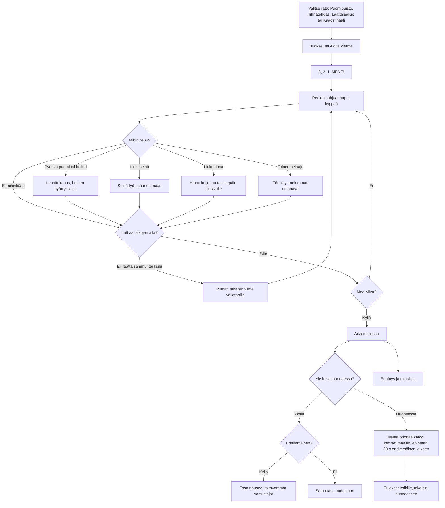

# Kaaosrata: one obstacle race, alone or with friends

How one race of Kaaosrata plays (v1). Jellybean players run up a course seen from above, through
five obstacle sections, and bump into each other on the way; off the floor you fall and come
back at the last checkpoint. Since v3 (#217) each moment has a recorded sound from the shared
library (`lib/aanet-2/`), named in brackets below; a sound not loaded yet falls back to v1's beep. Alone it is a race against seven computer players of the player's
level; in a room each phone runs its own player, and the phone that made the room (the host)
moves the computer players and ends the race.

Since #346 only each game's newest version folder is kept: a `games/<slug>/v<N>/` path below that is not the newest names a version that is history now (its files are in git's history, and the site sends its address to the newest), and what it says about that version is how it was.

v4 (#337, `aanet-4`) has no crowd: a fall plays only the (quieter) falling whistle, no "ooh".

v5 (#355) loads `aanet-5`, where the sounds Eero still found too loud are swapped for softer ones he picked by ear, or play quieter (the winning and losing tunes); nothing else changed.

v6 (#454) has four courses instead of one: the old one (Puomipuisto) and three new ones, two of them with a new obstacle each (conveyor belts, blinking tiles). The player picks the course in the menu; in a room the host picks it and every phone runs the same one. Each course has its own record and high-score list.

## Colours

- **blue**: what the player sees and does
- **amber**: a check that decides the path
- **teal**: players and walls pushing each other
- **violet**: the race in a room with friends
- **green**: a finish, a record or a win
- **rose**: a knock, a fall or a lost race

## Boxes

- **Valitse rata: Puomipuisto, Hihnatehdas, Laattalaakso tai Kaaosfinaali**: v6 (#454): the courses are data in `games/kaaosrata/v6/radat.js` (`RADAT`), one object each with its floors, obstacles, checkpoints (`CPS`), sections, the bots' path (`PATH`), finish line and time limit; `useCourse(id)` in `index.html` sets them before a race. Alone, the menu's "‹ Rata ›" chooser picks it and saves it in `ai-pelit:kaaosrata:rata`. In a room the host picks it under the player list (`R.extra()`) and sends its id in every `s` message (`c`), so a guest, also one that reloads mid-race, runs the same course. A guest waits for its first snapshot before moving; an end message also carries the course so a phone that missed the race saves to the right list.
- **Hihna kuljettaa taaksepäin tai sivulle**: v6 (#454): `groundAt()` returns a conveyor belt's own speed (`BELTS` in `radat.js`), which `move()` adds to the runner's like a moving floor's; the belts move by the race clock alone, the same on every phone.
- **Juokse! tai Aloita kierros**: `soloRace()` in `games/kaaosrata/v6/index.html` starts the player against seven computer players whose skill rises with the level; in a room, `R.on('start')` gives each phone in the round its own player (2–8 phones) and fills the start up to six with computer players.
- **3, 2, 1, MENE!**: `tick()` counts `race.cdT` to 3 s; in a room only the host counts and the others follow its `s` messages. Nobody moves or jumps before it. v3: `valinta` on each number, higher on MENE!.
- **Peukalo ohjaa, nappi hyppää**: a thumb anywhere drags a stick from where it lands (`pointerdown`/`pointermove`, `input`); the round button bottom right jumps (`press()` → `jump()`, held 0.15 s so an early tap still counts). v3: `hyppy` on the jump, `tomahdys` on landing on a floor (louder from higher, none when coming down over a gap; no beep before v3, so none as a fallback). `move()` runs at 5.5 m/s, jumps about 1.3 m high, and carries the player with a moving floor (`groundAt()`).
- **Mihin osuu?**: `hits()` for the bars (`SWEEPERS`, low enough to jump), the sliding walls (`PUSHERS`, too tall to jump), the bumpers and the hammers (`HAMMERS`); `bumps()` for the players.
- **Lennät kauas, hetken pyörryksissä**: `knock()`: thrown the way the bar or ball moves, 0.6–0.7 s with little control. v3: `potku`. A swinging ball also whooshes (`suhahdus`, `whoosh()` in `games/kaaosrata/v6/index.html`) as it passes the middle of the bridge within 7 m of the player, louder the closer. The bumpers keep their own beep.
- **Seinä työntää mukanaan**: a wall moving into the player pushes it along, off the edge if it does not get out of the way.
- **Tönäisy: molemmat kimpoavat**: `bumps()` pushes apart every player moved on this phone, harder the faster they met (v3: `osuma`, louder the harder); a player moved on another phone gets its own push there. A player who has finished passes through everyone, so it cannot change a result still being raced.
- **Lattiaa jalkojen alla?**: `groundAt()`: the floors, the stepping stones, the sliding platform and the three spinning discs; over nothing for 0.1 s means falling. v6 (#454): also the belts, and the blinking tiles (`TILES` in `radat.js`), solid only while their race-clock cycle says so: they flash for 0.6 s, then are gone for a set time, row by row in turns. The computer waits before entering a tile row until its predicted arrival leaves at least one second of solid time.
- **Putoat, takaisin viime välietapille**: `respawn()` after 1.1 s at the last of the checkpoints (`CPS`, the green dashed lines) the player has stood past. v3: `putoaminen` as the player falls, the crowd's `ohhoo` just after; `valinta`, a little higher, on passing a checkpoint. From v4 (#337) the fall is `putoaminen` only, no `ohhoo`.
- **Aika maalissa**: `move()` sets `fin` when the player crosses its course’s finish line (140, 150 or 180 m), to 1/100 s (v3: `voitto`). From then on the player stands still where it crossed (`tick()` skips it on every phone, and it bumps nobody) until the race ends.
- **Taso nousee, taitavammat vastustajat**: only first place with a time wins (`won` in `finish()`): at the selected course’s time limit the one who got furthest heads the standings but has not won, alone or in a room. `finish()` saves `ai-pelit:kaaosrata:taso`, `voitot`, `kisat` and `ennatys`; higher levels make the computer players faster and surer in their jumps (`think()`).
- **Isäntä odottaa kaikki ihmiset maaliin, enintään 30 s ensimmäisen jälkeen**: `over()` and `hostTick()`: each guest runs its own player and sends it to the host 12 times a second (`p`); the host sends everyone back (`s`), with the race clock that moves every obstacle, and runs the computer for a phone that is away (`on('continue')`). The race also ends at its course’s time limit (150, 160 or 190 s).
- **Tulokset kaikille, takaisin huoneeseen**: the host's `R.deliver()` of `end` with the standings (finishers by time, the rest by how far they got); each phone shows them, saves once (`R.once`) and goes back to the room.
- **Ennätys ja tuloslista**: `AiPelitScores.submit()` with the time; the list is the fastest first (`kaaosrata` in `public/scores.js` and `server/api.js`). v6 (#454): one list per course, picked with `AiPelitScores.board()`: Puomipuisto keeps `main` (every older time stays on it), the new ones `hihna`, `laatat` and `finaali`; the record is `ennatys` for Puomipuisto and `ennatys:<id>` for the others. This game keeps its own score entry; the shared registry’s new `minigolf` entry (#340, lowest stroke total on `main`) does not change it. Kiekkoammunta v1 adds independent `trap` and `skeet` score entries (Trap first, N/25); this box’s existing behavior is unchanged. Frisbeegolf v1 adds its own `main` entry to these registries: lowest strokes against par wins, displayed as `E`, `−2` or `+5`; this box keeps its existing behavior. Frisbeegolf now uses its separate `v3` leaderboard; versions 1–2 are not accepted there (#338). From v5 (#429) its rounds go to a new `v5` list, the shelf's first, and the `v3` list stays for v3–v4.
