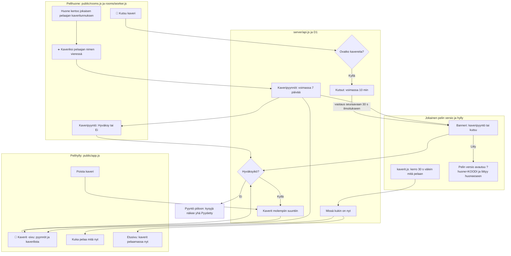

# Kaverit: friend list, what friends play, room invites

How two phones become friends, how each sees what the other is playing right now, and how one
invites the other into its room (#324). Friends are made only in a game room: one phone taps
"➕ Kaveriksi" beside another player, and that player accepts. Every game version already loads
`public/back.js`, so the "now playing" signal and the banners reach every game with no new game
version.

## Colours

- **amber**: what the player taps to make, accept or end a friendship
- **blue**: friendships and friend requests kept on the server
- **teal**: the "now playing" signal and where it shows
- **violet**: an invite into a room, from send to join

## Boxes

- **Huone kertoo jokaisen pelaajan kaveritunnuksen**: a phone with a nickname joins the room with `fid` (a hash of its secret player id); `rooms/worker.js` keeps it and sends it in each member of `peers`.
- **➕ Kaveriksi pelaajan nimen vieressä**: on the room screen in `public/rooms.js`, beside each other player who has a `fid` and is not yet a friend; sends `POST /api/friends/requests`. Turns into "Pyydetty".
- **Kaveripyyntö: Hyväksy tai Ei**: shown on the room screen of the phone asked (it checks for requests every 10 s while the room screen is open), on the shelf (front page and `#/kaverit`), and as a banner in a game once the phone has a friend.
- **Kaverit molempiin suuntiin**: the `friends` table in `migrations/0007_friends.sql`, one row per pair; made when a request is accepted, removed both ways.
- **kaverit.js: kerro 30 s välein mitä pelaan**: `ping()` in `public/kaverit.js` sends `POST /api/presence {player, game, version}` while the page is visible, only on a phone that has a friend. `public/back.js` only loads `kaverit.js` in every game; the shelf loads it from `public/index.html`.
- **Missä kukin on nyt**: the `presence` table; a row older than 90 s means the friend is not playing now, its time shows as "nähty … sitten".
- **📨 Kutsu kaveri**: a button on the room screen, shown on a phone with friends; it lists them, playing ones first, and sends `POST /api/invites`.
- **Banneri: kaveripyyntö tai kutsu**: `drawBanner()` in `public/kaverit.js`, on every page that loads it, from the requests and invites in the latest answer. On the shelf `public/app.js` sets `quietRequests`, so a request shows on the page itself and only an invite as a banner; on a room screen requests show in its own list.
- **Etusivu: kaverit pelaamassa nyt**: `drawPlaying()` in `public/app.js`: friend requests (Hyväksy / Ei) and the friends playing right now, above "Avoimet huoneet". A phone with a nickname but no friends yet sends no "now playing", so the front page reads `GET /api/friends` every 30 s while it shows (`watch(true, 30e3, true)`), and the first request appears without leaving the page.
- **Pyyntö piiloon: kysyjä näkee yhä Pyydetty**: "Ei" marks the request declined (`migrations/0008_friend_request_declined.sql`); the asked phone no longer sees it, and the asking phone keeps "Pyydetty" until it is a week old, so a "no" is never shown.
