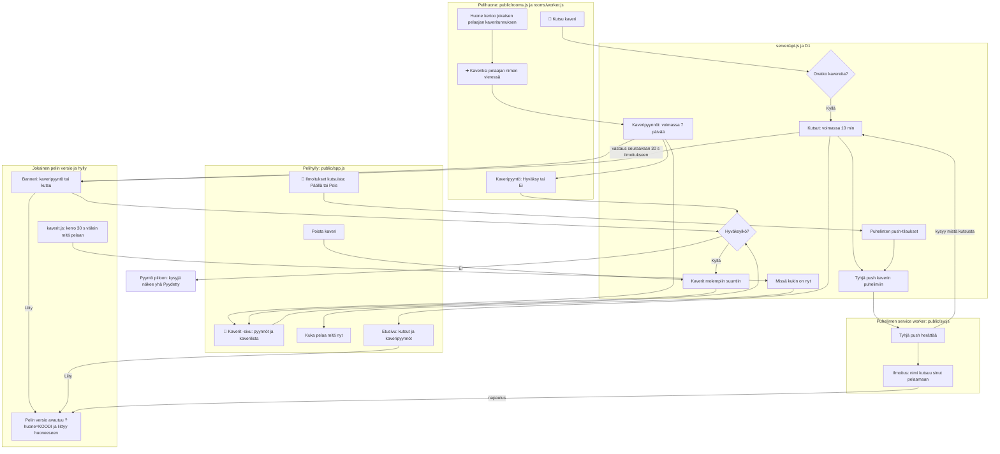

# Kaverit: friend list, what friends play, room invites

How two phones become friends, how each sees what the other is playing right now, and how one
invites the other into its room (#324). Friends are made only in a game room: one phone taps
"➕ Kaveriksi" beside another player, and that player accepts. Every game version already loads
`public/back.js`, so the "now playing" signal and the banners reach every game with no new game
version. An invite also reaches a phone with the site closed, as a phone notification, once that
phone has switched them on (#367).

## Colours

- **amber**: what the player taps to make, accept or end a friendship
- **blue**: friendships and friend requests kept on the server
- **teal**: the "now playing" signal and where it shows
- **violet**: an invite into a room, from send to join
- **green**: the same invite as a phone notification, with the site closed

## Boxes

- **Huone kertoo jokaisen pelaajan kaveritunnuksen**: a phone with a nickname joins the room with `fid` (a hash of its secret player id); `rooms/worker.js` keeps it and sends it in each member of `peers`.
- **➕ Kaveriksi pelaajan nimen vieressä**: on the room screen in `public/rooms.js`, beside each other player who has a `fid` and is not yet a friend; sends `POST /api/friends/requests`. Turns into "Pyydetty". A phone with only an animal name is first asked for a nickname; once the server takes it (a taken name keeps the row open with the reason, `setName()` and `nameError()` in `public/kaverit.js`; so does a name the admin rejected later, which every friends answer reports in `me`), it joins the room again on a new connection (`rejoinWithFid()`), so the others see its nickname and friend id, and the request is sent.
- **Kaveripyyntö: Hyväksy tai Ei**: shown on the room screen of the phone asked (it checks for requests every 10 s while the room screen is open), on the shelf (front page and `#/kaverit`), and as a banner in a game once the phone has a friend.
- **Kaverit molempiin suuntiin**: the `friends` table in `migrations/0007_friends.sql`, one row per pair; made when a request is accepted, removed both ways. A test player ("Testi1"…, `isTestName()` in `server/api.js`, #380) is deleted a day after it was made, with its friends, requests, invites, presence and push rows (`cleanTestPlayers()`).
- **kaverit.js: kerro 30 s välein mitä pelaan**: `ping()` in `public/kaverit.js` sends `POST /api/presence {player, game, version}` while the page is visible, only on a phone that has a friend. `public/back.js` only loads `kaverit.js` in every game; the shelf loads it from `public/index.html`.
- **Missä kukin on nyt**: the `presence` table; a row older than 90 s means the friend is not playing now, its time shows as "nähty … sitten".
- **📨 Kutsu kaveri**: a button on the room screen, shown on a phone with friends; it lists them (playing a game first, then browsing the shelf, then the rest) and sends `POST /api/invites`; the button reads "Kutsutaan…", then "Kutsuttu ✓" for the invite's 10 minutes, after which the friend may be invited again.
- **Banneri: kaveripyyntö tai kutsu**: `drawBanner()` in `public/kaverit.js`, on every page that loads it, from the requests and invites in the latest answer. "Liity" first leaves the room the phone is in, as "Poistu huoneesta" does (`AiPelitRooms.leave()`), then opens the new room so that back still goes up (`openInvite()`, the same handoff as a room code for another game in `rooms.js`, finished by `openFromRoom()` in `public/app.js`): game → its page → the shelf, never back into the game the phone was playing. On the room page (#388) the game in its frame asks the page to go (`AiPelitRoomShell.go()`, `shell.go(to.href)` in `openInvite()`) before it leaves the room, so the whole room page moves to the new room, not only the frame. On the shelf's front page and friends page `public/app.js` sets both `quietRequests` and `quietInvites` (#354), so requests and invites show in the page's own lists and no banner shows there; on a game's or a group's page a request comes as the banner; on a room screen requests show in its own list.
- **Etusivu: kutsut ja kaveripyynnöt**: `drawPlaying()` in `public/app.js` (#354): pending room invites ("Kutsut", Liity / Ei, `inviteRow()`) above friend requests (Hyväksy / Ei), above "Avoimet huoneet"; the friends page lists the same invites at its top. The front page no longer lists friends playing; who plays what shows only on the friends page. A phone with a nickname but no friends yet sends no "now playing", so the front page reads `GET /api/friends` every 30 s while it shows (`watch(true, 30e3, true)`), and a new request or invite appears without leaving the page.
- **Pyyntö piiloon: kysyjä näkee yhä Pyydetty**: "Ei" marks the request declined (`migrations/0008_friend_request_declined.sql`); the asked phone no longer sees it, and the asking phone keeps "Pyydetty" until it is a week old, so a "no" is never shown.
- **🔔 Ilmoitukset kutsuista: Päällä tai Pois**: the switch at the bottom of the friends page (`pushRow()` in `public/app.js`). On: `AiPelitKaverit.push.set(true)` in `public/kaverit.js` sends the nickname first if needed, asks the phone's permission, subscribes with the site's public key (`VAPID`) and sends `POST /api/push`. Off: unsubscribes and `DELETE /api/push`. Denied permission says "Ilmoitukset on estetty puhelimen asetuksista."; an iPhone outside the installed app says to add the games to the home screen. A phone with it on tells the server its subscription again once a day (`pushSync()`), and on the next page when the first telling failed (no network, a server error).
- **Puhelinten push-tilaukset**: the `push_subs` table (`migrations/0010_push.sql`): a phone's push address (`endpoint`), which only that phone knows, and its player; up to five per player. Only the browsers' own push services are taken (`pushEndpoint()` in `server/api.js`).
- **Tyhjä push kaverin puhelimiin**: `pushTo()` in `server/api.js`, run by `POST /api/invites` after it has answered (Cloudflare's `waitUntil`): an empty push signed with the site's VAPID key (`VAPID_PRIVATE_KEY` secret, `vapidAuth()`), valid for the invite's 10 minutes (`TTL: 600`). A push service that says the phone is gone (404, 410) has its address deleted.
- **Tyhjä push herättää**: the `push` handler in `public/sw.js` asks `GET /api/push/pending?endpoint=` for the newest open invite to this phone; with none, it shows nothing.
- **Ilmoitus: nimi kutsuu sinut pelaamaan**: "<nimi> kutsuu sinut pelaamaan: <peli>" with "Liity". A tap (`notificationclick`) answers the invite by the push address (`POST /api/invites/<id>/answer {endpoint}`), so no banner asks again, and opens the room's game with `?huone=`, in a window of the site already open when there is one.
