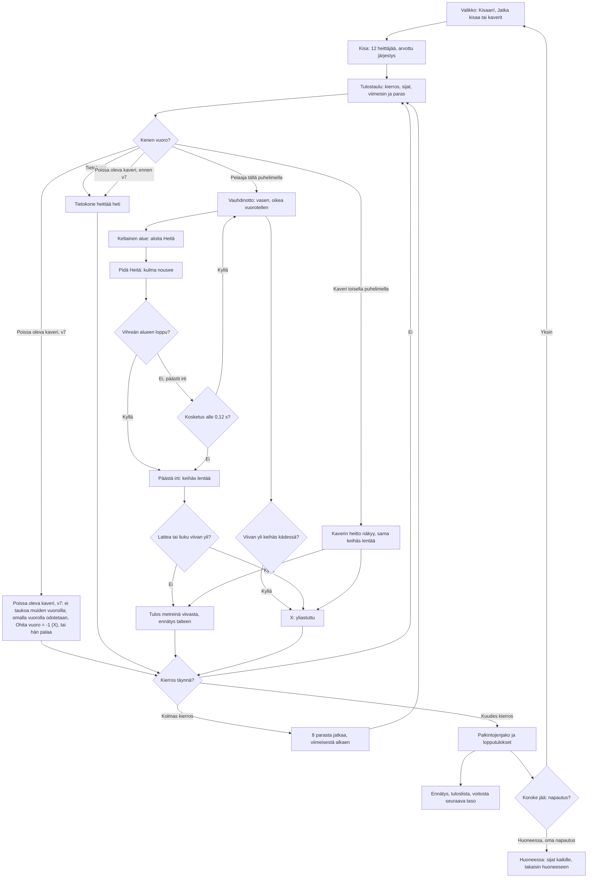

# Keihäänheitto: one throw and one meet

How Keihäänheitto plays (v1). A meet has twelve throwers: the player and eleven computer
throwers alone, or 2–8 phones in a room with the computer filling the rest. Everyone throws three
times in a drawn order; the best eight throw three more, the last in the standings first. On their
turn the player takes a run-up by tapping the left and right foot in turn, holds "Heitä" so the
javelin's angle rises, and lets go when the angle is in the green and they are on the green part of
the runway, before the line. The computer's throws are worked out at once.

From v3 (#166) the run is easier: a yellow mark on the runway says when to start holding
"Heitä", a strip under the ground shows the whole runway from the first step, a throw still held
at the end of the green goes by itself, and upright the throw is a bar above the two feet, not a
pad between them (`games/keihas/v3/index.html`).

v4 (#165) plays as v3, with the meet, the results board, the saves, the outfit message and the room handling from the shared athletics library (see `yleisurheilu-kirjasto.md`); the running knee bends the right way (#170), and sideways the gap between a column's throw pad and its foot does nothing. v5 (#176) plays as v4 on `yleisurheilu-3`: the meet ends with the medal ceremony, the medallists in their outfits, and the podium stays until a tap.

v6 (#218) plays as v5 with recorded sounds from the shared library (`aanikirjasto.md`, `lib/aanet-2/`) instead of beeps: `valinta` when the player's turn is ready, `askel`/`askel2` per foot tap in `press()`, `naksu` when "Heitä" goes down in `startAim()`, `suhahdus` as the javelin leaves the hand in `throwNow()`, `tomahdys` as it lands in `landed()` (every thrower's, a friend's quieter), then `onnistui` for the player's own good throw or `aplodit` for a new lead or record, `ohhoo` for a foul (`landed()`, `outcome()`), and the meet's `chime` rings `mitali` per medal with applause for the gold. Each sound that replaced a v5 beep falls back to that beep, one by one, while its file is not there; the landing thud is new (v5 had no landing sound), so it is simply left out then (`games/keihas/v6/index.html`).

From v2 (#158) the player's athlete wears the outfit picked under "👕 Asu" in the menu, and in a room each phone's thrower wears its own (`drawAthlete()` in `games/keihas/v2/index.html`; the picker is `asut.md`).

v7 (#297) plays as v6 on `public/lib/yleisurheilu-5/`: with friends the meet waits only for the phone on turn, a friend may leave and come back ("↩ Palaa kierrokseen"), the host's "Ohita vuoro" skips an away friend's turn as a miss (the computer never takes them), and the friends not on turn stand in a row at the bottom of the scene as spectators with "📣 Kannusta" (`K.drawFans()` in `drawScene()`, see `yleisurheilu-kirjasto.md`).

v8 (#313) plays as v7, but a pad that does nothing right then is greyed out and does not light up when pressed: while "Heitä" is held the feet add no speed, so they show grey (v7 flashed them). `padOn()` in `games/keihas/v8/index.html` says which pads are on, and both `drawControls()` and the presses read it; see `yleisurheilu-napit.md`.

v9 (#311) plays as v8 with the athletics events' common outfit set and one choice shared by every event and Ottelu (`data-share="yleisurheilu"` in `games/keihas/v9/index.html`, `asut.md`).

Since #346 only each game's newest version folder is kept: a `games/<slug>/v<N>/` path below that is not the newest names a version that is history now (its files are in git's history, and the site sends its address to the newest), and what it says about that version is how it was.

v11 (#337, `aanet-4`) has no crowd: a good throw (a lead or a record too) is the quiet `onnistui` blip at 0.3, a foul is silent, the podium plays only the medal tune, and a friend's "📣 Kannusta" is a quiet blip at 0.25 (`cheerSound`).

v13 (#355) loads `aanet-5`, where the sounds Eero still found too loud are swapped for softer ones he picked by ear, or play quieter (the winning and losing tunes); the cheer's chime plays at 0.08, not 0.25 pitched up.

v12 (#341) plays as v11 on `public/lib/yleisurheilu-7/`: the friends watching stand behind the boards, drawn before the athlete so they never cover it (`K.drawFans(x, {..., walk: true})` in `drawScene()`), and a tap on the scene walks your own figure there on every phone (`K.tapFans()` first in the canvas's `pointerdown`). See `yleisurheilu-kirjasto.md`.

## Colours

- **blue**: what the player sees and does
- **violet**: someone else throwing: the computer, or a friend on another phone
- **amber**: a check that decides the path
- **teal**: the meet's rules and the measured throw
- **rose**: a foul, marked X
- **green**: the end of the meet and what it saves

## Boxes

- **Valikko: Kisaan!, Jatka kisaa tai kaverit**: `showMenu()` in `games/keihas/v1/index.html`. "Kisaan!" starts a new meet at the player's level (`taso`); "Jatka kisaa (kierros N/6)" shows when a meet alone was left unfinished (`kesken`, saved after each of the player's throws, so a reload or a trip to the shelf keeps it); "👥 Pelaa kavereiden kanssa" opens the room (`public/rooms.js`, 2–8 phones). The menu shows meets, wins and the record (`kisat`, `voitot`, `ennatys`).
- **Kisa: 12 heittäjää, arvottu järjestys**: `newComp()` (v4: `meet()` and `rounds()` in `public/lib/yleisurheilu-1/kisa.js` (from v7 `yleisurheilu-5/kisa.js`, #297), from v5 `yleisurheilu-3/kisa.js`): the players, then computer throwers up to twelve (`FIELD`), each with a skill around `base(level)` metres (50 m at level 1, 4 m more per level up to 84 m); the order of rounds 1–3 is drawn once (`order0`).
- **Tulostaulu: kierros, sijat, viimeisin ja paras**: `drawBoard()` (v4: the library's `K.drawBoard()`), shown for 3.5 s (`BOARD_T`) before each player's turn; alone a tap skips it. The standings (`standings()`) go by the best throw, then the second best, as in a real meet; a dashed line shows the cut after eight.
- **Kenen vuoro?**: `advance()` (v4: the library's) throws for every computer thrower up to the next player on a phone; `follow()` makes the turn each phone draws (`th`), its own (`mine`) or someone else's.
- **Tietokone heittää heti**: `cpuMark()`: the skill plus a scatter of 3.5 m, a foul one time in eight. In a room the host's "Jatka ilman heitä" hands an away phone's throws to the computer (`R.on('continue')`) until it is back (`R.on('back')`); while a phone is away the meet waits (`R.paused`). From v7 (`yleisurheilu-5/`, #297) this is the computer's competitors only: a friend's phone is never handed over.
- **Poissa oleva kaveri, v7: ei taukoa muiden vuoroilla; omalla vuorolla odotetaan, Ohita vuoro = -1 (X), tai hän palaa**: from v7 (`yleisurheilu-5/`, #297) the library calls `R.turns()` with the competitor on turn, so a friend who closes the game or leaves the room stops nobody while others are on turn. On their own turn every phone shows "⏸ Odotetaan: <nimi>"; the host's "Ohita vuoro" (`R.on('skip')`) records the format's `missed` mark (-1 (X)) and the meet goes on, or the friend comes back ("↩ Palaa kierrokseen" on the room screen) and takes the turn themselves. See `yleisurheilu-kirjasto.md`.
- **Vauhdinotto: vasen, oikea vuorotellen**: `press()`: a step on the other foot adds speed, more the slower the thrower goes (as in Aitajuoksu), the same foot twice slows (from v3 it only adds nothing); about 8 m/s at eight taps a second. The bar under the score panel shows the speed; the green part of the runway (`stopDist()`) is where letting go stops the thrower before the line at that speed.
- **Keltainen alue: aloita Heitä**: v3 `zones()` and `drawStrip()`: at the speed now, the yellow part of the runway is where pressing "Heitä" brings the angle into the green just as the thrower reaches the end of the green part; "Pidä Heitä pohjassa!" shows there. The whole runway, the thrower, the yellow and the green show as a strip under the ground's distances from the first step, and the camera looks further ahead (about 11 m across) than v2's. Upright, the throw is a bar of its own above the two feet (`pads()`), and a touch in the gap between them does nothing (`padAt()`).
- **Vihreän alueen loppu?**: v3 `step()`: a throw still held at the last safe step (`-stopDist(v)`) goes by itself (`letFly()`), at least at 10°, so holding too long is no longer a foul. It is thrown from the position and speed rounded to the centimetre, the same numbers other phones get.
- **Viivan yli keihäs kädessä?**: `step()`: reaching the line (x = 0) before letting go is a foul, "Yliastuttu!". In a room 45 s with no tap (`TURN_MAX`, counted in `th.idle`, which every foot tap and press of Heitä sets back to nought) is a foul, "Aika loppui"; a slow player who keeps tapping is never timed out.
- **Pidä Heitä: kulma nousee**: `startAim()`: holding the middle pad (upright), the top pad of either side column or anywhere on the scene (sideways) raises the angle from 5° at 50° a second (`AIM_RATE`); the dial beside the thrower shows it, green from 33° to 42° (`GREEN`), the angles within about 2 m of the best. From v3 the angle rises at 40° a second and the green is 32°–44°, within 3 m of the best. The thrower slows a little while aiming.
- **Kosketus alle 0,12 s?**: `release()`: a touch shorter than `TAP_MIN` is a slip of the thumb and goes back to running.
- **Päästä irti: keihäs lentää**: `throwNow()` and `javelin()`: the release speed is 9 m/s plus 2.35 times the run-up (`relSpeed()`), less when thrown steeper than 34°; the flight has gravity and air drag (`flySub()`, 1/240 s steps), so the best angle is about 37°. The camera follows the javelin out over the field.
- **Lattea tai liuku viivan yli?**: `flight()`: thrown below 10° the tip does not land first; or the thrower slides over the line after letting go (`stopDist()`, braking at 18 m/s²). Either is a foul.
- **Kaverin heitto näkyy, sama keihäs lentää**: the thrower's phone sends where its thrower is twelve times a second (`p`) and the release (`rel`); the host passes both on, and every phone flies the same javelin with `throwNow()`, landing at the same mark.
- **Tulos metreinä viivasta, ennätys talteen**: `landed()` and `record()`: the mark is where the tip lands, from the line, down to the centimetre; a new record is saved at once (`ennatys`). The thrower's phone reports it (`res`); the host records it once (`seq`) and sends the meet to everyone (`c`).
- **8 parasta jatkaa, viimeisestä alkaen**: after round 3 `advance()` keeps the best eight (`final`), each later round in reverse order of the standings. With no player on a phone left in the final the rest is thrown at once.
- **Palkintojenjako ja lopputulokset**: `over()` and `netEnd()` (v4: the library's `over()`, `end()` and `K.step()`): before v5 the standings with 🥇🥈🥉, shown for a few seconds. From v5 (#176) the medal ceremony, `K.drawPodium()` at the end of `draw()` over the whole screen: the top three on the podium in their outfits (`look` in the meet's options, from `looks()`/`plain()`), an official hangs their medals with a chime each (`chime`), and the final standings under it.
- **Koroke jää: napautus?**: from v5 nothing leaves the podium by itself: the tap handler calls `K.skip()` alone and with friends; a tap during the ceremony finishes it (alone only), a tap after it shows the menu, or `R.backToRoom()` in a room, each phone by its own tap. Before v5 this came by itself after a few seconds.
- **Ennätys, tuloslista, voitosta seuraava taso**: `netEnd()` saves `kisat`, and alone a win adds `voitot` and the next level (`taso`); the meet's best throw goes to the high-score list with `AiPelitScores.submit()` (`keihas` in `public/scores.js` and `server/api.js`, see `tuloslistat.md`).
- **Huoneessa: sijat kaikille, takaisin huoneeseen**: the host sends the results with `R.deliver()`; each phone saves its own meet once (`R.once()`), shows its place and the top eight in the room (`afterEnd()`, `R.note()`, `R.backToRoom()`).
