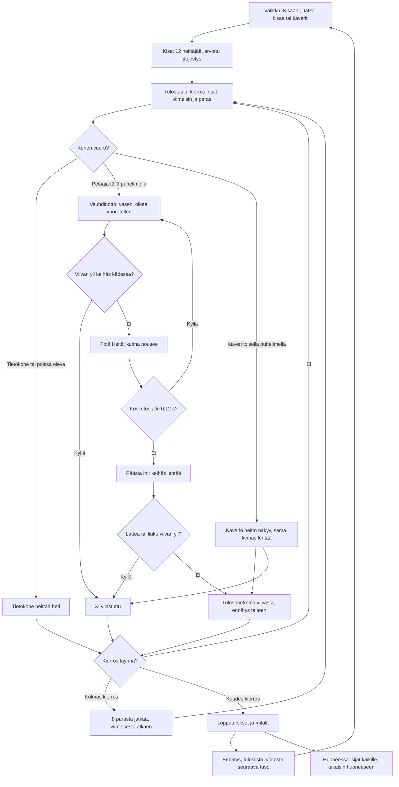

# Keihäänheitto: one throw and one meet

How Keihäänheitto plays (v1). A meet has twelve throwers: the player and eleven computer
throwers alone, or 2–8 phones in a room with the computer filling the rest. Everyone throws three
times in a drawn order; the best eight throw three more, the last in the standings first. On their
turn the player takes a run-up by tapping the left and right foot in turn, holds "Heitä" so the
javelin's angle rises, and lets go when the angle is in the green and they are on the green part of
the runway, before the line. The computer's throws are worked out at once.

## Colours

- **blue**: what the player sees and does
- **violet**: someone else throwing: the computer, or a friend on another phone
- **amber**: a check that decides the path
- **teal**: the meet's rules and the measured throw
- **rose**: a foul, marked X
- **green**: the end of the meet and what it saves

## Boxes

- **Valikko: Kisaan!, Jatka kisaa tai kaverit**: `showMenu()` in `games/keihas/v1/index.html`. "Kisaan!" starts a new meet at the player's level (`taso`); "Jatka kisaa (kierros N/6)" shows when a meet alone was left unfinished (`kesken`, saved after each of the player's throws, so a reload or a trip to the shelf keeps it); "👥 Pelaa kavereiden kanssa" opens the room (`public/rooms.js`, 2–8 phones). The menu shows meets, wins and the record (`kisat`, `voitot`, `ennatys`).
- **Kisa: 12 heittäjää, arvottu järjestys**: `newComp()`: the players, then computer throwers up to twelve (`FIELD`), each with a skill around `base(level)` metres (50 m at level 1, 4 m more per level up to 84 m); the order of rounds 1–3 is drawn once (`order0`).
- **Tulostaulu: kierros, sijat, viimeisin ja paras**: `drawBoard()`, shown for 3.5 s (`BOARD_T`) before each player's turn; alone a tap skips it. The standings (`standings()`) go by the best throw, then the second best, as in a real meet; a dashed line shows the cut after eight.
- **Kenen vuoro?**: `advance()` throws for every computer thrower up to the next player on a phone; `follow()` makes the turn each phone draws (`th`), its own (`mine`) or someone else's.
- **Tietokone heittää heti**: `cpuMark()`: the skill plus a scatter of 3.5 m, a foul one time in eight. In a room the host's "Jatka ilman heitä" hands an away phone's throws to the computer (`R.on('continue')`) until it is back (`R.on('back')`); while a phone is away the meet waits (`R.paused`).
- **Vauhdinotto: vasen, oikea vuorotellen**: `press()`: a step on the other foot adds speed, more the slower the thrower goes (as in Aitajuoksu), the same foot twice slows; about 8 m/s at eight taps a second. The bar under the score panel shows the speed; the green part of the runway (`stopDist()`) is where letting go stops the thrower before the line at that speed.
- **Viivan yli keihäs kädessä?**: `step()`: reaching the line (x = 0) before letting go is a foul, "Yliastuttu!". In a room a turn left untouched for 45 s (`TURN_MAX`) is a foul, "Aika loppui".
- **Pidä Heitä: kulma nousee**: `startAim()`: holding the middle pad (upright), the top pad of either side column or anywhere on the scene (sideways) raises the angle from 5° at 50° a second (`AIM_RATE`); the dial beside the thrower shows it, green from 33° to 42° (`GREEN`), the angles within about 2 m of the best. The thrower slows a little while aiming.
- **Kosketus alle 0,12 s?**: `release()`: a touch shorter than `TAP_MIN` is a slip of the thumb and goes back to running.
- **Päästä irti: keihäs lentää**: `throwNow()` and `javelin()`: the release speed is 9 m/s plus 2.35 times the run-up (`relSpeed()`), less when thrown steeper than 34°; the flight has gravity and air drag (`flySub()`, 1/240 s steps), so the best angle is about 37°. The camera follows the javelin out over the field.
- **Lattea tai liuku viivan yli?**: `flight()`: thrown below 10° the tip does not land first; or the thrower slides over the line after letting go (`stopDist()`, braking at 18 m/s²). Either is a foul.
- **Kaverin heitto näkyy, sama keihäs lentää**: the thrower's phone sends where its thrower is twelve times a second (`p`) and the release (`rel`); the host passes both on, and every phone flies the same javelin with `throwNow()`, landing at the same mark.
- **Tulos metreinä viivasta, ennätys talteen**: `landed()` and `record()`: the mark is where the tip lands, from the line, down to the centimetre; a new record is saved at once (`ennatys`). The thrower's phone reports it (`res`); the host records it once (`seq`) and sends the meet to everyone (`c`).
- **8 parasta jatkaa, viimeisestä alkaen**: after round 3 `advance()` keeps the best eight (`final`), each later round in reverse order of the standings. With no player on a phone left in the final the rest is thrown at once.
- **Lopputulokset ja mitalit**: `over()` and `netEnd()`: the standings with 🥇🥈🥉, shown for a few seconds.
- **Ennätys, tuloslista, voitosta seuraava taso**: `netEnd()` saves `kisat`, and alone a win adds `voitot` and the next level (`taso`); the meet's best throw goes to the high-score list with `AiPelitScores.submit()` (`keihas` in `public/scores.js` and `server/api.js`, see `tuloslistat.md`).
- **Huoneessa: sijat kaikille, takaisin huoneeseen**: the host sends the results with `R.deliver()`; each phone saves its own meet once (`R.once()`), shows its place and the top eight in the room (`afterEnd()`, `R.note()`, `R.backToRoom()`).
