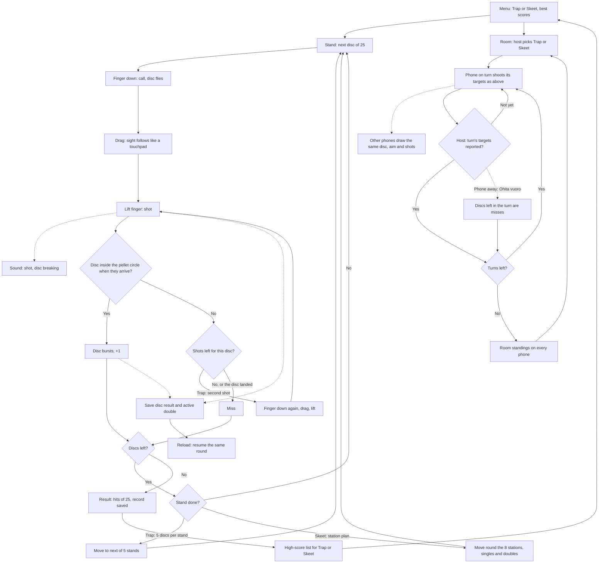

# Kiekkoammunta: one round of clay shooting

How Kiekkoammunta plays (v3). The player picks trap or skeet, then shoots 25 clay
discs from a view behind the gun. Putting a finger down calls the disc; dragging moves the
sight like a touchpad, and lifting the finger fires. The shot spreads into a growing circle of
pellets, so a disc is hit when it is inside the circle when the pellets get there.
With friends (v3), 2–6 phones share a room and take turns on the same 25 discs, about five a turn.

## Colours

- **blue**: what the player does
- **amber**: a question the game asks
- **teal**: the game moves on
- **rose**: a miss
- **green**: the result, saved

## Boxes

- **Finger down: call, disc flies**: touching the screen launches the next disc (or a double in skeet) from the trap house or a tower; `games/kiekkoammunta/v3/index.html`, `call()`. The sight starts near the launch path; `prepare()` and `shooter()` set the view for the station.
- **Drag: sight follows like a touchpad**: the sight moves by the finger's movement, not to where the finger is, so the finger never covers the disc; `drag()`.
- **Disc inside the pellet circle when they arrive?**: the pellets take a moment to fly and spread wider the further the disc is, so the player should aim a little ahead of a moving disc. Skeet has a bigger circle and slower discs than trap (`SKEET_PATTERN`, `SKEET_SPEED`), because its discs cross the view (v2); `shotHits()`.
- **Trap: second shot**: trap allows two shots at a disc; skeet allows one, as in the real sport.
- **Skeet: station plan**: the real skeet order of singles and doubles from the high and low towers, 25 discs in all; `SKEET`, including a return to station 4 for both ordered doubles before station 8.
- **Result: hits of 25, record saved**: the best score per discipline is saved at once under `ai-pelit:kiekkoammunta:`; the score goes to that discipline's list.

- **Save disc result and active double**: `keep()` saves results, the remaining target, ammunition and shots in flight in `ai-pelit:kiekkoammunta:kierros`; `resolveDisc()` saves each outcome. `pagehide` and hiding the page also save.
- **Reload: resume the same round**: `validSaved()` checks the active index, target slots, ammunition, results and numeric flight state before the menu offers `resume()`. Terminal or inconsistent active saves are not resumed. `resume()` restores a valid saved round from the menu. Rotation only changes the canvas size; it never resets the round.
- **Sound: shot, disc breaking**: `sound()` uses quiet `lahto` and `lasi` from `lib/aanet-5/`, with a quiet noise fallback after a gesture. A perfect five-target trap stand plays quiet `onnistui` at 0.08. No crowd cheers.

- **Room: host picks Trap or Skeet**: `games/kiekkoammunta/v3/room.js`, `roomControls()`, under the player list; the choice is saved as `huonelaji`. Only the phone that made the room sees the buttons. A host reload sends every phone back to the room, as in Minigolf.
- **Phone on turn shoots its targets as above**: the same code as a round alone, so a shot never waits for the network; `view()` builds `round` from the host's `match`, and `R.turns()` says which phone the round needs. `TURNS` gives each player five turns: trap five discs each, skeet 4, 5, 5, 5 and 6, because a double is not split.
- **Other phones draw the same disc, aim and shots**: `live()` sends `fly`, `aim` (ten a second), `shot` and `res` through the host; `hear()` draws them on a phone with `round.watch`. Such a phone never decides a hit, and a lost `live` only costs a moment of the picture: a disc in the air times out by itself and `syncView()` catches up.
- **Host: turn's targets reported?**: after each target `report()` sends the phone's whole list, so a lost report is made up for by the next, or when the host's `state` shows the phone is ahead. `takeEntry()` takes it only from the phone on turn, in this turn (`seq`), and only forward.
- **Discs left in the turn are misses**: `R.on('skip')`; the player keeps the seat and may come back with "Palaa kierrokseen". A reloading phone gets `state` through `hello` and carries on from the next target.
- **Room standings on every phone**: `R.deliver()` sends the end to every phone, and `roomEnd()` shows the standings. `R.once()` counts it once in `kaverit`; a room's round never touches the player's record, saved round or the high-score list (assumed, as in Minigolf).

`step()` processes elapsed input time in bounded physics slices, then stops once the current target and transition have reached idle. A stale timestamp cannot simulate unbounded idle time or automatically launch another target.
