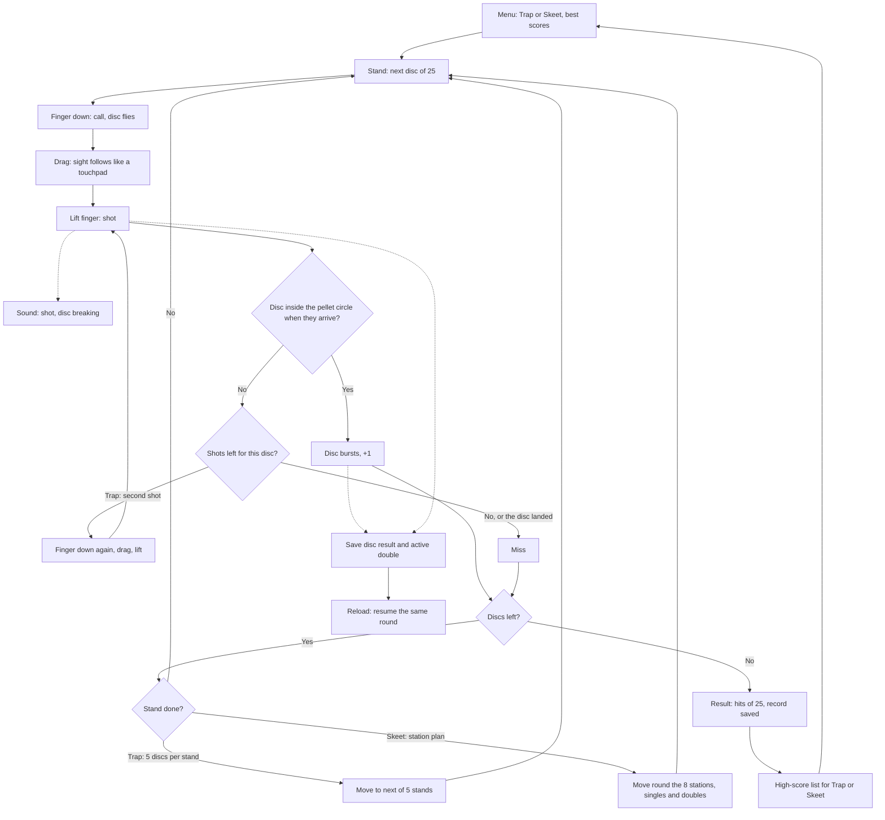

# Kiekkoammunta: one round of clay shooting

How Kiekkoammunta plays (v1). The player picks trap or skeet, then shoots 25 clay
discs from a view behind the gun. Putting a finger down calls the disc; dragging moves the
sight like a touchpad, and lifting the finger fires. The shot spreads into a growing circle of
pellets, so a disc is hit when it is inside the circle when the pellets get there.

## Colours

- **blue**: what the player does
- **amber**: a question the game asks
- **teal**: the game moves on
- **rose**: a miss
- **green**: the result, saved

## Boxes

- **Finger down: call, disc flies**: touching the screen launches the next disc (or a double in skeet) from the trap house or a tower; `games/kiekkoammunta/v1/index.html`, `call()`. The sight starts near the launch path; `prepare()` and `shooter()` set the view for the station.
- **Drag: sight follows like a touchpad**: the sight moves by the finger's movement, not to where the finger is, so the finger never covers the disc; `drag()`.
- **Disc inside the pellet circle when they arrive?**: the pellets take a moment to fly and spread wider the further the disc is, so the player must aim a little ahead of a moving disc; `shotHits()`.
- **Trap: second shot**: trap allows two shots at a disc; skeet allows one, as in the real sport.
- **Skeet: station plan**: the real skeet order of singles and doubles from the high and low towers, 25 discs in all; `SKEET`, including a return to station 4 for both ordered doubles before station 8.
- **Result: hits of 25, record saved**: the best score per discipline is saved at once under `ai-pelit:kiekkoammunta:`; the score goes to that discipline's list.

- **Save disc result and active double**: `keep()` saves results, the remaining target, ammunition and shots in flight in `ai-pelit:kiekkoammunta:kierros`; `resolveDisc()` saves each outcome. `pagehide` and hiding the page also save.
- **Reload: resume the same round**: `resume()` restores the saved round from the menu. Rotation only changes the canvas size; it never resets the round.
- **Sound: shot, disc breaking**: `sound()` uses quiet `lahto` and `lasi` from `lib/aanet-5/`, with a quiet noise fallback after a gesture. No crowd cheers.
