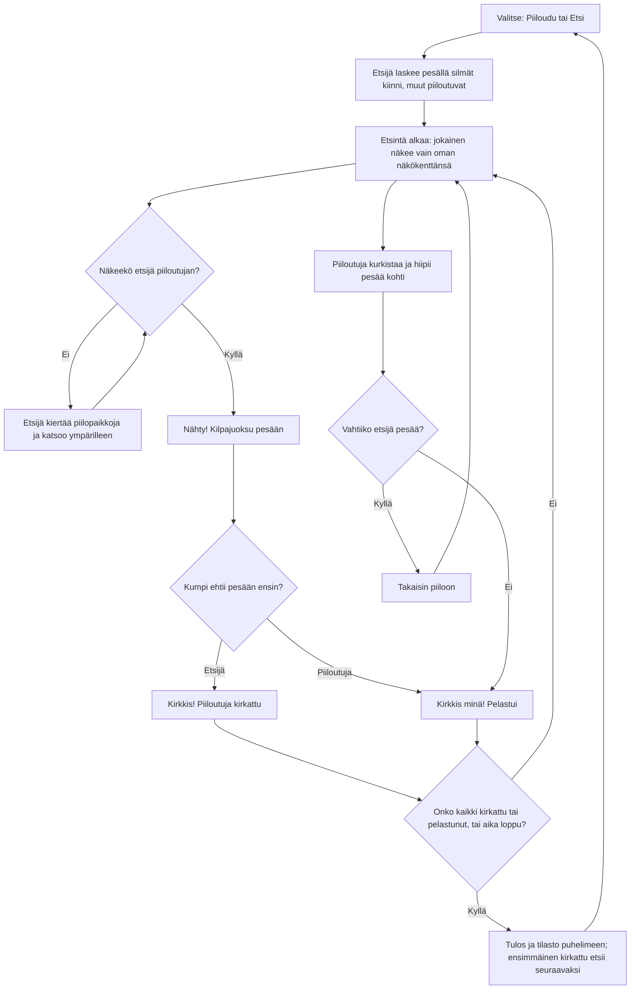

# Kirkkis: one round of kirkonrotta against the computer

How one round of Kirkkis plays (v1). The player either hides or seeks; the other four are
computer players. Everyone, the computer players too, sees only their own field of view, and
walls, trees and bushes block it. A seen hider is caught only when the seeker reaches the base
first and calls "Kirkkis!"; a hider who reaches the base first is saved.

## Colours

- **blue**: the menu, where a round starts and ends
- **amber**: a check that decides the path
- **violet**: counting and searching, with each player's own field of view
- **teal**: a hider on the move: racing, peeking or going back
- **green**: a hider saved
- **rose**: a hider caught

## Boxes

- **Valitse: Piiloudu tai Etsi**: `games/kirkkis/v1/index.html` `newRound()`; the button for the role the rules give next is outlined.
- **Etsijä laskee pesällä silmät kiinni, muut piiloutuvat**: `COUNT` is 10 s; the counting seeker sees nothing (`seesPoint()`), and a seeking player sees a dark screen. Computer hiders walk to their own place in `SPOTS`: spots out of sight of the base, or inside a bush.
- **Etsintä alkaa: jokainen näkee vain oman näkökenttänsä**: `canSee()`: 110° wide and 10 m long, cut by solid things (`castRay()`), anyone within 1.3 m whatever way one looks, and someone in a bush only from 2.4 m. The player's own view is cut out of the fog (`viewPoly()`); the seeker's view is drawn red when the player can see the seeker.
- **Etsijä kiertää piilopaikkoja ja katsoo ympärilleen**: `seekerBot()` walks A* paths (`findPath()`) to hiding places it has not looked at in 30 s, nearer ones first, and turns a full circle at each.
- **Nähty! Kilpajuoksu pesään**: `spot()`; a seen computer hider runs for the base, and a computer seeker runs back to it.
- **Kumpi ehtii pesään ensin?**: `rules()`: within 1.4 m of the base. A hider counts only after first going 5 m away from it.
- **Piiloutuja kurkistaa ja hiipii pesää kohti**: `hiderBot()`: runs when it sees the seeker far from the base and looking away, or saw it go far in the last 6 s; when brave enough it creeps toward the base, and runs once the base is in sight and the seeker is not.
- **Vahtiiko etsijä pesää?**: a computer hider that sees the seeker within 6 m of the base goes back to its place and waits, so guarding the base does not win.
- **Onko kaikki kirkattu tai pelastunut, tai aika loppu?**: `SEEK_TIME` is 100 s; whoever is still out when it ends is saved.
- **Tulos ja tilasto puhelimeen; ensimmäinen kirkattu etsii seuraavaksi**: `end()` saves rounds, times saved, times caught and hiders caught in `ai-pelit:kirkkis:tilasto`; `nextSeeker` is the first one caught, or the same seeker when nobody was.
