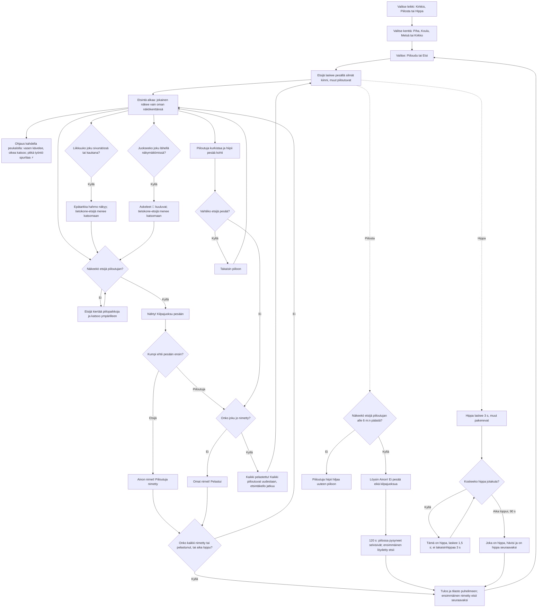

# Kirkkis: one round of kirkonrotta, piilosta or hippa

How one round of Kirkkis plays (v4, #67). The player either hides or seeks; the other four are
computer players, or friends' phones. Everyone, the computer players too, sees only their own
field of view, and walls, trees and bushes block it. A seen hider is named only when the seeker
reaches the base first and calls "Ainon nimet!"; a hider who reaches the base first calls "Omat
nimet!" and is saved, and once someone has been named that frees everyone: "Kaikki pelastettu!".
Versions 1–3 called these "Kirkkis Aino!" and "Kirkkis minä!", had no "Kaikki pelastettu!", and
seeking took 100 s. v6 (#109) adds three more maps to pick from (the yard of v1–v5 is the first),
and running is heard: steps 👣 show through walls, and the computer seeker goes to look. v7 (#137)
adds two more games, plain hide and seek (Piilosta) and tag (Hippa), a sprint, two-thumb steering
(left walks, right looks), sight with no length (only walls stop it; a seeker names someone from
10 m), a wider view and blurry side vision.

## Colours

- **blue**: the menu, where a round starts and ends
- **amber**: a check that decides the path
- **violet**: counting and searching, with each player's own field of view
- **teal**: a hider on the move: racing, peeking or going back
- **green**: a hider saved, or everyone freed
- **rose**: a hider named (caught)

## Boxes

- **Valitse leikki: Kirkkis, Piilosta tai Hippa**: `games/kirkkis/v7/index.html` `MODES` (v7, #137): each game's count, time, button words and help; `mode` is the game in play. Alone the menu's buttons pick it (`pickMode()`, saved in `ai-pelit:kirkkis:moodi`); with friends the host picks it under the player list (`roomControls()`), and `kr`/`kfin` carry it (`mode`). Each game keeps its own tally: `tilasto` (Kirkkis, as in v1–v6), `tilasto-piilosta`, `tilasto-hippa`.
- **Ohjaus kahdella peukalolla: vasen kävelee, oikea katsoo; pitkä työntö spurttaa ⚡**: v7 `movePlayer()` and the pointer handlers: a finger on the left half is the walking stick (`joy`), on the right half the eyes (`eye`); with no eye finger one looks the way one walks. Pushing past `PUSH` (84 px, the dashed ring) sprints: `SPRINT` 1.5× for `BREATH` 3 s, back in `REST` 5 s (`breathe()`, a bar under the player). Computer players sprint when racing, chasing or fleeing (`steer(…, fast)`). Picked by Eero from three tried in a prototype. The camera shows 17 × 27 m and leads the eyes by nearly half the screen (`draw()`).
- **Liikkuuko joku sivunäössä tai kaukana?**: `glimpses()` (v7): within `WIDE` 200° but outside the sharp 110° view, in the open and moving faster than `STIR` 1 m/s. Sight has no length since v7 (`RANGE` 60 m, was 10): only walls and things stop it, but the seeker tells who someone is only from `KNOW` 10 m in Kirkkis (`FIND` 6 m in Piilosta); a seeking player sees ❔ over a hider farther off (`unknown()`). The fog is half clear in the side vision, and the sharp view fades to half clear beyond `KNOW` (a radial gradient in `draw()`). The camera glides at a frame-rate-independent pace and jumps only on a new round, map or screen size (`camSnap`).
- **Epätarkka hahmo näkyy; tietokone-etsijä menee katsomaan**: drawn over the fog as a soft grey shape with no colour or name; `seekerBot()` goes to look when it is someone running within `KNOW` (as it does for steps it hears; someone sneaking goes unnoticed), and a Hippa runner flees it (`runnerBot()`).
- **Näkeekö etsijä piiloutujan alle 6 m:n päästä?**: `rulesHide()`: `canSee()` within `FIND` (6 m); farther off it is only a shape.
- **Löysin Ainon! Ei pesää eikä kilpajuoksua**: the `found` event in `show()`; the found one waits by the base.
- **Piiloutuja hiipii hiljaa uuteen piiloon**: `hideBot()`: a computer hider that sees the seeker within 8 m creeps (quietly) to a place farther away that the seeker cannot see.
- **120 s: piilossa pysyneet selvisivät; ensimmäinen löydetty etsii**: `timeUp()` and `end()`.
- **Hippa laskee 3 s, muut pakenevat**: `MODES.hippa.count`; `runnerBot()` wanders between hiding places and runs from "it" when it sees, hears or glimpses it close.
- **Koskeeko hippa jotakuta?**: `rulesTag()`: closer than `TAG` (two bodies and 0.2 m); `itBot()` chases the nearest one it sees.
- **Tämä on hippa, laskee 1,5 s; ei takaisinhippaa 3 s**: `setIt()`, the `tag` event (`FREEZE`, `NO_BACK`); `ks` carries who is it (`sk`) to the other phones.
- **Joka on hippa, hävisi ja on hippa seuraavaksi**: `end()` with `mode === 'hippa'`.
- **Valitse kenttä: Piha, Koulu, Metsä tai Kirkko**: `games/kirkkis/v7/index.html` `MAPS` (size, base, solid things, bushes and the drawing under them per map) and `loadMap()`, which rebuilds the walking grid (`blocked`) and the hiding places (`SPOTS`). Alone the menu's tiles pick it (`pickSolo()`, saved in `ai-pelit:kirkkis:kentta`, the yard when nothing is saved); with friends the host picks it under the room's player list (`roomControls()`), and the round's `kr` and `kfin` carry it (`map`), so every phone loads the same one in `castFrom()`.
- **Valitse: Piiloudu tai Etsi**: `newRound()` (v4 onwards); the button for the role the rules give next is outlined.
- **Etsijä laskee pesällä silmät kiinni, muut piiloutuvat**: `setupRound()`; `COUNT` is 10 s; the counting seeker sees nothing (`seesPoint()`), and a seeking player sees a dark screen. Computer hiders walk to their own place in `SPOTS`: spots out of sight of the base, or inside a bush.
- **Etsintä alkaa: jokainen näkee vain oman näkökenttänsä**: `canSee()`: 110° wide, cut by solid things (`castRay()`); 10 m long in v1–v6, with no length of its own since v7 (`RANGE` 60 m), where 10 m is instead how close a Kirkkis seeker must be to tell who it is (`KNOW`), anyone within 1.3 m whatever way one looks, and someone in a bush only from 2.4 m. The player's own view is cut out of the fog (`viewPoly()`); the seeker's view is drawn red when the player can see the seeker.
- **Etsijä kiertää piilopaikkoja ja katsoo ympärilleen**: `seekerBot()` walks A* paths (`findPath()`) to hiding places it has not looked at in 30 s, nearer ones first, and turns a full circle at each. A bush counts as looked at only from 2.4 m (`spotChecked()`), as close as someone in it is seen.
- **Juokseeko joku lähellä näkymättömissä?**: `hears()` (v6): faster than `LOUD` (2.6 m/s, a long drag or a computer player running) within `HEAR` (7 m), when it cannot be seen, walls or not. The seeker hears the hiders still out; a hider still out hears the seeker. Sneaking with a short drag is quiet.
- **Askeleet 👣 kuuluvat; tietokone-etsijä menee katsomaan**: `listen()` drops a footprint every 0.3 s where this phone's player hears someone (`prints`, drawn over the fog, fading in a second, with a soft step sound); on a guest phone it works from the positions and speeds the host sends. `seekerBot()` sets its goal to where it heard a hider and looks around there.
- **Nähty! Kilpajuoksu pesään**: `spot()`; a seen computer hider runs for the base, and a computer seeker runs back to it.
- **Kumpi ehtii pesään ensin?**: `rules()`: within 1.4 m of the base. A hider counts only after first going 5 m away from it.
- **Ainon nimet! Piiloutuja nimetty**: the `kirk` event in `show()`: the seeker calls every hider seen, "Ainon nimet, Eetun nimet!" (the genitive from `gen()`); on the named player's phone "Sinut nimettiin!", and the HUD says "Nimetty".
- **Onko joku jo nimetty?**: `rules()`: a hider at the base when any hider is `caught` calls `allSaved()` instead of being saved.
- **Omat nimet! Pelastui**: the `save` event in `show()`.
- **Kaikki pelastettu! Kaikki piiloutuvat uudestaan, etsintäkello jatkuu**: `allSaved()`: every hider, the saved and the named too, is hiding again and must again go 5 m from the base; the seeker is put back at the base to count `COUNT` again; the computer hiders pick new places (`pickSpots()`) and the seeker forgets where it looked. The seek clock is kept in `seekLeft`, keeps running through the count (shown in the HUD), and `startSeek()` goes on from it; if it runs out during the count, `timeUp()` saves everyone out. The first one named is forgotten. With friends the host sends the `all` event and `sl`; each phone shows it from its own side, and a seeker's phone moves its own player to the base.
- **Piiloutuja kurkistaa ja hiipii pesää kohti**: `hiderBot()`: runs when it sees the seeker far from the base and looking away, or saw it go far in the last 6 s; when brave enough it creeps toward the base, and runs once the base is in sight and the seeker is not.
- **Vahtiiko etsijä pesää?**: a computer hider that sees the seeker within 6 m of the base goes back to its place and waits, so guarding the base does not win.
- **Onko kaikki nimetty tai pelastunut, tai aika loppu?**: `SEEK_TIME` is 200 s (100 s before v4); whoever is still out when it ends is saved (`timeUp()`).
- **Tulos ja tilasto puhelimeen; ensimmäinen nimetty etsii seuraavaksi**: `end()` saves rounds, times saved, times named and hiders named in `ai-pelit:kirkkis:tilasto` (the keys keep v1's words: `kirkattiin`, `kirkkasit`, shown as "nimesit"); `nextSeeker` is the first one caught, or the same seeker when nobody was.
