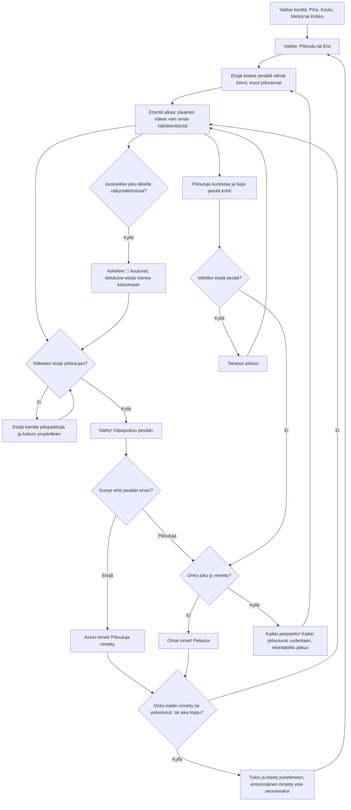

# Kirkkis: one round of kirkonrotta against the computer

How one round of Kirkkis plays (v4, #67). The player either hides or seeks; the other four are
computer players, or friends' phones. Everyone, the computer players too, sees only their own
field of view, and walls, trees and bushes block it. A seen hider is named only when the seeker
reaches the base first and calls "Ainon nimet!"; a hider who reaches the base first calls "Omat
nimet!" and is saved, and once someone has been named that frees everyone: "Kaikki pelastettu!".
Versions 1–3 called these "Kirkkis Aino!" and "Kirkkis minä!", had no "Kaikki pelastettu!", and
seeking took 100 s. v6 (#109) adds three more maps to pick from (the yard of v1–v5 is the first),
and running is heard: steps 👣 show through walls, and the computer seeker goes to look.

## Colours

- **blue**: the menu, where a round starts and ends
- **amber**: a check that decides the path
- **violet**: counting and searching, with each player's own field of view
- **teal**: a hider on the move: racing, peeking or going back
- **green**: a hider saved, or everyone freed
- **rose**: a hider named (caught)

## Boxes

- **Valitse kenttä: Piha, Koulu, Metsä tai Kirkko**: `games/kirkkis/v6/index.html` `MAPS` (size, base, solid things, bushes and the drawing under them per map) and `loadMap()`, which rebuilds the walking grid (`blocked`) and the hiding places (`SPOTS`). Alone the menu's tiles pick it (`pickSolo()`, saved in `ai-pelit:kirkkis:kentta`, the yard when nothing is saved); with friends the host picks it under the room's player list (`roomControls()`), and the round's `kr` and `kfin` carry it (`map`), so every phone loads the same one in `castFrom()`.
- **Valitse: Piiloudu tai Etsi**: `newRound()` (v4 onwards); the button for the role the rules give next is outlined.
- **Etsijä laskee pesällä silmät kiinni, muut piiloutuvat**: `setupRound()`; `COUNT` is 10 s; the counting seeker sees nothing (`seesPoint()`), and a seeking player sees a dark screen. Computer hiders walk to their own place in `SPOTS`: spots out of sight of the base, or inside a bush.
- **Etsintä alkaa: jokainen näkee vain oman näkökenttänsä**: `canSee()`: 110° wide and 10 m long, cut by solid things (`castRay()`), anyone within 1.3 m whatever way one looks, and someone in a bush only from 2.4 m. The player's own view is cut out of the fog (`viewPoly()`); the seeker's view is drawn red when the player can see the seeker.
- **Etsijä kiertää piilopaikkoja ja katsoo ympärilleen**: `seekerBot()` walks A* paths (`findPath()`) to hiding places it has not looked at in 30 s, nearer ones first, and turns a full circle at each. A bush counts as looked at only from 2.4 m (`spotChecked()`), as close as someone in it is seen.
- **Juokseeko joku lähellä näkymättömissä?**: `hears()` (v6): faster than `LOUD` (2.6 m/s, a long drag or a computer player running) within `HEAR` (7 m), when it cannot be seen, walls or not. The seeker hears the hiders still out; a hider still out hears the seeker. Sneaking with a short drag is quiet.
- **Askeleet 👣 kuuluvat; tietokone-etsijä menee katsomaan**: `listen()` drops a footprint every 0.3 s where this phone's player hears someone (`prints`, drawn over the fog, fading in a second, with a soft step sound); on a guest phone it works from the positions and speeds the host sends. `seekerBot()` sets its goal to where it heard a hider and looks around there.
- **Nähty! Kilpajuoksu pesään**: `spot()`; a seen computer hider runs for the base, and a computer seeker runs back to it.
- **Kumpi ehtii pesään ensin?**: `rules()`: within 1.4 m of the base. A hider counts only after first going 5 m away from it.
- **Ainon nimet! Piiloutuja nimetty**: the `kirk` event in `show()`: the seeker calls every hider seen, "Ainon nimet, Eetun nimet!" (the genitive from `gen()`); on the named player's phone "Sinut nimettiin!", and the HUD says "Nimetty".
- **Onko joku jo nimetty?**: `rules()`: a hider at the base when any hider is `caught` calls `allSaved()` instead of being saved.
- **Omat nimet! Pelastui**: the `save` event in `show()`.
- **Kaikki pelastettu! Kaikki piiloutuvat uudestaan, etsintäkello jatkuu**: `allSaved()`: every hider, the saved and the named too, is hiding again and must again go 5 m from the base; the seeker is put back at the base to count `COUNT` again; the computer hiders pick new places (`pickSpots()`) and the seeker forgets where it looked. The seek clock is kept in `seekLeft`, keeps running through the count (shown in the HUD), and `startSeek()` goes on from it; if it runs out during the count, `timeUp()` saves everyone out. The first one named is forgotten. With friends the host sends the `all` event and `sl`; each phone shows it from its own side, and a seeker's phone moves its own player to the base.
- **Piiloutuja kurkistaa ja hiipii pesää kohti**: `hiderBot()`: runs when it sees the seeker far from the base and looking away, or saw it go far in the last 6 s; when brave enough it creeps toward the base, and runs once the base is in sight and the seeker is not.
- **Vahtiiko etsijä pesää?**: a computer hider that sees the seeker within 6 m of the base goes back to its place and waits, so guarding the base does not win.
- **Onko kaikki nimetty tai pelastunut, tai aika loppu?**: `SEEK_TIME` is 200 s (100 s before v4); whoever is still out when it ends is saved (`timeUp()`).
- **Tulos ja tilasto puhelimeen; ensimmäinen nimetty etsii seuraavaksi**: `end()` saves rounds, times saved, times named and hiders named in `ai-pelit:kirkkis:tilasto` (the keys keep v1's words: `kirkattiin`, `kirkkasit`, shown as "nimesit"); `nextSeeker` is the first one caught, or the same seeker when nobody was.
