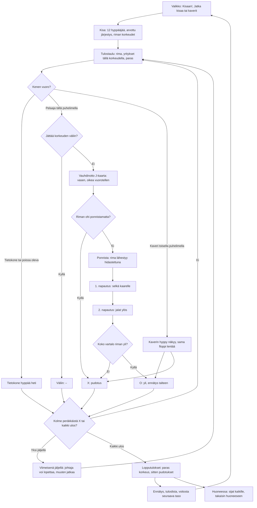

# Korkeushyppy: one jump and one meet

How Korkeushyppy plays (v1). A meet has twelve jumpers: the player and eleven computer jumpers
alone, or 2–8 phones in a room with the computer filling the rest. The bar rises height by height;
at each height everyone still in takes a first attempt in a drawn order, then those who failed a
second, then a third. Three failures in a row, at any heights, end a jumper's meet; a height may be
passed. On their turn the player runs the J by tapping the left and right foot in turn, takes off
with the middle pad on the green spot, and over the bar taps twice: the back arches (hips up), then
the legs lift. The computer's attempts are worked out at once.

## Colours

- **blue**: what the player sees and does
- **violet**: someone else jumping: the computer, or a friend on another phone
- **amber**: a check that decides the path
- **teal**: the meet's rules and a cleared or passed height
- **rose**: a failure, marked X
- **green**: the end of the meet and what it saves

## Boxes

- **Valikko: Kisaan!, Jatka kisaa tai kaverit**: `showMenu()` in `games/korkeushyppy/v1/index.html`. "Kisaan!" starts a new meet at the player's level (`taso`), the line under the title tells where the bar starts; "Jatka kisaa (rima N m)" shows when a meet alone was left unfinished (`kesken`, saved after each of the player's attempts); "👥 Pelaa kavereiden kanssa" opens the room (`public/rooms.js`, 2–8 phones). The menu shows meets, wins and the record (`kisat`, `voitot`, `ennatys`).
- **Kisa: 12 hyppääjää, arvottu järjestys, riman korkeudet**: `newComp()`: the players, then computer jumpers up to twelve (`FIELD`), each with a skill (the height it clears half the time) around `base(level)` (1.75 m at level 1, 2.5 cm more per level up to 1.90 m) and a first height a little under it. `heightsFor()`: the bar starts 25 cm under `base`, rises 5 cm at a time, then 3 cm, then 2 cm (never a bigger step than before, as the rules say).
- **Tulostaulu: rima, yritykset tällä korkeudella, paras**: `drawBoard()`, shown for 3.5 s (`BOARD_T`) before each player's turn; alone a tap skips it. "NYT" is the attempts at this height as on a result sheet (O, X, –), "ulos" for a jumper out. The standings (`standings()`, `placeOf()`) go by the best height cleared, then fewer failures at that height, then fewer failures in all up to it; a full tie shares the place (no jump-off).
- **Kenen vuoro?**: `advance()` jumps for every computer jumper up to the next player on a phone (`due()`: not out, has not cleared or passed this height, and is at this attempt round); `follow()` makes the turn each phone draws (`th`), its own (`mine`) or someone else's.
- **Tietokone hyppää heti**: `cpuTry()`: clears with a chance that falls from near certain to near nought within about 10 cm around its skill. In a room the host's "Jatka ilman heitä" hands an away phone's attempts to the computer (`R.on('continue')`) until it is back (`R.on('back')`); while a phone is away the meet waits (`R.paused`).
- **Jättää korkeuden väliin?**: the "⏭ Jätä korkeus väliin" button on the canvas before the run (`actBoxes`, acts when the finger lifts on it, `pass()`). A failure before the pass still counts: X then a pass leaves two attempts at the next height (`t.run`, three in a row and out).
- **Väliin: –**: `mark()` writes '-' for the rest of the height.
- **Vauhdinotto J-kaarta: vasen, oikea vuorotellen**: `press()`: a step on the other foot adds speed, more the slower the jumper goes (as in Aitajuoksu and Keihäänheitto), the same foot twice slows. From 6 m before the bar (`CURVE0`) the run is on the curve of the J (drawn as a dashed line on the apron, `depth()`), where more than 8 m/s (`VCURVE`) cannot be carried. The green ellipse is where to take off (`ZONE`, 0.8–1.4 m before the bar).
- **Riman ohi ponnistamatta?**: `step()`: reaching the bar (`RUN_PAST`) without a take-off is a failure, "Ohijuoksu". In a room a minute with no tap (`TURN_MAX`, as in the rules, counted in `th.idle`) is a failure, "Aika loppui".
- **Ponnista: rima lähestyy hidastettuna**: `jumpPress()` and `takeOff()` (only on the curve, `JUMP_FROM`): `flight()` gives the lift from the run-up speed, less the further the take-off is off the green, and the drift over the bar. The flight plays at 0.45 speed (`SLOW`) so the two taps can be timed; the camera zooms in on the bar.
- **1. napautus: selkä kaarelle** and **2. napautus: jalat ylös**: `airTap()`. The body is five points (head, shoulders, hips, knees, feet) around the centre of mass, blended from standing (`UP`) to lying back (`LAY`), then arched (`ARCH`: hips up, shoulders down) and kicked (`KICK`: legs up, hips down), turning head down after the peak (`pose()`). Arching before the shoulders are over drops them on the bar, kicking before the hips are over drops the hips; never arching leaves the hips low, never kicking leaves the legs.
- **Koko vartalo riman yli?**: `flyStep()` and `check()`: ten points along the body (`SAMPLES`, each with its thickness) must each pass the plane of the bar above it; the lowest pass is the margin. `whyFail()` tells why not: "Liian läheltä" or "Liian kaukaa" (the take-off), "Kaari liian aikaisin", "Kaarra selkä…", "Jalat liian aikaisin", "Nosta jalat…", "Korkeus ei riittänyt" (speed). A pass within 3 cm wobbles the bar, "Rima heilui, mutta pysyi!". The drawing uses the same points, so what touches the bar is what the player sees.
- **Kaverin hyppy näkyy, sama floppi lentää**: the jumper's phone sends where its jumper is twelve times a second (`p`), the take-off (`up`), each tap with its flight time (`tap`) and the whole jump on landing (`done`); the host passes them on, and every phone flies the same jump with `jumpResult()`, so all show the same result.
- **O: yli, ennätys talteen**: `landed()`: a new record is saved at once (`ennatys`). The jumper's phone reports the attempt (`res`: O, X, - or S); the host records it once (`seq`) and sends the meet to everyone (`c`).
- **Kolme peräkkäistä X tai kaikki ulos?**: `mark()` and `advance()`: three failures in a row put a jumper out; the meet ends when no one is left in. With no player on a phone left in, the computer jumps the rest at once.
- **Viimeisenä jäljellä: johtaja voi lopettaa, muuten jatkaa**: the last one in, with everyone else out, goes on jumping the next heights. Only when they also lead the standings (`soleWinner()`: best height, then countback, `placeOf() === 1`) does the turn say "Voitit! Jatka?" and offer "🏁 Lopeta" (`stopMeet()`, 'S'), which ends their meet there. Behind a jumper already out (a worse countback, or a height passed that the other cleared) it says "Viimeisenä jäljellä" and offers only the pass, so they can still try to win.
- **Lopputulokset: paras korkeus, sitten pudotukset**: `over()` and `netEnd()`: the standings with 🥇🥈🥉 and each jumper's failures at their best height and in all up to it (the countback), shown for a few seconds.
- **Ennätys, tuloslista, voitosta seuraava taso**: `netEnd()` saves `kisat`, and alone a first place adds `voitot` and the next level (`taso`); the meet's best height goes to the high-score list with `AiPelitScores.submit()` (`korkeushyppy` in `public/scores.js` and `server/api.js`, see `tuloslistat.md`).
- **Huoneessa: sijat kaikille, takaisin huoneeseen**: the host sends the results with `R.deliver()`; each phone saves its own meet once (`R.once()`), shows its place and the top eight in the room (`afterEnd()`, `R.note()`, `R.backToRoom()`).
