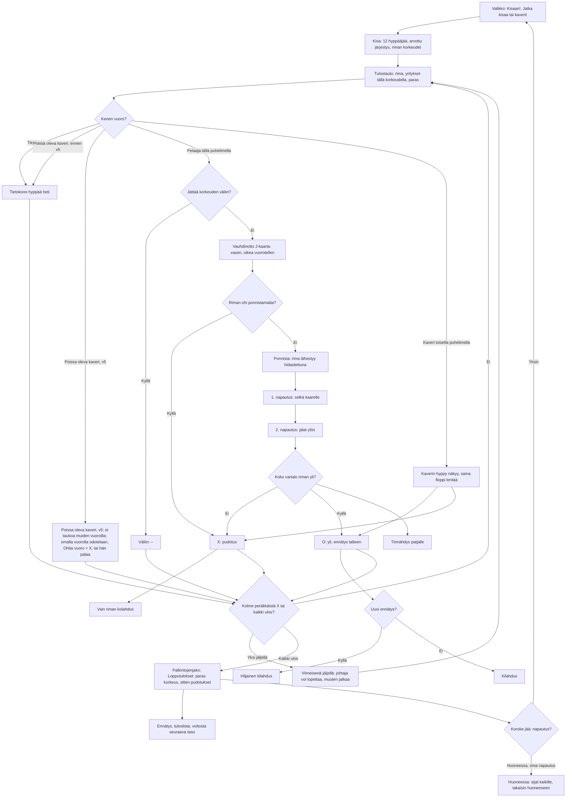

# Korkeushyppy: one jump and one meet

How Korkeushyppy plays (v1; v3 (#176) ends the meet with the medal ceremony from `yleisurheilu-4`, the podium staying until a tap; v2 plays the same, with the meet, the results board, the saves and the
room handling from the shared athletics library's bar-height format, `public/lib/yleisurheilu-1/korkeus.js` (from v3 `yleisurheilu-4/korkeus.js`),
see `yleisurheilu-kirjasto.md`; v2 also has Keihäänheitto v3's buttons, the jump a full-width bar above
the two feet with a gap that does nothing, and the running knee bends the right way, #170). A meet has twelve jumpers: the player and eleven computer jumpers
alone, or 2–8 phones in a room with the computer filling the rest. The bar rises height by height;
at each height everyone still in takes a first attempt in a drawn order, then those who failed a
second, then a third. Three failures in a row, at any heights, end a jumper's meet; a height may be
passed. On their turn the player runs the J by tapping the left and right foot in turn, takes off
with the middle pad on the green spot, and over the bar taps twice: the back arches (hips up), then
the legs lift. The computer's attempts are worked out at once.

From v4 (#220) the jump sounds like one: the beeps are recorded sounds from the shared library `public/lib/aanet-2/` (`aanikirjasto.md`), loaded in `games/korkeushyppy/v4/index.html` as `AU` (`S` is the drawing scale there) — a blip when the turn comes, footsteps, the take-off thump with a whoosh, a soft whoosh for each tap over the bar, the bar's metal clatter when it falls, a thud on the mat, a chime for a clear or applause for a new record, the crowd's "ooh" for a failure, and a steel-drum chime per medal. Each falls back to v3's own beep when it cannot play (before the sound loads, offline on the first open); the mat's thud has no beep, as v3 had none.

v5 (#297) plays as v4 on `public/lib/yleisurheilu-5/`: with friends the meet waits only for the phone on turn, a friend may leave and come back ("↩ Palaa kierrokseen"), the host's "Ohita vuoro" skips an away friend's turn as a miss (the computer never takes them), and the friends not on turn stand in a row at the bottom of the scene as spectators with "📣 Kannusta" (`K.drawFans()` in `drawScene()`, see `yleisurheilu-kirjasto.md`).

v6 (#311) adds the outfit picker ("👕 Asu" in the menu, `asut.md`): the player's jumper wears the outfit in every pose, on the podium and on friends' phones, and the choice is one for every athletics event and Ottelu (`data-share="yleisurheilu"` in `games/korkeushyppy/v6/index.html`).

Since #346 only each game's newest version folder is kept: a `games/<slug>/v<N>/` path below that is not the newest names a version that is history now (its files are in git's history, and the site sends its address to the newest), and what it says about that version is how it was.

v8 (#337, `aanet-4`) has no crowd: a clearance (a record too) is the quiet `onnistui` blip at 0.3, a failure only the bar's clatter, the podium only the medal tune, and "📣 Kannusta" a quiet blip at 0.25 (`cheerSound`).

v10 (#355) loads `aanet-5`, where the sounds Eero still found too loud are swapped for softer ones he picked by ear, or play quieter (the winning and losing tunes); the cheer's chime plays at 0.08, not 0.25 pitched up.

v9 (#341) plays as v8 on `public/lib/yleisurheilu-7/`: the friends watching stand behind the boards, drawn before the athlete so they never cover it (`K.drawFans(x, {..., walk: true})` in `drawScene()`), and a tap on the scene walks your own figure there on every phone (`K.tapFans()` first in the canvas's `pointerdown`). See `yleisurheilu-kirjasto.md`.

v11 (#373) plays as v10 on `public/lib/yleisurheilu-8/`: the friends watching run after the athlete as the background moves, a little slower than it, and catch up once it stops (`scroll:` in the `K.drawFans()` call in `drawScene()`, 0 with the athlete at the start), and a tap on another spectator climbs onto their shoulders (`K.tapFans(px, py)` in the canvas's `pointerdown`). See `yleisurheilu-kirjasto.md`.

v12 (#395) plays as v11 on `public/lib/yleisurheilu-9/`: the friends watching no longer run. The row only slides with the background, a little slower than it, and stops when it stops; legs move only on a tapped walk.

## Colours

- **blue**: what the player sees and does
- **violet**: someone else jumping: the computer, or a friend on another phone
- **amber**: a check that decides the path
- **teal**: the meet's rules and a cleared or passed height
- **rose**: a failure, marked X
- **green**: the end of the meet and what it saves; from v4 also what the player hears

## Boxes

- **Valikko: Kisaan!, Jatka kisaa tai kaverit**: `showMenu()` in `games/korkeushyppy/v1/index.html`. "Kisaan!" starts a new meet at the player's level (`taso`), the line under the title tells where the bar starts; "Jatka kisaa (rima N m)" shows when a meet alone was left unfinished (`kesken`, saved after each of the player's attempts); "👥 Pelaa kavereiden kanssa" opens the room (`public/rooms.js`, 2–8 phones). The menu shows meets, wins and the record (`kisat`, `voitot`, `ennatys`).
- **Kisa: 12 hyppääjää, arvottu järjestys, riman korkeudet**: `newComp()` (v2: `meet()` in `kisa.js` (from v5 `yleisurheilu-5/kisa.js`, #297) and `heights()` in `public/lib/yleisurheilu-1/korkeus.js` (from v3 `yleisurheilu-4/korkeus.js`), with `heightsFor()` and the computer's `plan` from the game): the players, then computer jumpers up to twelve (`FIELD`), each with a skill (the height it clears half the time) around `base(level)` (1.75 m at level 1, 2.5 cm more per level up to 1.90 m) and a first height a little under it. `heightsFor()`: the bar starts 25 cm under `base`, rises 5 cm at a time, then 3 cm, then 2 cm (never a bigger step than before, as the rules say).
- **Tulostaulu: rima, yritykset tällä korkeudella, paras**: `drawBoard()` (v2: `board()` in `korkeus.js`), shown for 3.5 s (`BOARD_T`) before each player's turn; alone a tap skips it; from v4 the turn starting plays `valinta` on the jumper's phone. "NYT" is the attempts at this height as on a result sheet (O, X, –), "ulos" for a jumper out. The standings (`standings()`, `placeOf()`) go by the best height cleared, then fewer failures at that height, then fewer failures in all up to it; a full tie shares the place (no jump-off).
- **Kenen vuoro?**: `advance()` (v2: in `korkeus.js`) jumps for every computer jumper up to the next player on a phone (`due()`: not out, has not cleared or passed this height, and is at this attempt round); `follow()` makes the turn each phone draws (`th`), its own (`mine`) or someone else's.
- **Tietokone hyppää heti**: `cpuTry()`: clears with a chance that falls from near certain to near nought within about 10 cm around its skill. In a room the host's "Jatka ilman heitä" hands an away phone's attempts to the computer (`R.on('continue')`) until it is back (`R.on('back')`); while a phone is away the meet waits (`R.paused`). From v5 (`yleisurheilu-5/`, #297) this is the computer's competitors only: a friend's phone is never handed over.
- **Poissa oleva kaveri, v5: ei taukoa muiden vuoroilla; omalla vuorolla odotetaan, Ohita vuoro = X, tai hän palaa**: from v5 (`yleisurheilu-5/`, #297) the library calls `R.turns()` with the competitor on turn, so a friend who closes the game or leaves the room stops nobody while others are on turn. On their own turn every phone shows "⏸ Odotetaan: <nimi>"; the host's "Ohita vuoro" (`R.on('skip')`) records the format's `missed` mark (X) and the meet goes on, or the friend comes back ("↩ Palaa kierrokseen" on the room screen) and takes the turn themselves. See `yleisurheilu-kirjasto.md`.
- **Jättää korkeuden väliin?**: the "⏭ Jätä korkeus väliin" button on the canvas before the run (`actBoxes`, acts when the finger lifts on it, `pass()`). A failure before the pass still counts: X then a pass leaves two attempts at the next height (`t.run`, three in a row and out).
- **Väliin: –**: `mark()` writes '-' for the rest of the height.
- **Vauhdinotto J-kaarta: vasen, oikea vuorotellen**: `press()` (from v4 `askel` or `askel2` per tap, a little faster at speed): a step on the other foot adds speed, more the slower the jumper goes (as in Aitajuoksu and Keihäänheitto), the same foot twice slows. From 6 m before the bar (`CURVE0`) the run is on the curve of the J (drawn as a dashed line on the apron, `depth()`), where more than 8 m/s (`VCURVE`) cannot be carried. The green ellipse is where to take off (`ZONE`, 0.8–1.4 m before the bar).
- **Riman ohi ponnistamatta?**: `step()`: reaching the bar (`RUN_PAST`) without a take-off is a failure, "Ohijuoksu". In a room a minute with no tap (`TURN_MAX`, as in the rules, counted in `th.idle`) is a failure, "Aika loppui".
- **Ponnista: rima lähestyy hidastettuna**: `jumpPress()` and `takeOff()` (from v4 `ponnistus` and a soft `suhahdus`) (only on the curve, `JUMP_FROM`): `flight()` gives the lift from the run-up speed, less the further the take-off is off the green, and the drift over the bar. The flight plays at 0.45 speed (`SLOW`) so the two taps can be timed; the camera zooms in on the bar.
- **1. napautus: selkä kaarelle** and **2. napautus: jalat ylös**: `airTap()` (from v4 a quiet `suhahdus` each, the second a little higher). The body is five points (head, shoulders, hips, knees, feet) around the centre of mass, blended from standing (`UP`) to lying back (`LAY`), then arched (`ARCH`: hips up, shoulders down) and kicked (`KICK`: legs up, hips down), turning head down after the peak (`pose()`). Arching before the shoulders are over drops them on the bar, kicking before the hips are over drops the hips; never arching leaves the hips low, never kicking leaves the legs.
- **Koko vartalo riman yli?**: `flyStep()` and `check()`: ten points along the body (`SAMPLES`, each with its thickness) must each pass the plane of the bar above it; the lowest pass is the margin. `whyFail()` tells why not: "Liian läheltä" or "Liian kaukaa" (the take-off), "Kaari liian aikaisin", "Kaarra selkä…", "Jalat liian aikaisin", "Nosta jalat…", "Korkeus ei riittänyt" (speed). A pass within 3 cm wobbles the bar, "Rima heilui, mutta pysyi!". The drawing uses the same points, so what touches the bar is what the player sees.
- **Kaverin hyppy näkyy, sama floppi lentää**: the jumper's phone sends where its jumper is twelve times a second (`p`), the take-off (`up`), each tap with its flight time (`tap`) and the whole jump on landing (`done`); the host passes them on, and every phone flies the same jump with `jumpResult()`, so all show the same result.
- **O: yli, ennätys talteen**: `landed()`: a new record is saved at once (`ennatys`). The jumper's phone reports the attempt (`res`: O, X, - or S); the host records it once (`seq`) and sends the meet to everyone (`c`).
- **Tömähdys patjalle**: v4: `landed()` plays `tomahdys` on every phone, softer for someone else's jump, and once: a watching phone that landed its own copy of the jump before the jumper's `done` arrives takes the result from `done` with no second thud and keeps its landing time.
- **Uusi ennätys?**: v4: `landed()` asks `K.record(th.bar)` for a cleared height on this phone; no record yet counts as a new one.
- **Hiljainen kilahdus**: from v8 (#337) `onnistui` at 0.3 for every clearance, a record too, with no applause. Before it, v4: `aplodit` 0.25 s after landing. When it cannot play, v3's two-note beep.
- **Kilahdus**: v4: `onnistui` 0.25 s after landing, or v3's two-note beep.
- **Vain riman kolahdus**: from v8 (#337) a failed jump plays only the bar's `rima` clatter, no crowd's "ooh". Before it, v4: `ohhoo` on the jumper's phone for a failed jump (after the bar's `rima` clatter, which every phone hears when the bar falls, in `step()` and on another phone's `done`) and for running past the bar (`outcome()`, or v3's falling beep).
- **Kolme peräkkäistä X tai kaikki ulos?**: `mark()` and `advance()`: three failures in a row put a jumper out; the meet ends when no one is left in. With no player on a phone left in, the computer jumps the rest at once.
- **Viimeisenä jäljellä: johtaja voi lopettaa, muuten jatkaa**: the last one in, with everyone else out, goes on jumping the next heights. Only when they also lead the standings (`soleWinner()`: best height, then countback, `placeOf() === 1`) does the turn say "Voitit! Jatka?" and offer "🏁 Lopeta" (`stopMeet()`, 'S'), which ends their meet there. Behind a jumper already out (a worse countback, or a height passed that the other cleared) it says "Viimeisenä jäljellä" and offers only the pass, so they can still try to win.
- **Palkintojenjako; Lopputulokset: paras korkeus, sitten pudotukset**: `over()` and `netEnd()` (v2: the library's `over()`, `end()` and `K.step()`): the standings with 🥇🥈🥉 and each jumper's failures at their best height and in all up to it (the countback), shown for a few seconds. From v3 (#176) the end is the medal ceremony, `K.drawPodium()` at the end of `draw()` over the whole screen: the top three on the podium in the game's kit (`look`), an official hangs their medals with a chime each (`chime`; from v4 the `mitali` sound, a little lower for each better place, and applause with the gold), and the final standings under it. Medals go by place (`yleisurheilu-4`): a full countback tie shares the place and the medal: in the standings, and on the podium, where everyone placed 1st–3rd stands on their place's block, a shared place side by side.
- **Koroke jää: napautus?**: from v3 nothing leaves the podium by itself: the tap handler calls `K.skip()` alone and with friends; a tap during the ceremony finishes it (alone only), a tap after it shows the menu, or `R.backToRoom()` in a room, each phone by its own tap. Before v3 this came by itself after a few seconds.
- **Ennätys, tuloslista, voitosta seuraava taso**: `netEnd()` saves `kisat`, and alone a first place adds `voitot` and the next level (`taso`); the meet's best height goes to the high-score list with `AiPelitScores.submit()` (`korkeushyppy` in `public/scores.js` and `server/api.js`, see `tuloslistat.md`).
- **Huoneessa: sijat kaikille, takaisin huoneeseen**: the host sends the results with `R.deliver()`; each phone saves its own meet once (`R.once()`), shows its place and the top eight in the room (`afterEnd()`, `R.note()`, `R.backToRoom()`).
