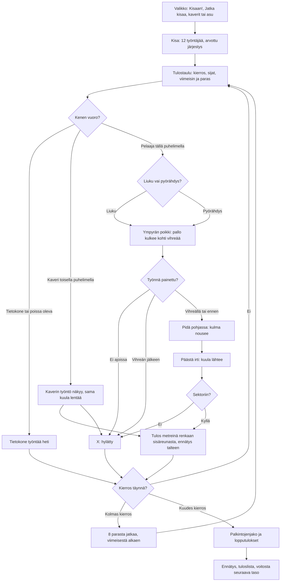

# Kuulantyöntö: one put and one meet

How Kuulantyöntö plays (v1, #268). The meet, the results board, the saves and the room are the
shared athletics library's (`yleisurheilu-4/kisa.js`, see `yleisurheilu-kirjasto.md`): twelve
putters, three rounds, the best eight put three more. The circle is seen from the side. On their
turn the player picks the glide or the spin, presses Työnnä when the thrower reaches the power
position, holds it while the angle rises and lets go at the green angle. The computer's puts are
worked out at once.

## Colours

- **blue**: what the player sees and does
- **violet**: someone else putting: the computer, or a friend on another phone
- **amber**: a check that decides the path
- **teal**: the meet's rules and the measured put
- **rose**: a foul, marked X
- **green**: the end of the meet and what it saves

## Boxes

- **Valikko: Kisaan!, Jatka kisaa, kaverit tai asu**: `showMenu()` in `games/kuula/v1/index.html`. "Kisaan!" starts a new meet at the player's level (`taso`); "Jatka kisaa (kierros N/6)" shows when a meet alone was left unfinished (`kesken`); "👥 Pelaa kavereiden kanssa" opens the room (`public/rooms.js`, 2–8 phones); "👕 Asu" the outfits (`public/outfits.js`).
- **Kisa: 12 työntäjää, arvottu järjestys**: `AiPelitKisa.meet()` in `public/lib/yleisurheilu-4/kisa.js` with `AiPelitKisa.rounds()`: the players, then computer putters up to twelve, each with a skill around `base(level)` (14 m at level 1, 0.8 m more per level up to 19 m).
- **Tulostaulu: kierros, sijat, viimeisin ja paras**: the library's `K.drawBoard()`, shown for 3.5 s (`BOARD_T`) before each player's turn; alone a tap skips it.
- **Kenen vuoro?**: the library's `advance()` and `follow()`; the game's `newTurn()` sets up this phone's view of the put (`th`).
- **Tietokone työntää heti**: `cpuMark()`: the skill plus a scatter of 0.8 m, a foul one time in ten. In a room the host's "Jatka ilman heitä" hands an away phone's puts to the computer.
- **Liuku vai pyörähdys?**: `press(k)` in the `ready` phase: the left pad is the glide (1), the right the spin (2), both in `TECH`. The glide is easier: a push window of ±0.14 s and straight down the middle, about 19.4 m at best. The spin puts further, about 22.3 m at best, but its window is ±0.085 s and an early push goes wide (`pushDev()`).
- **Ympyrän poikki: pallo kulkee kohti vihreää**: the `move` phase: the hips go across the circle on `hip(k, t)`, reaching the power position at `T` seconds. The strip under the field (`drawStrip()`) shows the time as a ball running to the green window and the red end over the board. From here the whole pad area is Työnnä (`pads()`).
- **Työnnä painettu?**: `startPush()`: how far the press is from the power position (`off`) sets the shot's speed (`pushSpeed()`): within the window a little less the further off; earlier, much weaker. After the window the weight is already over the board, "Liian myöhään: yli renkaan"; no press by then, "Ei työntöä ajoissa: yli renkaan" (in `step()`); in a room a minute in the `ready` phase, "Aika loppui".
- **Pidä pohjassa: kulma nousee**: the `push` phase: the angle rises 40° a second from 10° (`AIM0`, `AIM_RATE`), shown on a dial with the green angles 33–42° (`GREEN`); held to 70° it goes by itself.
- **Päästä irti: kuula lähtee**: `release()` and `letGo()`: the put goes at the angle reached, from the hand 2.1 m up over the front foot (`REL_H`, `REACH`). A steeper push is weaker (`relSpeed()`), so the best angle is about 37°. In a room the put goes to every phone rounded (`rel`), and each flies the same shot with `throwNow()`.
- **Sektoriin?**: `flight()`: the landing is measured from the circle's centre; outside 17.46° of the middle it is "Sektorin ulkopuolelle". A small map from above in the corner (`drawSector()`) shows where it came down, which the side view cannot.
- **Kaverin työntö näkyy, sama kuula lentää**: the putter's phone sends where it is twelve times a second (`p`: the phase, the time, the way across, the angle) and the put (`rel`); a foul goes as `rel` with its reason.
- **Tulos metreinä renkaan sisäreunasta, ennätys talteen**: `flight()` and `landed()`: the mark is the distance from the centre less 1.0675 m, down to the centimetre, as World Athletics measures it. A new record is saved at once (`ennatys`). The shot thuds down (`tomahdys`); the crowd claps a new lead or record (`aplodit`), a foul gets an "ooh" (`ohhoo`); sounds from `public/lib/aanet-2/`.
- **8 parasta jatkaa, viimeisestä alkaen**: the library's rounds format after round 3.
- **Palkintojenjako ja lopputulokset**: `K.drawPodium()` at the end of `draw()`: the top three on the podium in their outfits, a steel-drum run per medal (`mitali`), until a tap.
- **Ennätys, tuloslista, voitosta seuraava taso**: the library saves `kisat`, and alone a win adds `voitot` and the next level; the meet's best put goes to the high-score list with `AiPelitScores.submit()` (`kuula` in `public/scores.js` and `server/api.js`, see `tuloslistat.md`).
