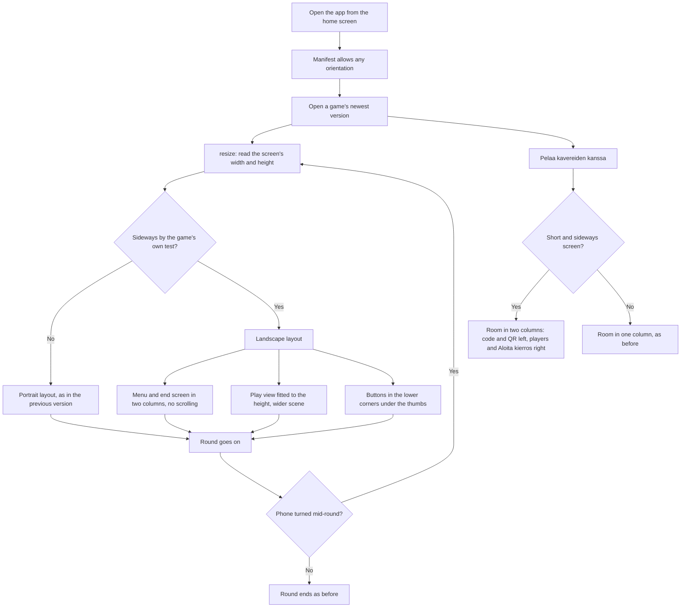

# Landscape: playing with the phone on its side

How a game lays itself out when the phone turns (#95). The installed app may now turn sideways,
and every game version made for this checks the screen's shape on each resize and picks its
portrait or its landscape layout from it. Only the drawing and the buttons move: the round, its
clock and its physics carry on as they were, so turning the phone mid-round keeps the round. The
shared room screen does the same with CSS alone.

## Colours

- **blue**: opening the app and a game
- **amber**: a check that decides the layout
- **teal**: as before this change
- **violet**: new in landscape

## Boxes

- **Manifest allows any orientation**: `public/manifest.webmanifest` has `"orientation": "any"` (was `"portrait"`), so the installed app turns with the phone.
- **Open a game's newest version**: the new versions made for #95: aitajuoksu v4, areena v4, hiihto v8, kaahari v3, kaaosrata v2, kirkkis v5, lentopallo v4, orava v2, pallorata v2, piano v6, puhelinkoppi v5, sormiskeitti v6, trampoliini v5, vauvan-syotto v2, voimistelu v6 (`games/<slug>/v<N>/index.html`). Older versions keep their portrait layout.
- **Sideways by the game's own test?**: in `resize()` (Voimistelu: `wide()`), from `W` and `H`. Eleven games take wider than tall (`W > H`). Aitajuoksu v4 waits until it is 15 % wider (`W > H * 1.15`), so a nearly square screen keeps the upright layout with its taller track. Lentopallo v4 also needs a short screen (`W > H && H < 500`), so a tablet keeps the upright court. Orava v2 asks the browser (`matchMedia('(orientation:landscape) and (max-height:520px)')`), and Pallorata v2's menu uses the same kind of CSS rule with 540 px; its 3D view follows any size.
- **resize: read the screen's width and height**: each version's own `resize()`, run on the window's resize event, as before; it now also decides the layout.
- **Menu and end screen in two columns, no scrolling**: title and results left, buttons right; the long help text is shortened or hidden sideways. Checked at 740 × 360, 844 × 390 and 640 × 360 by each game's `tests/test_<slug>_v<N>.py`.
- **Play view fitted to the height, wider scene**: the scene keeps its size from the screen's height and shows more to the sides, or is centred; nothing about the rules or speeds changes. The 3D games, Hiihto v8 and Pallorata v2, set the three.js camera's aspect and the renderer's size from the canvas on every resize; Hiihto v8 also slides its 3D picture down 6 % sideways (`setViewOffset`) so the HUD stays in the sky. Orava v2 caps the hawk's starting distance at a 420 px wide screen, so it does not take half as long again to arrive on a wide one.
- **Buttons in the lower corners under the thumbs**: on-screen buttons move to the left and right lower corners, clear of the back chip and the play area.
- **Phone turned mid-round?**: a resize only redoes the layout, so the same round goes on; each new test turns the phone mid-round and checks this.
- **Room in two columns: code and QR left, players and Aloita kierros right**: a `@media (orientation:landscape) and (max-height:500px)` block in the CSS of `public/rooms.js`; the players list is two columns too, so a full room of 8 and the game's own host controls fit 740 × 360. Tested in `tests/test_rooms_lib.py::test_the_room_screen_fits_a_phone_on_its_side`.
