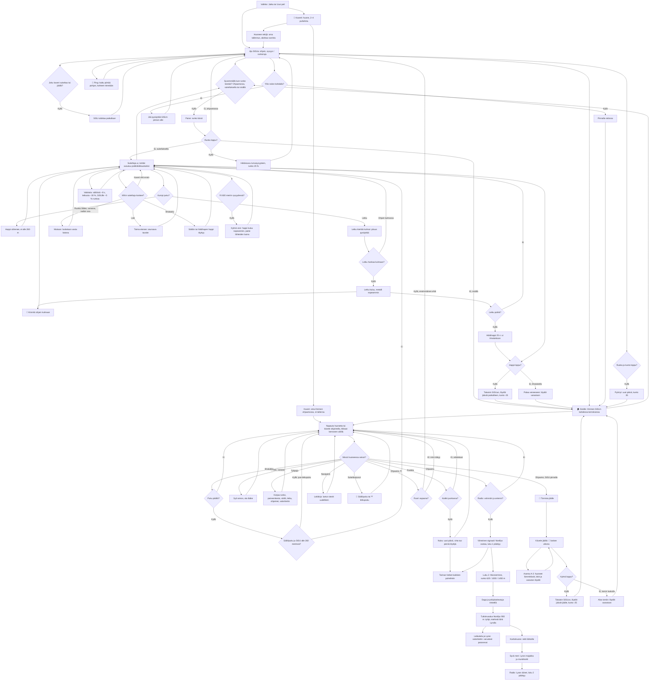

# Last Signal: sukellusvene, sonar ja sukellukset

How a day in Last Signal plays (v1 #125, v2 #129, v3 #132, v5 #138, v6 #143, v7 #145). The player drives the submarine SISU through a side view
of an arctic sea (glacier bay, wreck field, iceberg caves), listens with the sonar, stops, swims out, and brings finds
home: in the tank gear with limited air down to 260 m, or (v7) in the hose suit, as deep as SISU but only as far
as its hose reaches. Inside SISU (v3) they walk as a person between rooms on two decks: they eat in the
galley, heal, repair and upgrade, sleep in the bunk, and put on the diving suit to leave by the airlock. The amplifier and the antenna
fix the radio and end chapter 1. Chapter 2 (v2) goes down the continental slope to the empty research vessel
Nordlys and on to the deep sea, where the cold and glowing fish cost air, hose or hull. Nothing ends the game:
hunger, air and the hull each send the player back. Since v5, 2–4 phones can play one game together: the game and
its save are the host's, and each friend walks and dives as their own person. Since v6 the sea is frozen over: SISU
comes up only in a few openings, and the person climbs out through the tower to walk the ice to the abandoned station A-3.

## Colours

- **blue**: what the player sees and does
- **amber**: a check that decides the path
- **teal**: diving, the ice, finds and life inside SISU
- **rose**: damage or a setback that never ends the game
- **green**: the story moving on

## Boxes

- **Aja SISUa: ohjain, syvyys / runkoraja**: `stepSub()` in `games/last-signal/v7/index.html` (v6 down to v1 in their own folders) turns the stick (`input`) into speed, bumps off the sea floor (`floorY()`), the glacier, the ice shelf, the iceberg (`inBerg()`), the hot vents (`VENTS`) and the wrecks (`solid(…, true)`); a hard bump costs hull (`bump()`). Below 300 m `subBoost()` speeds SISU up (up to 2.2×) so the long slope does not drag. The HUD shows depth against the hull's rating (`RATING`: 160, 260, 380, 620, 1000, 1450 m); within 25 m of it "Runko natisee". Saved every 4 s.
- **📡 Ping: kaiku piirtää pohjan, kohteet nimetään**: `doPing()` sends a ring out to 450 m; contacts inside it become known (`G.s.known`) and `drawSonar()` draws the floor, the iceberg and the wrecks in sonar green for a moment. Since v7 a crack in the iceberg's east side (`BERG_EAST`, contact "RAILO JÄÄSSÄ") leads to the cache K-7 within the first hose's reach, and chapter 1's goal points there. Contacts up to 1000 m show at the screen's edge as "TUNTEMATON KONTAKTI, 640 m" until pinged; the current goal's contact is yellow (`goalNow().target`).
- **Paine: runko kärsii**: `pressure()`: below the rating the hull loses 4 % a second and "PAINE! Nouse ylemmäs" shows. Since v4 this goes on during a dive and inside SISU too ("PAINE! SISU on liian syvällä"), and the game saves every 4 s in all three, so a reload keeps the damage; v3 and earlier spared the hull once the player left the helm.
- **Hätänousu turvasyvyyteen, runko 25 %**: `breach()` ends a dive or a walk inside (the haul is lost) and lifts SISU to 40 m above the hull's rating (v1 lifted it to the surface, a long way back from the deep sea); the hull is never fatal.
- **Sukeltaja ui, kohde avautuu poikkileikkaukseksi**: `stepDive()`. Sites are grids in `SITES` (2 m cells: station A-3, two containers, the wrecks Polaris and Nordvik, the aid container in the trench); `drawSite()` fades the hull away to show the rooms when the diver is inside. The iceberg's caves are segments with a radius in `BERG.caves` (way in, upper caves, the great chamber, the side passage to cache K-7, the lower cave, the deep crack). In a big cave `diveScale()` widens the view, and `drawLayout()` shows the ice around the caves (layers, cracks, bubbles) so the great chamber reads as a hall in the ice.
- **Säiliöpuku ja SISU alle 260 metrissä?**: v7's `startDive()` opens the airlock for the tank gear only while SISU is above `TANK_MAX` (260 m): "Säiliöpuku kestää vain 260 m. Pue ➰ letkupuku."
- **Kumpi puku?**: `diver.kit`, from `crew.kit` as the suit was put on: `'tank'` or `'hose'`.
- **Happi vähenee, ei alle 260 m**: the tank gear as in v5: air (`TANK`: 60, 90, 120, 150 s) drains, air pockets fill it, and in `stepDive()` a tank diver cannot swim below `TANK_MAX` ("Säiliöpuku ei kestä syvemmälle").
- **Letku kiertää kulmat: pituus pysäyttää**: v7's hose: `hoseFollow()` keeps the corners it bends round (`hose.pts`, from `airlock()` to the diver): it catches on a new corner when the line to the diver is blocked (`clearLine()`, which lets a line lie along a wall) and slips off when the corner before it sees the diver; `tidyHose()` drops points it runs straight past. `hoseLen()` is its length; a move past `HOSE` (80, 120, 180, 260 m by `up.hose`) is held back like a wall ("Letku on lopussa (80 m). Aja SISU lähemmäs tai pidennä letkua."). The HUD shows ➰, the hose's condition and the metres left.
- **Letku hankaa kulmaan?**: `rubbing()`: each corner (points within 1.5 m are one) without a guide near it (`guided()`, `GUIDE_R`).
- **Letku kuluu, metalli nopeammin**: as the hose pays out or reels in, each rubbing corner wears it by `WEAR` (0.2 % a metre on a wreck, 0.1 % on ice or rock) times `TOUGH` of the hose level; `drawHose()` turns it from yellow to red and marks rubbing corners.
- **📌 Kiinnitä ohjain kulmaan**: near an unguided corner the dive's button is "📌 Kiinnitä ohjain (n)": `act('guide')` uses one of `inv.ohjain` (2 at the start, two for a spare part in the workshop, some night finds) and saves it in `G.s.guides`, where `drawGuides()` shows it and every later hose there is guided.
- **Letku poikki?**: `wearHose()` at 100 % calls `cutHose()`; a glowing fish's bite (`FISH_BITE` 30 % times `TOUGH`) counts too.
- **Hätähappi 25 s: ui ilmalukkoon**: a cut hose leaves `EMERG` seconds of the suit's own air (cold drains it faster, air pockets fill it); back at the airlock the haul counts, and the next dive has a whole hose.
- **Mukaan: lasketaan vasta kotona**: a touched find is asked for with `act('take')` and held for that diver (`G.held`; this phone's own in `G.carry`); since v5 `endDive(false)` asks for `act('home')`, and the host's (or, alone, the phone's own) `bank()` moves that diver's haul into `G.s.inv` and `G.s.got`.
- **Tarina etenee: seuraava tavoite**: a log (`LOGS`) opens a card and sets a flag; `goalNow()` reads the flags: container → station → hull upgrade → wrecks (Nordvik's map) → iceberg cache (antenna) → station amplifier → radio.
- **Takaisin SISUun, löydöt jäävät paikoilleen, kunto -25**: `endDive(true)`: since v5 it asks for `act('lost')`, which lets go only this diver's haul (its finds wait where they were) and takes 25 health; the person comes to in the airlock.
- **Palaa veneeseen: löydöt varastoon**: `endDive(false)` and the host's `bank()` (v5); since v3 the person then stands in the airlock, still in the suit (`crew`), not at the helm.
- **🏠 Sisälle: ihminen SISUn kahdessa kerroksessa**: `openHome()` (the 🏠 corner button, or "🚶 Sisälle" when SISU is almost still) zooms in and puts the person (`crew`) at the helm. `drawInterior()` draws the rooms of `ROOMS` as in the SISU picture of #125: the reactor in the stern and the airlock in the bow full height; upstairs the galley, control room, navigation and bunk; downstairs electrical, workshop, stores (one tin per ration), diving suits. `drawCrew()` draws the person. Sideways the whole of SISU fits; upright the view follows the person. The first visit shows a card on how to walk (`flags.koti`). Hunger runs only while someone is at the helm or diving (`people()` in `step()`): alone, time stands still inside; with friends it runs while any of them drives or dives.
- **Napauta huonetta tai kävele ohjaimella, tikkaat kerrosten välillä**: a tap on the canvas goes to `walkTo()`, which picks the room and deck; `stepCrew()` walks there, by the ladder (`LADDER`) when it is on the other deck. The stick walks along a deck (`DECK_X`), right on the stick right on the screen whichever way SISU faces (the inside is drawn mirrored when it faces left), and climbs when pushed up or down at the ladder; halfway the person holds on.
- **Missä huoneessa seisot?**: `roomOf()` and `enterRoom()`; once the person stands still, `roomActs()` puts the room's one or two actions on the big buttons (`#act`, `#act2`) above its name. The reactor and electrical rooms only say something (`say`).
- **Korjaa runko, paineenkesto, säiliö, letku, ohjaimet, valonheitin**: the workshop's two buttons: one spare part mends 35 % hull; `upgradeCard()` buys upgrades with spare parts (`COST`): the tank and (v7) the hose apart, and two hose guides for one spare part (`act('guides')`).
- **Nuku: uusi päivä, virta tuo pieniä löytöjä**: `sleep()`; `newFinds()` drops up to three small finds on the floor within the hull's reach, so food never runs out for good.
- **Lokikirja: luetut viestit uudelleen**: `logBook()` lists every log read so far (`LOGS`, found in `G.s.got`) to read again, under the current goal.
- **🤿 Säiliöpuku tai ➰ letkupuku**: v7's suit room offers both (`crew.kit`), and "🧥 Riisu puku" once one is on; one suit leaves its hook while worn, and the hose reel hangs by the airlock. The hose suit is drawn copper-coloured.
- **Puku päällä?**: the airlock's button: "🌊 Sukella ulos" runs `startDive()`, which puts the diver at the bow airlock with a full tank, or (v7) on a fresh hose with `EMERG` seconds of emergency air and, the first time, the card "➰ Letku" (`flags.letku`); without the suit it says "Pue ensin puku" and cannot be pressed.
- **Radio: vahvistin ja antenni?**: the control room's second button opens `radio()`; its first, "⛵ Ruoriin", goes back to driving (`toHelm()`, then `closeHome()` once allowed). Alone the ⛵ corner button does the same from anywhere inside; with friends only from the control room (see "Ruori vapaana?").
- **Viimeinen signaali: Nordlys vastaa, luku 1 päättyy**: `radio()` with both parts sets `flags.end`; play goes on.
- **Pyörryt: uusi päivä, kunto 35**: `faint()`, when hunger has emptied health; since v3 the person wakes in the bunk.
- **Kylmä vesi: happi kuluu nopeammin, paitsi lähteiden luona**: `chill()`: below `COLD` (600 m) air drains 1.35× (`CHILL`), not within 16 m of a vent's top (`nearVent()`); the HUD's air shows ❄️. Since v7 only a cut hose's emergency air runs there (the tank gear cannot go so deep).
- **Valokala: säiliöstä −8 s, letkusta −30 %, SISUlle −5 % runkoa**: `FISH` swim fixed loops (`fishAt()`) on the slope's foot and the deep plain; in `stepDive()` one within 2.8 m bites a whole hose (v7) or takes air (8 s from a tank, 5 s of emergency air; never below 1 s) and pushes the diver away; in `stepSub()` one beside SISU takes 5 % hull. Once per 3 s (`G.fishCd`).
- **Luku 2: Mannerrinne, runko 620 / 1000 / 1450 m**: `chapter2()` shows the chapter's card once (`flags.ch2`), after the last signal or on opening a v1 save whose chapter 1 ended. `goalNow()` then walks: hull 380 → Saga → hull 620 → lander → hull 1000 → Nordlys's chart room → hull 1450 → the beacon → the radio.
- **Saga ja pohjalaskeutuja rinteellä**: the sites `saga` (cable ship, 260–380 m) and `laskeutuja` (Nordlys's lander, 380–620 m), with `rinne` (containers) beside it; their logs point down the slope.
- **Tutkimusalus Nordlys 900 m: tyhjä, miehistö lähti Lyralla**: the site `nordlys`, a 62 × 13 grid drawn by `drawNordlys()`; inside, `drawLayout()` names its rooms (`rooms`: bridge, chart room, labs, workshop, mess, diving gear, bow store, the research sub's hangar, hold, engine room). Logs by digit (`logs`): bridge, lab, chart room, hangar.
- **Letkukela ja Lyran valonheitin: varusteet paranevat**: the finds `T` and `V`; `bank()` (v5; `endDive()` before) raises the hose a level (v7; the tank before) and the lamp to its third level, or pays 2 spare parts when that level was already bought.
- **Syvä meri: Lyran majakka ja muistikortti**: the site `majakka` on the deep plain (~1340 m) among the vents and a whale's bones (`drawDeep()`); its log ties back to the tapping in the iceberg's crack; its memory card (`K`, `inv.kortti`) goes home.
- **Radio: Lyran äänet, luku 2 päättyy**: `radio()` with the card sets `flags.end2`; play goes on.
- **👥 Kaverit: huone, 2–4 puhelinta**: v5's "👥 Pelaa kavereiden kanssa" opens `rooms.js` (`data-max="4"`). The host's phone keeps the game (`net.host`): its own save (`load()`, or a new game), SISU, the stores, meters, day and story. Each phone walks and swims its own person and tells the host where it is (`'me'`, ten times a second); the host sends the game when it changes (`sendState()`, `'s'`), where everybody and SISU are (`snapshot()`, `'f'`), and the story's moments (`story()`, `'card'`). Everything that changes the game goes through `act()`: alone or on the host `doAct()` does it at once; a friend's phone asks the host, which answers in the order the asks come (`'re'`, read by `answer()`), so the first one wins. In the navigation room the host's "👥 Huoneeseen" (`toRoom()`) takes everyone back to the room, where late friends can join; the next round goes on with the same save.
- **Huoneen tekijä: oma tallennus, aloittaa ruorista**: `R.on('start')` on the host: `begin(load())` and the helm (`net.helm`) is theirs. Only the host's `save()` writes.
- **Kaveri: oma ihminen ohjaamossa, ei tallenna**: `guestBegin()` once the host's game arrives: the friend's person stands in the control room, and the card "Mukana SISUssa" says whose game it is. A friend's `save()` does nothing, so their own Last Signal save stays as it was. A friend whose page reloads starts again in the control room (`R.on('hello')`: `letGo()` drops their haul and helm).
- **Joku kaveri sukeltaa tai jäällä?**: in `stepSub()` the helm's stick does nothing while anyone is out diving or on the ice (`people()`), and says "Odota: Aino sukeltaa" or "Odota: Aino on jäällä"; `startDive()` opens the airlock only when SISU is still.
- **SISU odottaa paikallaan**: so a diver's way home, the airlock (`airlock()`), stays where they left it.
- **Kaveri ehti ensin**: `doAct('take')`: a find goes to the first diver to ask (`G.held`, who holds what; `G.carry`, this phone's own); it is gone from everyone's sea, and a diver who touched it at the same moment hears "Aino ehti ensin". Each diver has their own air, suit and hose (v7: `hosePack()` sends a diver's hose corners with where they are, so every phone draws it; hoses never tangle); one who runs out (`act('lost')`) loses only their own haul. `bank()` counts a diver's haul into the stores when they come home.
- **Kaikki punkassa?**: `doAct('sleep')`: the night comes only when everyone in the game stands in the bunk room; otherwise "Kaikki punkkaan: odotetaan Ville".
- **Ruori vapaana?**: `doAct('helm')`: with friends the helm is taken only in the control room (elsewhere the ⛵ corner button says "Kävele ohjaamoon: ruori on siellä", and the host refuses an ask from another room; each ask carries where the person stands); alone the corner button still goes straight to the helm, as in v4. The first to ask gets the helm; the others' control room shows "⛵ Aino ruorissa" (it cannot be pressed) and the ⛵ corner button says "Aino on ruorissa". Whoever is at the helm drives SISU on their own phone; the others' SISU follows (`net.subT`).
- **Tarinan hetket kaikkien puhelimiin**: `story()` / `showStory()`: a new day, the start, chapter 1's last signal, chapter 2, chapter 2's end, fainting and the hull giving way show on every phone, each closing its own; fainting puts everyone in the bunk, and the hull giving way pulls divers in by the airlock. A card a player opens themselves (workshop, a log they found, the radio's state, the logbook) shows only on their phone, and the sea goes on for the others.
- **Ylös railon kohdalla?**: v6: `solid()` makes the sea ice (`underIce()`, from the ice shelf to the far end, not around the iceberg) solid above `ICE_Y`; only the openings in `HOLES` (one in front of the station, one on the ridge, one before the iceberg, one on the slope) let SISU up to `SURF`. Each opening is a sonar contact ("RAILO JÄÄSSÄ"), and while the first hull's parts are short `goalNow()` points at the first one until its store's finds are home (`flags.pinta`).
- **Jää pysäyttää SISUn pinnan alle**: `stepSub()`: the ice overhead, or an opening's edge when SISU is steered sideways while surfaced, stops SISU without a bump or hull damage (`onlyIce()`: anything else it touches, the iceberg or the shelf, still bumps) and says "Jää yläpuolella – pintaan pääsee vain railoista 📡". A save from v5 or earlier that left SISU where the ice is now starts just under it (`begin()`); the hull's emergency lift stops 10 m down.
- **Pinnalla railossa**: under an opening `stepSub()` draws SISU to its middle, so it comes up straight; `surfaced()` is true once it lies there with its back out of the water. The first time says "Pinnalla! 🏠 sisälle ja ohjaamon tikkaita ylös jäälle" (`flags.pinnalla`).
- **🧗 Tornista jäälle**: in the control room, while SISU is surfaced, `roomActs()` offers it in place of the helm (the ⛵ corner button still goes to the helm); pushing the stick up at the ladder does the same (`stepCrew()`). `goIce()` puts the person (`walker`) on the tower's hatch with the warmth meter full; they climb down onto SISU's back. The first time a card explains the cold (`flags.jaa`).
- **Kävele jäällä: 🥶 laskee ulkona**: `stepIce()`: the stick or a tap walks along `groundAt()`: SISU's back and planks across its opening, the sea ice, a drift up onto the shelf; open water in another opening stops the walk ("Railo: avovettä edessä"), and so does the iceberg's wall ("Jäävuoren seinä: tästä ei pääse"). Outside the meter (`walker.warm`, `#mWarm`) runs down in `WARM` (60) seconds; snow blows and frost creeps in at the screen's edge (`drawWeather()`). With friends each phone walks its own person and the others see them (`mine()`, `'ice'`).
- **Asema A-3: huoneet lämmittävät, lokit ja varaston löydöt**: the station on the shelf, `STATION` and its rooms `SROOMS` (store, bunk room, lab, radio room, hall), drawn by `drawStation()`; with the person inside its wall comes off (`drawStationInside()`) and the room's name shows. Inside the meter fills again (`WARMUP`). The radio room's diary and the lab's whiteboard are logs (`LOGS.paivakirja`, `LOGS.taulu`); bringing the store's finds home sets `flags.pinta`; the store's two spare parts and two rations and the bunk room's medicine are `ICE_ITEMS`, carried like a diver's finds (`act('take')`).
- **Takaisin SISUun, löydöt jäävät jäälle, kunto -25**: `endIce(true)` when the warmth runs out: the person comes down the ladder into the control room, `act('lost')` drops their haul (it waits in the station) and takes 25 health.
- **Alas torniin: löydöt varastoon**: by the tower's hatch (`atHatch()`) the big button "⬇️ Alas torniin" runs `endIce(false)`: the person stands at the ladder in the control room, and `act('home')` banks the haul (`bank()`), as after a dive.
