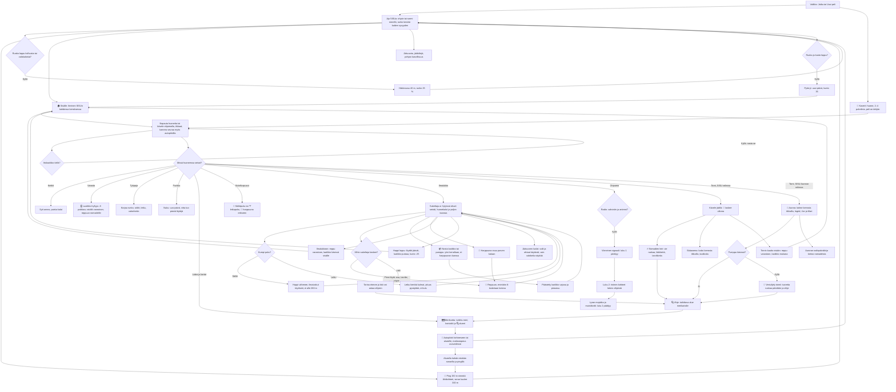

# Last Signal: sukellusvene, sonar, laatikot ja vihjeet

How a day in Last Signal plays (v1 #125 … v11 #221, v12 and v13 #300). The player drives the submarine SISU through a side
view of a frozen arctic sea, listens with the sonar, stops, swims out of the airlock (tank gear to 260 m, or the hose
suit as far as its hose reaches) and brings finds home: small ones in a bag, crates one at a time to SISU's storage
shelf. Inside SISU they walk between rooms on two decks; out of the tower they walk the ice to the stations and the
nomads' camp. Since v12 the sea is 3.34 times as wide and the sonar short, so far places are found from hints — the
logs and the nomads, who trade what they know for food, medicine and supplies — that put a search area on the chart.
Nothing ends the game: hunger, air, cold and the hull each send the player back. 2–4 phones can play one game: the
game and its save are the host's. Since v13 the research station Aurora (the old A-3) stands on the ice over the first
opening: SISU docks in its moon pool and the tower opens straight into it, and its three survivors need a new water pump.

## Colours

- **blue**: what the player sees and does
- **amber**: a check that decides the path
- **teal**: diving, crates, the ice and life inside SISU
- **rose**: damage or a setback that never ends the game
- **green**: the story and the hints moving on

## Boxes

- **Aja SISUa: ohjain tai sormi merellä, runko kestää kaiken syvyyden**: v13: a finger held on the sea steers SISU towards it (`G.subTo`, `seaPoint()` in `draw.js`); the stick takes over. `stepSub()` in `games/last-signal/v13/play.js` (v9 on are split into files, #161) turns the stick, or the autopilot's `steer`, into speed; SISU bumps off the floor (`floorY()`), the ice, the iceberg (`inBerg()`) and the wrecks (`solid(…, true)`), a hard bump costing hull (`bump()`). Since v12 (#300) the hull is no longer reinforced and the sea's pressure does nothing (`pressure()` and `RATING` are gone): the HUD shows only the depth. The world (`world.js`) is `WX()` of v11's east of the bay, 13.5 km wide; the floor's long stretches get gentle rises and dips.
- **📡 Ping 150 m nimeää lähikohteet, sonar kuulee 300 m**: `doPing()` in `game.js`: contacts within `PING` (150 m, `pingR()`) become known and the echo draws the floor onto the chart; `mapStep()` in `world.js` hears contacts within `HEAR` (300 m, v11: 1000 m). At the helm `drawSonar()` in `draw.js` shows the heard ones at the screen's edge, and the goal's search area (gold) until SISU is in it.
- **Runko loppu kolhuista tai valokaloista?**: `needs()` in `play.js` calls `breach()` at 0 hull; bumps and the glowing fish (`FISH`) take hull.
- **Hätänousu 40 m, runko 25 %**: `breach()`: 40 m up, clear of what it hit; every haul in hand is lost and crates in hands fall (`dropAll()` in `cargo.js`).
- **Irtolaatikko tiellä?**: v12: `crateBlock()` in `cargo.js`, from `stepCrew()` in `game.js`: a loose crate on a deck (`w: 'sub'`) stops the person at its side ("📦 Laatikko on tiellä"); "📦 Nosta" lifts it. Crates in SISU are in its own coordinates, so they go along with it and never slide.
- **🗄️ Laatikko hyllyyn, 8 paikkaa; sisältö varastoon; reppuun nomadeille**: the storage room's buttons (`homeActs()`, `roomActs()` in `game.js`): with a crate in hand "📦 Hyllyyn (n/8)" (`act('shelf')`, `SHELF`), else "🗄️ Varasto" (`storeCard()` in `cargo.js`): the stores' counts, a shelved crate taken down, and food, medicine or supplies into the bag for the nomads (`act('pack')`, `G.s.pack`, given back by a reload). A shelved crate's contents count in the stores (`stock()`); `use()` takes from the crate with least left, and an empty crate leaves the shelf (Eero's choice).
- **Syö annos, paista kalat**: `act('eat')` from `stock('ruoka')`; two harpooned fish make a ration (`act('cook')`).
- **Korjaa runko, säiliö, letku, valonheitin**: the workshop: one spare part mends 35 % hull; `upgradeCard()` buys the tank, hose and lamp (`COST`) with spare parts from the stores and the shelf. No hull rating and no hose guides since v12.
- **Nuku: uusi päivä, virta tuo pieniä löytöjä**: `sleep()` and `newFinds()` in `play.js`: up to three small finds within 1.2 km of SISU, anywhere in the sea; the schools are whole again.
- **🗺️ Merikartta: tutkittu meri, kontaktit ja 🔍 alueet**: `openChart()` / `drawChart()` in `chart.js`: the explored sea, contacts heard (❓), known (◆) and seen (●), and since v12 the hints' search areas (`areas()` in `world.js`): a dashed circle `AREA_R` (150 m) round a point 70–140 m from the place, never on it and never in the iceberg (`areaOf()`). A tap in an area opens its panel (`pickable()`). The weather station and the nomads' tents show once their opening is known.
- **🧭 Autopilotti kohteeseen tai alueelle, matkanopeus avovedessä**: `startAuto()` / `autoRoute()` / `stepAuto()` in `chart.js`: to a known contact or (v12) an area's open water (`areaSpot()`), any depth; on a long clear leg it cruises up to three times as fast (`steer.boost`), slowing before turns and the end. Arriving in an area says "Perillä alueella: etsi kohde sonarilla 📡".
- **Alueella kohde etsitään sonarilla ja pingillä**: in the area the place is within the sonar's hearing; the HUD's arrow and a ping within 150 m name it, and its area leaves the chart.
- **🤿 Säiliöpuku tai ➰ letkupuku, 🔱 harppuuna erikseen**: the suit room (`roomActs()`): a suit first, then "🔱 Ota harppuuna" (`crew.harp`, v12); "🧥 Riisu puku" leaves both. With the harpoon in hand no crate can be lifted.
- **Sukeltaja ui: hylyissä ohuet seinät, huonekalut ja paljon tavaraa**: `stepDive()` in `play.js`. Since v12 a site's '#' cells are thin plates along their middle (`WALL`, `wallAt()`, `walls()` in `world.js`); `drawSite()` and `drawDecor()` in `draw.js` show the rooms, bunks, tables, cupboards, wheels and engines (`s.decor`); two new wrecks, Aurora and Kestrel, are full of crates.
- **Kumpi puku?**: `diver.kit` from `crew.kit`.
- **Happi vähenee, ilmataskut täyttävät, ei alle 260 m**: the tank gear (`TANK`), `TANK_MAX`.
- **Letku kiertää kulmat, pituus pysäyttää, ei kulu**: `hoseFollow()`, `clearLine()` (v12: short steps inside a wreck, `blocks()`), `hoseLen()` against `HOSE`; v12 took out the wear, the guides and the emergency air.
- **Mihin sukeltaja koskee?**: in `stepDive()` every find in reach is asked for (`act('take')`), an air pocket fills the tank.
- **Pieni löytö: osa, tarvike, näyte**: v13: food and medicine lie only in crates.
- **🎒 Reppuun, enintään 8: lasketaan kotona**: `G.carry` (this phone's) and `G.held` (the host's view), at most `BAG`; "🎒 Reppu on täynnä" when full. The HUD's `#carry` shows the bag and the crate in hand.
- **Tarina etenee ja loki voi antaa vihjeen**: a log's card (`LOGS`); `LOG_HINT` in `world.js` names the hint it gives (`learn()`): A-3's diary the nomads' opening, Nordvik's map K-7, K-7 Saga, Saga the lander, the lander Nordlys, the chart room the beacon, the weather station's diary Kestrel.
- **📦 Nosta laatikko tai pumppu: yksi kerrallaan, ei harppuunan kanssa**: v13: the crate swings round in the arms as the person turns (`face`, `swimHands()`). `crateActs()` in `game.js`, `nearCrate()` and `act('lift')` in `cargo.js`: crates (`G.s.crates`, from `CRATES0`: F food, M medicine, P parts, U supplies, J junk, B any, the same for every phone by `hash()`) are carried in the hands (`w: 'held'`, `handsOf()`), one at a time.
- **Päästetty laatikko vajoaa ja pinoutuu**: "⬇️ Laske laatikko" (`act('drop')`, `dropSpot()`): `stepCrates()` on the host lets it sink slowly in water, fall on land or through SISU's ladder hatch, and land on a plate, the floor or another crate (`restBelow()`); lifting a lower crate wakes the ones on it (`wake()`). Friends see falling crates in `snapshot()`'s `cr`.
- **🔱 Harppuuna osuu parven kalaan**: `fire()` / `stepSpear()` in `play.js`, only with `diver.harp`.
- **Ilmalukkoon: reppu varastoon, laatikko käsissä sisälle**: `endDive(false)` and `bank()` in `game.js`; packed goods go back to the stores; the crate stays in the person's hands in the airlock.
- **Happi loppu: löydöt jäävät, laatikko putoaa, kunto -25**: `endDive(true)`, `act('lost')`: finds wait where they were, packed goods are lost, the crate falls where the diver was.
- **🔍 Vihje: tutkittava alue merikartalle**: `learn()` / `HINTS` in `world.js`: `sites` get a search area each (`G.s.areas`), `holes` become known openings; `relearn()` gives an older save the hints its logs and trades earned. `goalNow()` points at the place once heard, else at its area (`aimAt()`).
- **Jäävuoren luolat: salit ja ahtaat käytävät, vain valokeila näyttää**: v12's caves (`CAVES` in `world.js`): chambers (the first, a side chamber, the great hall `HALL`, the lower cave, the east, far and small chambers) joined by narrow winding passages and a low way round, walls made rough by `rough()`; the moulin's shaft and the deep crack stay, as do the cache K-7 and the east crack. The dark, the lamp (`lampPoly()`) and the mapped outline (`CAVE_LINES`) work as in v9.
- **Kävele jäällä: 🥶 laskee ulkona**: `stepIce()` in `play.js`: the stick or a tap (`tapIce()`) walks along `groundAt()`; outside the warmth (`walker.warm`) runs down in `WARM` seconds, inside a building or by the nomads' fire (`nearFire()`) it fills.
- **Auroran radiopäiväkirja kertoo nomadeista**: v13: in Aurora's radio room, top floor. `STATION`, `SROOMS`, `ICE_ITEMS`; v12 adds crates in its store and a line in its radio diary that puts the nomads' opening on the chart.
- **🔥 Nomadien leiri: vie ruokaa, lääkkeitä, tarvikkeita**: `CAMP` by the second opening, drawn by `drawCamp()` in `scenery.js`; by the elder "🤝 Vaihtokauppa" opens `campCard()` in `cargo.js`. `TRADES`: five trades, each asking food, medicine or supplies from the bag and the crate in hand (`goodsOf()`), giving a hint (`trade()`, `toldCard()`): the wreck field, Aurora, the weather station, the container pile and the aid container, the slope's containers.
- **Sääasema: kaksi kerrosta tikkailla, laatikoita**: `SAA` in `world.js` (east of the iceberg by the fifth opening), drawn by `drawSaa()` in `scenery.js`; `bldAt()` / `stationRoom()` and `walker.fl`: the stick at its ladder, or a tap on the other floor, climbs (`walker.ladder`). Its diary (`LOGS.saa`) points to Kestrel; crates stand in its store.
- **Tornin kautta sisään: reppu varastoon, laatikko mukana**: `climbIn()` / `endIce(false)`: up the tower's outside ladder, in at the hatch, down the inside ladder; a crate carried from the ice comes in with the person.
- **Radio: vahvistin ja antenni?**: the control room's radio (`radio()` in `chart.js`, `act('radio')`).
- **Luku 2: rinteen kohteet lokien vihjeistä**: `goalText()` walks Saga → the lander → Nordlys's chart room → the beacon, each found from the last one's log; no hull steps since v12.
- **👥 Kaverit: huone, 2–4 puhelinta, peli on tekijän**: `rooms.js`; the host keeps the game, crates and their physics; every change goes through `act()` / `doAct()` (v12: `lift`, `drop`, `shelf`, `unshelf`, `pack`, `trade`). A friend whose phone reloads or leaves (`letGo()`) drops their crate where they were, and goods they packed go back into the stores (`unpackGood()`).
- **Pyörryt: uusi päivä, kunto 35**: `faint()`; packed goods are lost, crates in hands fall.
- **🚪 Aurora: kolme kerrosta tikkailla, Ingrid, Jon ja Mari**: v13 (#300): `AUR` in `world.js` replaces v12's one-floor A-3 on the shelf (Eero: Aurora is A-3): a station on the ice over the first opening (`pool: 0`). Surfaced there, the tower's button is "🚪 Aurora-asemalle" (`goIce()`): the person comes up onto SISU's back in the moon pool, inside the station (`groundAt()`: the dock's floor has the pool in it). Three floors (`floors`) joined by ladders (`ladders`, climbed with the stick or by a tap on another floor, `tapIce()`); no door out. `drawAurora()` and `survivor()` in `scenery.js` draw it. Back down: "⬇️ Alas torniin" by the hatch.
- **Pumppu käsissä?**: "💬 Puhu Ingridille" by her in the hydroponics (`nearIngrid()`, `auroraCard()`, `auroraAct()` in `cargo.js`): the first talk puts Kestrel's area on the chart (`f.ingrid`); the pump (`k: 'pumppu'`, `X` in Kestrel's hold) is carried like a crate, never shelved; "🔧 Anna pumppu".
- **🌱 Vesiviljely toimii: tuoretta ruokaa päivittäin ja vihje**: `f.pumppu`: the racks turn green, the containers go on the chart (`learn('kontit')`), and once a day "🥬 Ota tuoretta ruokaa" puts two rations in the bag (`tuore:` finds, banked as food). `goalText()` asks for the pump after the wreck field, before the antenna.
- **Jäävuoria, jääkölejä, pohjan kasvillisuus**: v13: `BERGS` (five icebergs of other sizes, solid, rough), `keel()` (ice hanging under the sea ice, never by an opening), rockier floor ridges; `drawSmallBergs()`, ridges on the ice in `drawIce()`, and `drawGrowth()` in `draw.js` (kelp, sea grass, starfish, anemones in the shallows; sponges and coral fans deeper; sea pens in the deep). The autopilot keeps clear (`subFits()`).
- **Sukeltaja ui: hylyissä ohuet seinät, huonekalut ja paljon tavaraa**, v13 scale: wreck cells are 1.5 m (`C`), a room 2.7 m clear, the furniture life-sized (`drawDecor()`), ladders through hatches (`H`); every ship has a bridge, cabins, a galley, holds and an engine room. SISU is drawn and moves 15 % bigger (`SS`) while the people keep their size, so heads clear the lower deck. The sea's hiss, the engine and the steps in the snow are quieter. v13 saves under `peli13`, reading v12's `peli12` once.
