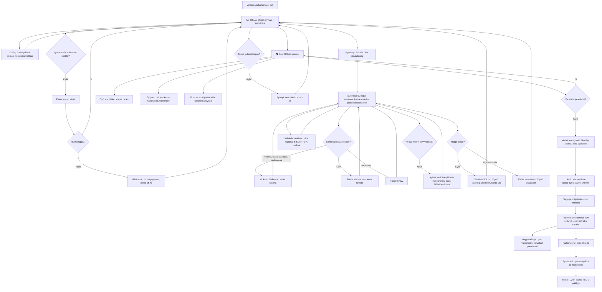

# Last Signal: sukellusvene, sonar ja sukellukset

How a day in Last Signal plays (v1 #125, v2 #129). The player drives the submarine SISU through a side view of an
arctic sea (glacier bay, wreck field, iceberg caves), listens with the sonar, stops, swims out with limited
air, and brings finds home. At home they eat, heal, repair, upgrade and sleep; the amplifier and the antenna
fix the radio and end chapter 1. Chapter 2 (v2) goes down the continental slope to the empty research vessel
Nordlys and on to the deep sea, where the cold and glowing fish cost air or hull. Nothing ends the game:
hunger, air and the hull each send the player back.

## Colours

- **blue**: what the player sees and does
- **amber**: a check that decides the path
- **teal**: diving, finds and life at home
- **rose**: damage or a setback that never ends the game
- **green**: the story moving on

## Boxes

- **Aja SISUa: ohjain, syvyys / runkoraja**: `stepSub()` in `games/last-signal/v2/index.html` turns the stick (`input`) into speed, bumps off the sea floor (`floorY()`), the glacier, the ice shelf, the iceberg (`inBerg()`), the hot vents (`VENTS`) and the wrecks (`solid(…, true)`); a hard bump costs hull (`bump()`). Below 300 m `subBoost()` speeds SISU up (up to 2.2×) so the long slope does not drag. The HUD shows depth against the hull's rating (`RATING`: 160, 260, 380, 620, 1000, 1450 m); within 25 m of it "Runko natisee". Saved every 4 s.
- **📡 Ping: kaiku piirtää pohjan, kohteet nimetään**: `doPing()` sends a ring out to 450 m; contacts inside it become known (`G.s.known`) and `drawSonar()` draws the floor, the iceberg and the wrecks in sonar green for a moment. Contacts up to 1000 m show at the screen's edge as "TUNTEMATON KONTAKTI, 640 m" until pinged; the current goal's contact is yellow (`goalNow().target`).
- **Paine: runko kärsii**: below the rating the hull loses 4 % a second and "PAINE! Nouse ylemmäs" shows.
- **Hätänousu turvasyvyyteen, runko 25 %**: `breach()` lifts SISU to 40 m above the hull's rating (v1 lifted it to the surface, a long way back from the deep sea); the hull is never fatal.
- **Pysähdy: Sukella ulos ilmalukosta**: "Sukella ulos" shows when SISU is almost still; `startDive()` puts the diver at the bow airlock with a full tank (`TANK`: 60, 90, 120 s).
- **Sukeltaja ui, happi vähenee, kohde avautuu poikkileikkaukseksi**: `stepDive()`. Sites are grids in `SITES` (2 m cells: station A-3, two containers, the wrecks Polaris and Nordvik, the aid container in the trench); `drawSite()` fades the hull away to show the rooms when the diver is inside. The iceberg's caves are segments with a radius in `BERG.caves` (way in, upper caves, the great chamber, the side passage to cache K-7, the lower cave, the deep crack). In a big cave `diveScale()` widens the view, and `drawLayout()` shows the ice around the caves (layers, cracks, bubbles) so the great chamber reads as a hall in the ice.
- **Mukaan: lasketaan vasta kotona**: finds go into `G.carry`; `endDive(false)` moves them into `G.s.inv` and `G.s.got`.
- **Tarina etenee: seuraava tavoite**: a log (`LOGS`) opens a card and sets a flag; `goalNow()` reads the flags: container → station → hull upgrade → wrecks (Nordvik's map) → iceberg cache (antenna) → station amplifier → radio.
- **Takaisin SISUun, löydöt jäävät paikoilleen, kunto -25**: `endDive(true)`: the haul is lost but its finds wait where they were.
- **🏠 Koti: SISUn sisätilat**: `openHome()` zooms in on SISU and `drawInterior()` draws the lit cross-section (reactor, kitchen, workshop, control room, stores with one tin per ration, bunk, suits, airlock); `homeCard()` lists the rooms' actions. The room names are drawn last, on a dark strip, as large as each room allows (about 11 px; v1 drew them at about 9).
- **Työpaja: paineenkesto, happisäiliö, valonheitin**: `upgradeCard()`, paid in spare parts (`COST`).
- **Punkka: uusi päivä, virta tuo pieniä löytöjä**: `sleep()`; `newFinds()` drops up to three small finds on the floor within the hull's reach, so food never runs out for good.
- **Viimeinen signaali: Nordlys vastaa, luku 1 päättyy**: `radio()` with both parts sets `flags.end`; play goes on.
- **Pyörryt: uusi päivä, kunto 35**: `faint()`, when hunger has emptied health.
- **Kylmä vesi: happi kuluu nopeammin, paitsi lähteiden luona**: `chill()`: below `COLD` (600 m) air drains 1.35× (`CHILL`), not within 16 m of a vent's top (`nearVent()`); the HUD's air shows ❄️.
- **Valokala tönäisee: −8 s happea, SISUlle −5 % runkoa**: `FISH` swim fixed loops (`fishAt()`) on the slope's foot and the deep plain; in `stepDive()` one within 2.8 m takes 8 s of air (never below 1 s) and pushes the diver away; in `stepSub()` one beside SISU takes 5 % hull. Once per 3 s (`G.fishCd`).
- **Luku 2: Mannerrinne, runko 620 / 1000 / 1450 m**: `chapter2()` shows the chapter's card once (`flags.ch2`), after the last signal or on opening a v1 save whose chapter 1 ended. `goalNow()` then walks: hull 380 → Saga → hull 620 → lander → hull 1000 → Nordlys's chart room → hull 1450 → the beacon → the radio.
- **Saga ja pohjalaskeutuja rinteellä**: the sites `saga` (cable ship, 260–380 m) and `laskeutuja` (Nordlys's lander, 380–620 m), with `rinne` (containers) beside it; their logs point down the slope.
- **Tutkimusalus Nordlys 900 m: tyhjä, miehistö lähti Lyralla**: the site `nordlys`, a 62 × 13 grid drawn by `drawNordlys()`; inside, `drawLayout()` names its rooms (`rooms`: bridge, chart room, labs, workshop, mess, diving gear, bow store, the research sub's hangar, hold, engine room). Logs by digit (`logs`): bridge, lab, chart room, hangar.
- **Happisäiliö ja Lyran valonheitin: varusteet paranevat**: the finds `T` and `V`; `endDive()` raises the tank to 150 s and the lamp to its third level, or pays 2 spare parts when that level was already bought.
- **Syvä meri: Lyran majakka ja muistikortti**: the site `majakka` on the deep plain (~1340 m) among the vents and a whale's bones (`drawDeep()`); its log ties back to the tapping in the iceberg's crack; its memory card (`K`, `inv.kortti`) goes home.
- **Radio: Lyran äänet, luku 2 päättyy**: `radio()` with the card sets `flags.end2`; play goes on.
