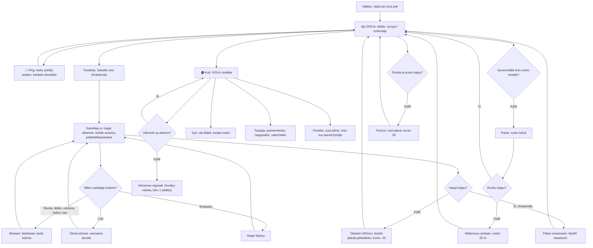

# Last Signal: sukellusvene, sonar ja sukellukset

How a day in Last Signal v1 plays (#125). The player drives the submarine SISU through a side view of an
arctic sea (glacier bay, wreck field, iceberg caves), listens with the sonar, stops, swims out with limited
air, and brings finds home. At home they eat, heal, repair, upgrade and sleep; the amplifier and the antenna
fix the radio and end chapter 1. Nothing ends the game: hunger, air and the hull each send the player back.

## Colours

- **blue**: what the player sees and does
- **amber**: a check that decides the path
- **teal**: diving, finds and life at home
- **rose**: damage or a setback that never ends the game
- **green**: the story moving on

## Boxes

- **Aja SISUa: ohjain, syvyys / runkoraja**: `stepSub()` in `games/last-signal/v1/index.html` turns the stick (`input`) into speed, bumps off the sea floor (`floorY()`), the glacier, the ice shelf, the iceberg (`inBerg()`) and the wrecks (`solid(…, true)`); a hard bump costs hull (`bump()`). The HUD shows depth against the hull's rating (`RATING`: 160, 260, 380 m). Saved every 4 s.
- **📡 Ping: kaiku piirtää pohjan, kohteet nimetään**: `doPing()` sends a ring out to 450 m; contacts inside it become known (`G.s.known`) and `drawSonar()` draws the floor, the iceberg and the wrecks in sonar green for a moment. Contacts up to 1000 m show at the screen's edge as "TUNTEMATON KONTAKTI, 640 m" until pinged; the current goal's contact is yellow (`goalNow().target`).
- **Paine: runko kärsii**: below the rating the hull loses 4 % a second and "PAINE! Nouse ylemmäs" shows.
- **Hätänousu pintaan, runko 25 %**: `breach()`; the hull is never fatal.
- **Pysähdy: Sukella ulos ilmalukosta**: "Sukella ulos" shows when SISU is almost still; `startDive()` puts the diver at the bow airlock with a full tank (`TANK`: 60, 90, 120 s).
- **Sukeltaja ui, happi vähenee, kohde avautuu poikkileikkaukseksi**: `stepDive()`. Sites are grids in `SITES` (2 m cells: station A-3, two containers, the wrecks Polaris and Nordvik, the aid container in the trench); `drawSite()` fades the hull away to show the rooms when the diver is inside. The iceberg's caves are segments with a radius in `BERG.caves` (way in, upper caves, the great chamber, the side passage to cache K-7, the lower cave, the deep crack).
- **Mukaan: lasketaan vasta kotona**: finds go into `G.carry`; `endDive(false)` moves them into `G.s.inv` and `G.s.got`.
- **Tarina etenee: seuraava tavoite**: a log (`LOGS`) opens a card and sets a flag; `goalNow()` reads the flags: container → station → hull upgrade → wrecks (Nordvik's map) → iceberg cache (antenna) → station amplifier → radio.
- **Takaisin SISUun, löydöt jäävät paikoilleen, kunto -25**: `endDive(true)`: the haul is lost but its finds wait where they were.
- **🏠 Koti: SISUn sisätilat**: `openHome()` zooms in on SISU and `drawInterior()` draws the lit cross-section (reactor, kitchen, workshop, control room, stores with one tin per ration, bunk, suits, airlock); `homeCard()` lists the rooms' actions.
- **Työpaja: paineenkesto, happisäiliö, valonheitin**: `upgradeCard()`, paid in spare parts (`COST`).
- **Punkka: uusi päivä, virta tuo pieniä löytöjä**: `sleep()`; `newFinds()` drops up to three small finds on the floor within the hull's reach, so food never runs out for good.
- **Viimeinen signaali: Nordlys vastaa, luku 1 päättyy**: `radio()` with both parts sets `flags.end`; play goes on.
- **Pyörryt: uusi päivä, kunto 35**: `faint()`, when hunger has emptied health.
