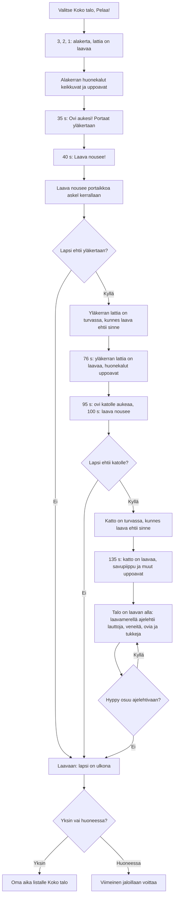

# Lattia on laavaa: Koko talo, the climb (#526)

The fourth choice of Lattia on laavaa v3: one round that climbs the whole house. It starts
downstairs like the other rooms; then the lava rises up the stairs and the kids race it to the
upstairs room, then up a second staircase to the flat roof; once the whole house is under the lava
the round goes on, on things drifting across the lava sea. A round lasts about two minutes to the roof. Everything is still a function of the round clock and the seed,
so every phone in a room draws the same house.

## Colours

- **blue**: what the player picks and sees first
- **amber**: a check that decides the path
- **rose**: sinking furniture, rising lava, falling in
- **teal**: the drifting things at the end
- **green**: the result

## Boxes

- **Valitse Koko talo, Pelaa!**: the fourth entry in `ROOMS`, pushed by `games/lattia-on-laavaa/v3/talo.js` (loaded before `world.js`; `HOUSE_LV` is its number, 4). It opens with a win alone in Keittiö (`auki` reaches 4); in a room the host can pick it at any time. Its list is `huone-4` ("Koko talo", `server/api.js` takes `huone-[1-4]`), its best time `paras-4`. The menu's note is "Portaita ylös katolle asti" (`ROOM_NOTES` in `ui.js`).
- **3, 2, 1: alakerta, lattia on laavaa**: the three floors stack in the same 14 × 10 m box as the other rooms: downstairs at 0 m, upstairs at 3 m, the roof at 6 m (`FLOOR_H`), each floor above a 0.2 m slab (`SLAB`) with a hole over its staircase. The round starts downstairs, a living room; each piece is `[kind, x, z, w, d, h, order, floor]`.
- **Alakerran huonekalut keikkuvat ja uppoavat**: each floor sinks its own pieces like the other rooms do, from its `start` (10 s downstairs, 76 s upstairs, 134 s on the roof) with its `gap` (2.6, 2.8, 2.4 s). On the two floors with a staircase up (`keep: 3`), pieces of order 3 and over never sink by themselves: only the lava climbing to the next floor takes them, so a way to the stairs is still there when the door opens (downstairs the sofa, the table, a pouf, the chest and the stool, then the pouf in front of the stairs; upstairs the bed, the toy boxes, the desk, its chair and a beanbag, then the pouf in front of the second staircase).
- **35 s: Ovi aukesi! Portaat yläkertaan**: each staircase is shut by a door (a wall, `openAt`) until `HOUSE.open` (35 s, then 95 s for the second), so nobody is upstairs early; the doors swing open in the drawing (`draw3d.js`). From the door's opening the screen says "Ovi aukesi!" over "Portaita ylös yläkertaan!" (or "katolle!"), and from the climb's start "Laava nousee!" over it, until 3 s into the climb (`ui.js`). The stairs are 11 steps (`STEPS`, 0.25 m up and 0.6 m deep each, 1.2 m wide) along the left wall downstairs and the right wall upstairs, with a wall along their open side up to a rail over the floor above. A ledge grab never reaches across a wall or a shut door (`climb()` in `world.js`).
- **40 s: Laava nousee!** and **Laava nousee portaikkoa askel kerrallaan**: `houseLava()` in `talo.js`: the floor until 20 s, creeping at 0.005 m/s to 0.12 m by 40 s (`HOUSE.climb[0]`), then rising at 0.08 m/s (`HOUSE.rise`) to the upstairs floor (3.02 m) by about 76 s; the 11 steps go under one by one, about 3 s apart. A step or a floor is "gone" once the lava covers its top.
- **Lapsi ehtii yläkertaan?**: the same lava rule as the other rooms (`inLava()`): a kid whose feet are at the lava is out. The floors above are solid: a jump stops at the ceiling, and a slab above never pushes a kid aside (each solid has a `bot`).
- **Yläkerran lattia on turvassa, kunnes laava ehtii sinne**: the upstairs floor (a slab with a hole over the first staircase) is ground until the lava reaches 3.0 m; the lava creeps on at 0.005 m/s until 100 s. The camera follows the kid up, and every floor above the followed kid is hidden (`L3D.cutY` in `draw3d.js`), with the kids' names over the cut.
- **95 s: ovi katolle aukeaa, 100 s: laava nousee** and **Lapsi ehtii katolle?**: from `HOUSE.climb[1]` (100 s) the lava rises the same way up the second staircase, on the right wall, to the roof at 6.02 m by about 136 s.
- **Katto on turvassa, kunnes laava ehtii sinne** and **135 s: katto on laavaa, savupiippu ja muut uppoavat**: the flat roof has a railing, a chimney, skylights, a water tank, a vent, planters, a bench, a deck box and a pot; they sink from 134 s. On the roof stage the sky shows round the house, the lava sea spreads to the horizon with distant rooftops, and the fallen kids sit in a rescue balloon behind the house (before that, on the sill of the floor on screen while the lava is below it).
- **Talo on laavan alla: laavamerellä ajelehtii lauttoja, veneitä, ovia ja tukkeja**: from `floatAt` (135 s) rafts, boats, doors, big cushions and logs (`HOUSE_FLOATS`) drift across over the house the way the other rooms' floats do (`floatsAt()` in `world.js`), more and faster as time goes on, while the lava creeps on at 0.005 m/s; each sinks at the end of its way. All of it comes from the seed and `rt` alone, the same on every phone.
- **Hyppy osuu ajelehtivaan?**: a drifter is a solid like any piece; a kid that misses falls into the lava.
- **Yksin vai huoneessa?**, **Oma aika listalle Koko talo** and **Viimeinen jaloillaan voittaa**: as in the other rooms (`lattia-on-laavaa.md`): alone the player's seconds go to `huone-4`; in a room the last kid standing wins.
- The computer's kids (`ai.js`, Lastenhuone's skill) head for the stairs once a staircase's door on their floor is open: to the piece in front of it, onto the bottom step, and up to the landing (`stairRoute()`); they never step down a floor, and keep their target while in the air.
