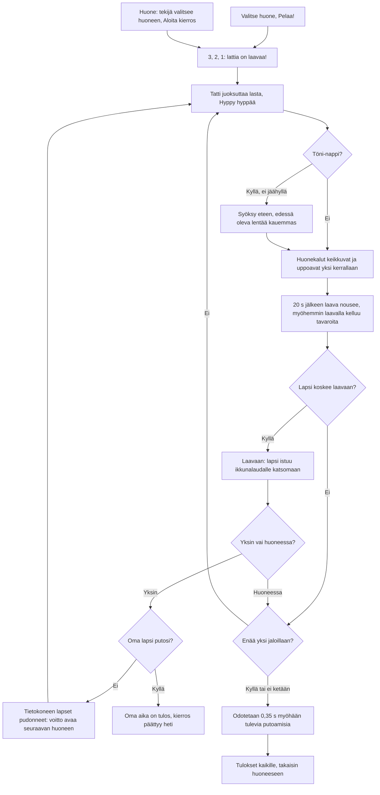

# Lattia on laavaa: one round over the lava

How a round of Lattia on laavaa plays (v1, #488). Kids stand on the furniture of a room seen
in 3D from behind and above. After a 3-2-1 countdown the floor is lava: pieces of furniture
wobble and sink one at a time, the lava rises, and the kids jump from piece to piece and shove
each other. The last kid standing wins. Alone the player meets five computer kids; in a room
2–8 phones play the same room, and computer kids fill the empty places up to six.

## Colours

- **blue**: what the player sees and does
- **amber**: a check that decides the path
- **teal**: a shove
- **rose**: sinking furniture, rising lava, falling in
- **violet**: the round in a room with friends
- **green**: a win, a new room opened, a time on the list

## Boxes

- **Valitse huone, Pelaa!**: the menu offers three rooms (`ROOMS` in `games/lattia-on-laavaa/v1/world.js`: Olohuone, Lastenhuone, Keittiö); the next opens when the player wins a round alone in the newest open one, saved as `ai-pelit:lattia-on-laavaa:auki`. The room picked is `ai-pelit:lattia-on-laavaa:huone`, each room's best time `paras-N`, rounds won `voitot`, and `osattu` hides the first round's hint. "👥 Pelaa kavereiden kanssa" opens the room screen. A round alone is not saved mid-round: a reload starts at the menu.
- **Huone: tekijä valitsee huoneen, Aloita kierros**: `rooms.js` with `data-min="2" data-max="8"`; the host picks any of the three rooms under the player list (`roomControls()` with `RM.extra()`, `games/lattia-on-laavaa/v1/net.js`); a guest sees "Huoneen tekijä (…) valitsee huoneen.". A room round saves nothing, so every room is open there.
- **3, 2, 1: lattia on laavaa!**: `COUNT` (3 s) on the round clock `rt`, which runs from −3; the kids stand on the pieces that sink last (`newWorld()`).
- **Tatti juoksuttaa lasta, Hyppy hyppää**: a finger on the left half of the screen (not on a button) is a floating stick; one on the right half that misses the buttons does nothing: where it touched down is the middle, and its direction and distance (up to 52 px) run the kid that way, relative to the camera behind it. "Hyppy" jumps (held, higher), about 1.5 m up and 3 m along at full run (`JUMP_V`, `GRAV`); a kid steps onto a piece up to `STEP_UP` higher without a jump.
- **Töni-nappi?**: "Töni" above "Hyppy" (beside it when the phone is sideways); only while the round is on and its cooldown (`SHOVE_CD`, 1.5 s) is over.
- **Syöksy eteen, edessä oleva lentää kauemmas**: the kid dashes forward (`startShove()`), and the nearest kid in front within `SHOVE_REACH` and at about the same height is pushed away and up (`shoveTarget()`, `pushOf()`), stunned for a moment; a kid pushed in the last 0.4 s is not pushed again (`PUSHED_AGAIN`). In a room the host decides whom a shove hits, from where it has every kid, and a kid another phone moves is pushed by a `push` message to that phone. The host keeps each guest's cooldown itself on its round clock (`hostShove()` in `net.js`, `SHOVE_CD` less 0.25 s for messages that arrive bunched), so a shove sent sooner is ignored, a reload included.
- **Huonekalut keikkuvat ja uppoavat yksi kerrallaan**: from each room's `start` (14, 12 or 10 s), one piece at a time wobbles for `WOBBLE` (2.6 s) and then sinks at `SINK_V`, tipping over to one side in its first 1.5 s under (`tipOf()`, drawn only: its top stays flat for the kids); the small pieces go first, the big ones last, and the seed shuffles each class (`newWorld()`). The next starts `gap` seconds later, a little sooner each time, never under 1.6 s.
- **20 s jälkeen laava nousee, myöhemmin laavalla kelluu tavaroita**: `lavaAt()` is the floor until 20 s, then rises to 0.45 m. From the room's `floatAt` (46, 40 or 34 s, while the last pieces still sink) cushions, books, baskets, trays and rubber ducks float across the lava, each lasting a while and sinking at the end, faster and smaller as the round goes on (`floatsAt()`), so a good player can last after the furniture is gone. The floats are pure functions of the seed and `rt`, the same on every phone.
- **Lapsi koskee laavaan?**: a kid out of the air at the lava's height is out (`inLava()`, `fall()`). Alone the phone judges every kid; in a room each phone judges its own kid and sends the time of its fall, the host judges its own kid, the computer's, and a kid whose phone has been silent for a second of running round.
- **Laavaan: lapsi istuu ikkunalaudalle katsomaan**: the kid sinks for a moment, then sits on the windowsill (`poseKid()` in `draw3d.js`); its phone's camera then follows the first kid still standing.
- **Oma lapsi putosi?**: alone, the round ends the moment the player's own kid is out; nothing waits.
- **Enää yksi jaloillaan?** and **Odotetaan 0,35 s myöhään tulevia putoamisia**: only in a room: `decide()` in `world.js`, on the host once a step, waits `GRACE` in `rt` for word of a fall that happened earlier on another phone; then the last kid standing wins, or with nobody standing the latest fall, and falls at the same instant are a draw.
- **Tietokoneen lapset pudonneet: voitto avaa seuraavan huoneen**: alone, when every computer kid is out while the player stands, the round is won at once: `voitot` grows and the next room opens (`auki`). The lava goes on, so the player's time can still grow until the player falls.
- **Oma aika on tulos, kun itse putoaa**: alone, the seconds the player lasted are the score, sent with `AiPelitScores.submit()` (tenths) to the room's own list `huone-N`, level: rooms open; the best per room is saved as `paras-N`. The end screen lists every kid's time, "Uusi kierros" and "Valitse huone".
- **Tulokset kaikille, takaisin huoneeseen**: the host `deliver()`s the result; each phone shows it once (`once()`; a phone that already saw it goes straight back to the room) and saves nothing, then "Takaisin huoneeseen". A kid the computer drove for an away phone ("Jatka ilman heitä") is marked 🤖, and that phone reads "Tietokone pelasi välillä puolestasi", with its time when it has one.
- **Who drives a kid in a room**: each kid has a hand-over count `own`. The host raises it when the computer takes the kid over, when it gives it back, and on every `hello` (a reload); after giving it back or a reload the host runs the kid on itself (the computer, when it was driving) until the phone's first spot with the new count arrives; it takes a guest's spot only with the kid's current count, and a guest takes its kid's spot from the host's snapshot whenever the count rises. While a phone is away the room is paused, and `rt` stops on every phone. The other phones' kids are drawn a moment back through `public/lib/sulava-1/sulava.js` (`drawnSpot()`), and so is a guest's own kid while the computer drives it.
