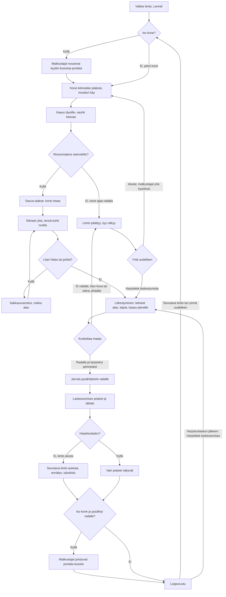

# Lentokone: one flight from runway to runway

How one flight of Lentokone plays (v2, #547; v1 #533). The player flies a passenger jet or a
small propeller plane in 3D from one airfield's runway to another's: in the jet the passengers
first board it, then the take-off roll and lift-off, a flight over Finnish lakes and forest to the
next field, the approach and a landing that is scored, and in the jet the passengers leave it.
Five routes grow harder (a turn on the way, a side wind, dusk, a short runway between hills).

## Colours

- **blue**: what the player sees and does
- **amber**: a check that decides the path
- **rose**: a warning or a failed flight
- **green**: a result or a record

## Boxes

- **Valitse lento, Lennä!**: the menu lists five routes (`ROUTES` in `games/lentokone/v2/world.js`);
  a locked one says "🔒 Laskeudu ensin: <reitti>". The next opens after any landing on the one
  before that was flown from its runway, not a practice landing (`ai-pelit:lentokone:auki`), with each route's best stars in `ai-pelit:lentokone:tahdet`
  and best points in `ai-pelit:lentokone:ennatys-<N>`, the same for both planes. "✈ Iso kone" /
  "🛩 Pieni kone" picks the plane (`kone`, the jet by default; a flight saved by v1 has no kind and
  resumes in the small plane). "📷 Takaa" / "📷 Ohjaamosta" picks the view
  (`kamera`), "🕹 Sauva" which way the stick lifts the nose (`sauva`: finger down by default).
  "▶ Jatka lentoa" resumes a flight saved each second as `ai-pelit:lentokone:lento` (a reload, a
  hidden page, a turned phone); the flight pauses when the page is hidden.
- **Iso kone?**: `p.kind` (`'iso'` or `'pieni'`, `PLANES` in `world.js`), from `kone` when the flight
  starts. A practice landing ("Harjoittele laskeutumista") skips the boarding even in the jet.
- **Matkustajat nousevat kyytiin bussista portaita**: `beginBoarding()` in `ui.js`, drawn from
  `paxScene('board', t)` in `passengers.js`: 16 passengers walk from a yellow bus to wheeled stairs and
  in at the jet's front door, counted "🧳 N / 16 koneessa"; the door shuts, the bus drives off and the
  stairs pull back (about 13 s). A tap anywhere ("Napauta: ohita · vedä: katso ympärille") skips to the flight; a drag turns the view instead. Flying the
  same route again in the jet after a crash or a restart ("Alusta" on the end screen, ⏸'s restart)
  skips it: the passengers are still aboard. Nothing is
  saved during it, and turning the phone keeps it.
- **Kone kiitoradan päässä, moottori käy**: looking around (`LOOK` in `draw3d.js`): a finger put down
  on the free part of the screen (not the stick's left side below the top strip, the throttle or a
  button), or anywhere during the passengers' scenes, turns the view about the plane as it drags (the
  cockpit view turns the head). A moment (1.2 s, `LOOK_BACK`) after it lifts, the flight's view glides
  back behind the plane; the passengers' view stays where it was turned. A new flight starts looking ahead.
- **Kaasu täysille, vauhti kasvaa**: the throttle is a slider on the right; a finger dragged up or
  down from anywhere on it moves it from where it was. On the ground the stick's side movement
  steers the nose wheel, and "Jarru" (shown only on the ground) brakes while held.
- **Nousunopeus saavutettu?**: the hint says to lift the nose at the plane's `vr`: 100 km/h in the
  small plane, 130 km/h in the jet (`PLANES` in `world.js`); the plane leaves the ground when the
  wing's lift is over its weight and the speed over 15 m/s; the nose wheel lifts only past the
  plane's `vRotate` (20 m/s small, 28 m/s jet). Leaving the
  runway on the wheels faster than 6 m/s ends the flight "Ulos kiitoradalta".
- **Sauva taakse: kone irtoaa**: the stick is where the left thumb touches down: up/down is pitch,
  left/right is bank, and a banked plane turns by itself (`airStep()` in `world.js`). Lift grows
  with speed squared and the angle of attack, more with flaps.
- **Telineet ylös, lennä kohti nuolta**: "Telineet" and "Laipat" (0, 1, 2) are buttons left of the
  throttle, acting when the finger lifts. The top strip shows speed, height above the ground and
  climb; the yellow arrow points to "Lähestymispiste" (3 km before the runway, on its line), then
  along the runway; past the map's edge it turns red with "Käänny takaisin!", and 6 km past it the
  flight ends "Eksyit liian kauas".
- **Liian hidas tai jyrkkä?**: the wing stalls past an angle of attack of 0.24 rad (about 14°, both planes):
  lift drops, "SAKKAUS – nokka alas!" shows, `halytys` sounds quietly, and the nose falls by
  itself until speed comes back.
- **Lähestyminen: telineet alas, laipat, kaasu pienelle**: four lights at the aim point, 220 m past
  the threshold (110 m on the short runway; `aimAt()` in `world.js`), where the 3° glide path meets
  the ground (`PAPI_ANGLES` 3.5°, 3.17°, 2.83°, 2.5°; two white and two red on it), also drawn as
  four dots ("Liukupolku") in the strip within 4.5 km, with the same in words under them (`glideWords()`
  in `ui.js`, from how many are white: 0 "Liian matalalla – nouse ⬆", 1 "Vähän matalalla", 2 "Oikea
  liukupolku ✓", 3 "Vähän korkealla", 4 "Liian korkealla – laskeudu ⬇"). Yellow rings every 300 m out to 3 km, centred
  14 m above that path, mark it on the first two routes; "Telineet alas!" warns inside 2.5 km with
  the gear up.
- **Koskettaa maata**: `touchDown()` in `world.js`. A touch ends the flight with its reason when
  it is in a lake ("Järveen"), off a runway ("Ohi kiitoradan", "Sakkaus maahan" when stalled), with
  the gear up ("Telineet ylhäällä"), sinking faster than 3 m/s ("Liian kova lasku"), banked over
  10° ("Siipi maahan") or nose down past 5° ("Nokka edellä maahan"). Stopping on the start field
  or another one ends it "Palasit lähtökentälle" / "Pysähdyit väärälle kentälle". On a crash the
  plane stops, `kolari` sounds softly, and there is no explosion. A touchdown within 20° of the
  runway's line turns the plane onto it (either way), and after it the plane leaves the ground again
  only with the stick pulled back.
- **Jarruta pysähdyksiin radalle**: the landing ends when the plane stops, throttle or not, or
  rolls off the runway (then with no stopping points). Once the flight has ended, ⏸ does nothing.
- **Laskeutumisen pisteet ja tähdet**: `landingScore()`: softness 400 at 0.5 m/s, falling to 0
  at 3 m/s; centre line 300, falling to 0 at the runway's edge; touchdown point 200 within
  150–300 m of the threshold (60–180 m on the short runway), less beyond; stopped on the runway
  100. Stars: 3 from 850 points, 2 from 600, else 1.
- **Harjoituslasku?**: whether the flight began at "Harjoittele laskeutumista" (`p.practice`, set by
  `startFlight(true)` in `ui.js` and kept in the saved flight).
- **Vain pisteet näkyvät**: the end screen shows the points and stars with "Harjoituslasku: ei
  tuloslistalle eikä avaa uutta lentoa." and offers "Harjoittele laskeutumista" again.
- **Seuraava lento aukeaa, ennätys, tuloslista**: saved the moment the plane stops
  (`settleFlight()` in `ui.js`, once per flight), so a reload or a hidden page during the 1.8 s banner
  keeps it; the end screen follows the banner. The points go to the route's high-score list
  (`reitti-<N>`, `scores.js`), which opens over the end screen after a new score; "🏆 Tuloslista"
  opens it again (in the jet only after the passengers have left). Buttons: "Seuraava lento", "Lennä uudelleen", "Valikkoon". A crash also drops the
  saved flight at once, so a reload during its banner does not offer it again.
- **Iso kone ja pysähtyi radalle?**: a landing in the jet that ended well and stopped on the runway
  (`p.over.ok` and `p.over.stop === 100`, a practice landing too) leaves the passengers out after the
  1.8 s banner, the plane set level; a crash or a roll off the runway goes straight to the end screen.
- **Loppuruutu**: after a landing (`showEnd()` in `ui.js`), "Seuraava lento" (when the next route is
  open) and "Lennä uudelleen" call `startFlight(false)`, which in the jet boards new passengers again
  (the landing let the last ones out); after a practice landing "Harjoittele laskeutumista" too.
- **Matkustajat poistuvat portaita bussiin**: `beginDeplaning()` in `ui.js`, `paxScene('deplane', t)`:
  the bus comes from behind, the stairs drive to the door, it opens and the 16 walk down into the bus,
  which drives away; then the end screen. The landing was already saved; a tap skips it.
- **Yritä uudelleen**: after a crash the end screen's "Alusta" flies the route again from the runway,
  skipping the boarding in the jet (`aboard` in `startFlight()`: the passengers never got off; ⏸'s
  restart does the same), and
  "Harjoittele laskeutumista" starts 5 km out on the runway's line on the glide path (about 270 m),
  151 km/h in the small plane and 209 km/h in the jet (`vStart`), gear up and flaps 0, so landing can be practised without flying the whole route.
