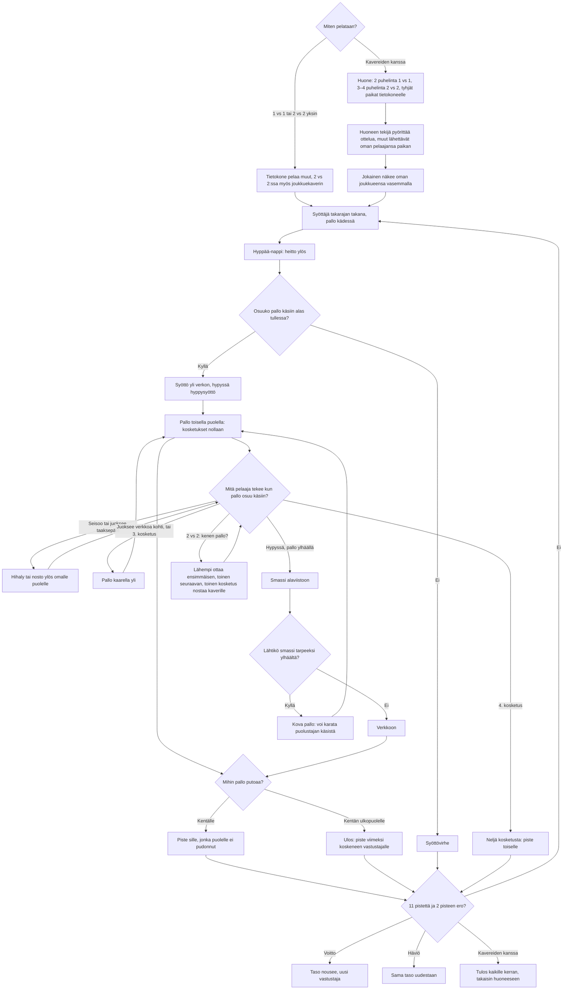

# Lentopallo: one rally, from the serve to the point

How a match and one rally of Lentopallo play. Beach volleyball seen from the side, rally scoring
to 11 with a two-point lead. v1 is 1 vs 1 against the computer; v2 adds 2 vs 2 and playing with
friends on 2–4 phones through the shared room library (see `moninpeli.md`). The ball is played
automatically when it touches a player's hands; what the touch does depends on what the player
is doing at that moment.

## Colours

- **blue**: what the player sees and does
- **amber**: a check that decides the path
- **teal**: the ways the ball can be played
- **violet**: the opponent's side of the rally, and playing in a room (v2)
- **green**: a point or a win
- **rose**: a fault, a lost point or a lost match

## Boxes

- **Miten pelataan?**: v2's menu in `games/lentopallo/v2/index.html`: pick **1 vs 1** or **2 vs 2** first (`pickMode()`, kept in `ai-pelit:lentopallo:muoto`), then **Pelaa yksin** (`newMatch()`) or **👥 Pelaa kavereiden kanssa** (`AiPelitRooms.open()`; the room screen says which it will be, `roomNote()`). v1 has only the 1 vs 1 match.
- **Tietokone pelaa muut, 2 vs 2:ssa myös joukkuekaverin**: the computer's players run `cpuThink()`; the teammate Tiina plays at least as well as level 3.
- **Huone: 2 puhelinta 1 vs 1, 3–4 puhelinta 2 vs 2, tyhjät paikat tietokoneelle**: `setupFor()` on the host: phones take turns left and right in room order; two phones play what the host picked in the menu, three or four always 2 vs 2. The host sends it as `setup`, and again to a phone that comes back (`on('hello')`).
- **Huoneen tekijä pyörittää ottelua, muut lähettävät oman pelaajansa paikan**: the host runs the rules, the ball and the computer's players, and sends `s` 20 times a second (`snapshot()`); a guest moves its own player at once and sends `p` (where it is, and whether it runs toward the net) and `toss` (`guestUpdate()`), and draws the rest from `applySnapshot()`. A phone let go with "Jatka ilman heitä" is played by the computer (`on('continue')`).
- **Jokainen näkee oman joukkueensa vasemmalla**: `view` mirrors the drawing on a phone of the right-hand team; ◀ ▶ stay as seen on the screen (`steer()`).
- **Lähempi ottaa ensimmäisen, toinen seuraavan, toinen kosketus nostaa kaverille**: `myBall()`: in 2 vs 2 the computer player nearer the ball takes the first touch and leaves the next to its teammate, stepping out from under it; a person teammate is trusted with a ball clearly theirs. The second touch sets toward where the teammate stands (`hit()`). After any touch the ball cannot be played for 0.2 s (`ball.cd` in `stepBall()`), so teammates on the same spot touch it once, not twice.
- **Tulos kaikille kerran, takaisin huoneeseen**: `hostEnd()` → `AiPelitRooms.deliver()`; every phone saves its win or loss once (`once()`) in `ai-pelit:lentopallo:kaverit` and goes back to the room (`backToRoom()`). The end names each player's side, so a phone that reloads after missing it still knows its result (`finish()`).
- **Syöttäjä takarajan takana, pallo kädessä**: `newRally()` in `games/lentopallo/v1/index.html`; the winner of the last point serves (rally scoring), and `stepPlayer()` keeps the server behind the end line until the serve is hit.
- **Hyppää-nappi: heitto ylös**: `press()` → `toss()`; the same button jumps during play. The computer serves on its own after about a second.
- **Osuuko pallo käsiin alas tullessa?**: `touching()` checks the ball against the player's hands (0.25–2.6 m above the feet, about half a metre to each side); a tossed serve can only be hit on its way down. A toss left to fall is `land()` → "Syöttövirhe".
- **Syöttö yli verkon, hypyssä hyppysyöttö**: the serve branch of `hit()`; `arcTo()` and `clears()` lift the arc until it passes over the net.
- **Pallo toisella puolella: kosketukset nollaan**: `stepBall()` counts `crossings` and resets `touches` when the ball passes over the net.
- **Hihaly tai nosto ylös omalle puolelle**: the set branch of `hit()`: a high ball that comes down 1 m from the net on the player's own side, ready for a spike.
- **Pallo kaarella yli**: the over branch of `hit()`: an arc into the far court, always clear of the net. The third touch is always this.
- **Smassi alaviistoon**: the spike branch of `hit()` (`shotTo()`): short and sharp, or deep when running toward the net. A ball off the middle of the hands goes a little wrong.
- **Lähtikö smassi tarpeeksi ylhäältä?**: only a spike hit more than 0.35 m above the net top is aimed deeper until it clears; a lower one may go into the net.
- **Kova pallo: voi karata puolustajan käsistä**: in `hit()`, a ball faster than 8.5 m/s adds error to the dig, and sometimes flies off the arms ("Karkasi käsistä!").
- **Neljä kosketusta: piste toiselle**: `hit()` gives the point away on a fourth touch on one side.
- **Ulos: piste viimeksi koskeneen vastustajalle**: `land()`: past 4 m from the net is out.
- **11 pistettä ja 2 pisteen ero?**: `matchWinner()`.
- **Taso nousee, uusi vastustaja**: `endMatch()` saves `ai-pelit:lentopallo:taso`, `voitot` and `haviot`; `cpuSetup()` makes each level's opponent quicker, quicker to react, more accurate and more eager to spike.
